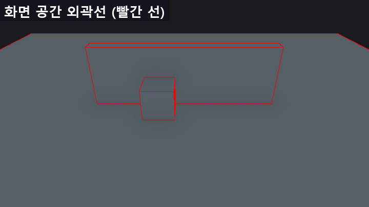
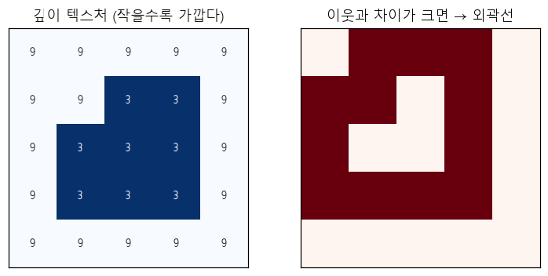

# Day 14. 외곽선 ③ — 다 그린 그림 위에 펜으로 긋기

> ⏱ **약 1시간** — 읽기 20분 · 코드 따라 읽기 25분 · 해보기 15분
> 🧸 **오늘의 비유**: 그림을 다 그린 뒤 **"깊이가 확 바뀌는 곳"을 찾아 펜으로 선을 긋는 화가**예요.

## 오늘 배울 것

- [ ] 화면 공간 외곽선(포스트 프로세스)이 인버티드 헐과 어떻게 다른지 안다
- [ ] 깊이 엣지와 노멀 엣지 검출 방법을 손으로 계산할 수 있다
- [ ] Renderer Feature가 URP에 패스를 끼워 넣는 방법을 안다
- [ ] RenderGraph와 블릿(Blit)이 무엇인지 비유로 설명할 수 있다

---

## 1. 두 가지 외곽선 비교

| | 인버티드 헐 (Day 12–13) | 화면 공간 외곽선 (오늘) |
|---|---|---|
| 방식 | 물체마다 부푼 껍질을 한 번 더 그림 | 다 그린 화면을 보고 경계에 선을 덧그림 |
| 비용 | 물체 수만큼 늘어남 | 화면 크기만큼 (물체 수와 무관) |
| 잘하는 것 | 캐릭터 실루엣, 물체별 색·두께 조절 | 배경 전체, **안쪽 주름·모서리**선 |
| 약점 | 안쪽 선은 못 그림 | 물체별 세밀한 조절이 어려움 |

이 셰이더 패키지는 둘 다 써요. 캐릭터는 인버티드 헐, 배경과 안쪽 선은 화면 공간 외곽선이에요.



## 2. 경계 찾기: 이웃과 비교하기



화면의 각 픽셀에서 **이웃 픽셀과 깊이를 비교**해요. 몸통과 배경 사이처럼 깊이가 **확 뛰는 곳**이 경계예요. 위 그림에서 3과 9가 만나는 곳에 선이 생기죠.

깊이만으로는 **같은 거리의 접힌 면**(책상 모서리, 옷 주름)을 못 찾아요. 그래서 **노멀**도 비교해요. 노멀이 확 바뀌는 곳 = 면이 꺾이는 곳이에요.

## 3. 셰이더 읽기

[ScreenSpaceOutline.shader L31–64](https://github.com/JJH0204/GitBook/blob/main/GameDev/toon-shader-study/source/CharacterToon/Shaders/ScreenSpaceOutline.shader#L31-L64)

```hlsl
half4 Frag(Varyings input) : SV_Target
{
    float2 uv = input.texcoord;
    half4 srcColor = SAMPLE_TEXTURE2D_X(_BlitTexture, sampler_LinearClamp, uv);   // 다 그린 그림

    float2 t = _OutlineSSThickness / _ScaledScreenParams.xy;                     // 몇 픽셀 옆을 볼지 (UV로)

    // ① 깊이 엣지 — 나, 오른쪽, 아래, 대각선 4칸
    float dC  = LinearEyeDepth(SampleSceneDepth(uv),                  _ZBufferParams);
    float dX  = LinearEyeDepth(SampleSceneDepth(uv + float2(t.x, 0)), _ZBufferParams);
    float dY  = LinearEyeDepth(SampleSceneDepth(uv + float2(0, t.y)), _ZBufferParams);
    float dXY = LinearEyeDepth(SampleSceneDepth(uv + t),             _ZBufferParams);
    float depthEdge = abs(dC - dX) + abs(dC - dY) + abs(dC - dXY);
    float depthRef = lerp(1.0, max(dC, 1e-3), _OutlineSSDepthScale);   // ② 멀수록 기준을 넉넉하게
    depthEdge /= depthRef;

    // ③ 노멀 엣지
    half3 nC = SampleSceneNormals(uv);
    half3 nX = SampleSceneNormals(uv + float2(t.x, 0));
    half3 nY = SampleSceneNormals(uv + float2(0, t.y));
    float normalEdge = distance(nC, nX) + distance(nC, nY);

    // ④ 둘 중 하나라도 기준을 넘으면 선
    float edge = saturate(step(_OutlineSSDepthThreshold,  depthEdge)
                        + step(_OutlineSSNormalThreshold, normalEdge));

    // ⑤ 물체별 '여기는 선 긋지 마' 표시
    float suppress = SAMPLE_TEXTURE2D_X(_CameraNormalsTexture, sampler_PointClamp, uv).w;
    edge *= (1.0 - saturate(suppress));

    return lerp(srcColor, _OutlineSSColor, edge * _OutlineSSColor.a);   // 원래 그림 위에 선 색 섞기
}
```

| 단계 | 쉬운 말 |
|---|---|
| ① | 4칸의 깊이 차이를 더해요. 2×2 칸을 대각선으로 비교하는 이 방법을 **로버츠 크로스**(Roberts cross)라고 해요 |
| ② | 멀리 있는 배경은 원래 깊이 차가 크게 나요. `_OutlineSSDepthScale`을 올리면 **내 깊이로 나눠서** 가까운 곳과 먼 곳에 같은 기준을 써요 (B3) |
| ③ | 노멀 화살표끼리의 **거리**. 같은 방향이면 0, 크게 꺾이면 커요 |
| ④ | `step`: 기준 넘으면 1. 둘을 더하고 `saturate`로 0~1 |
| ⑤ | 노멀 텍스처의 **남는 칸(w)** 에 "선 긋지 마" 정도를 적어 두는 트릭. 배경 셰이더의 DepthNormals 패스가 `_OutlineSuppress`를 적어요: [SceneToon.shader L484–489](https://github.com/JJH0204/GitBook/blob/main/GameDev/toon-shader-study/source/SceneToon/Shaders/SceneToon.shader#L484-L489) |


셰이더 이름이 `Hidden/CharacterToon/ScreenSpaceOutline`이에요. `Hidden/`으로 시작하면 머티리얼의 셰이더 드롭다운에 **안 보여요**. 사람이 물체에 쓰는 셰이더가 아니라 C# 코드가 화면 전체에 쓰는 셰이더니까요.


## 4. Renderer Feature — URP에 단계 끼워 넣기

이 셰이더는 물체에 붙지 않아요. 그럼 누가 실행할까요? **Renderer Feature**예요. URP 렌더러 에셋에 꽂는 **확장 카드** 같은 거예요.

[CharacterToonRendererFeature.cs](https://github.com/JJH0204/GitBook/blob/main/GameDev/toon-shader-study/source/CharacterToon/Runtime/CharacterToonRendererFeature.cs)

### ① 준비: `Create()` (L43–54)

```csharp
public override void Create()
{
    CoreUtils.Destroy(_outlineMaterial);   // 이전 머티리얼 먼저 정리
    _outlineMaterial = null;
    _outlinePass = null;
    if (outline.shader != null)
    {
        _outlineMaterial = CoreUtils.CreateEngineMaterial(outline.shader);
        _outlinePass = new ScreenSpaceOutlinePass(_outlineMaterial);
    }
}
```


**💡 실제로 있었던 일 (C6)**: URP는 인스펙터 값이 바뀔 때마다 `Create()`를 **다시** 불러요. 예전엔 이전 머티리얼을 안 지워서 슬라이더를 움직일 때마다 머티리얼이 **쌓였어요**(메모리 누수). 첫 줄에서 지우게 고쳤어요.


### ② 매 프레임: `AddRenderPasses()` (L56–77)

게임 카메라와 씬 카메라일 때만 머티리얼에 값을 넣고 `renderer.EnqueuePass(_outlinePass)` — "이 단계도 해 주세요"라고 줄을 세워요.

### ③ 패스 만들기 (L100–108)

```csharp
requiresIntermediateTexture = true;                                                // 중간 도화지 필요
ConfigureInput(ScriptableRenderPassInput.Depth | ScriptableRenderPassInput.Normal);   // 깊이·노멀 지도 주세요
```

`ConfigureInput`으로 "깊이와 노멀 텍스처가 필요해요"라고 하면 URP가 DepthNormals 패스(Day 18)를 실행해서 만들어 줘요.

## 5. RenderGraph와 블릿

[L110–139](https://github.com/JJH0204/GitBook/blob/main/GameDev/toon-shader-study/source/CharacterToon/Runtime/CharacterToonRendererFeature.cs#L110-L139)

**RenderGraph**는 URP의 **요리 순서표**예요. "어떤 재료(텍스처)를 언제 만들고, 누가 읽고, 언제 버려도 되는지"를 미리 적어 두면 URP가 순서와 메모리를 알아서 정리해요.

```csharp
TextureHandle source = resourceData.activeColorTexture;          // 지금까지 그린 그림
TextureHandle dest = renderGraph.CreateTexture(desc);            // 새 빈 도화지
var blit = new RenderGraphUtils.BlitMaterialParameters(source, dest, _material, 0);
using (var builder = renderGraph.AddBlitPass(blit, "CharacterToon SS Outline", returnBuilder: true))
{
    if (resourceData.cameraDepthTexture.IsValid())   builder.UseTexture(resourceData.cameraDepthTexture);
    if (resourceData.cameraNormalsTexture.IsValid()) builder.UseTexture(resourceData.cameraNormalsTexture);
}
resourceData.cameraColor = dest;                                  // 이제부터 새 도화지가 '현재 그림'
```

- **블릿(Blit)** = 그림 전체를 **복사하면서 필터를 씌우기**. `source`를 `_BlitTexture`로 넘기고, 화면 전체에 외곽선 셰이더를 한 번 칠해서 `dest`에 담아요.
- `UseTexture` = "이 패스가 깊이·노멀 텍스처를 **읽어요**"라고 순서표에 적기. 안 적으면 RenderGraph가 그 텍스처를 **일찍 버리거나 다른 용도로 재활용**할 수 있어요 (B11에서 추가).
- 마지막 줄: 복사본을 다시 원래 자리로 옮기지 않고 **"이제 이게 현재 그림"** 이라고 바꿔 끼워요. 복사 한 번을 아껴요.

## 6. 해보기 (15분)

1. **깊이 엣지 손계산** — `dC = 3`, `dX = 3`, `dY = 9`, `dXY = 9`면 `depthEdge = 0 + 6 + 6 = 12`. 기준 0.2면 선? (네) 넷 다 3이면? (0 → 선 없음)
2. **노멀 엣지** — `nC = (0,1,0)`, `nX = (1,0,0)`이면 `distance = √2 ≈ 1.41`. 기준 0.4면? (선)
3. **깊이 정규화** — 배경에서 `dC = 50`, 옆 칸 `51`이면 차이 1. 기준 0.2면 선이 생겨 버려요(먼 지면에 줄무늬). `_OutlineSSDepthScale = 1`이면 `1 / 50 = 0.02` → 선 없음. 이게 B3에서 추가한 이유예요.
4. **(Unity가 있다면)** PC_Renderer 에셋에서 Character Toon Renderer Feature를 찾아 Thickness와 Threshold를 움직여 보세요.

## 7. 오늘의 액기스

👉 [ESSENCE.md — Day 14](essence.md#day-14)

## 더 읽을거리

- 수학: [Wikipedia — Roberts cross](https://en.wikipedia.org/wiki/Roberts_cross) · [Sobel operator](https://en.wikipedia.org/wiki/Sobel_operator) · [Edge detection](https://en.wikipedia.org/wiki/Edge_detection) (영어) — 이미지 처리의 경계 찾기
- [URP — Renderer Feature로 패스 끼워 넣기](https://docs.unity3d.com/Packages/com.unity.render-pipelines.universal@17.0/manual/renderer-features/scriptable-renderer-features/inject-a-pass-using-a-scriptable-renderer-feature.html)
- [URP — Render Graph](https://docs.unity3d.com/6000.0/Documentation/Manual/urp/render-graph.html)

---

[← Day 13](day13-outline-pixel-width.md) · [목차](README.md) · [다음: Day 15 →](day15-face-sdf.md)
