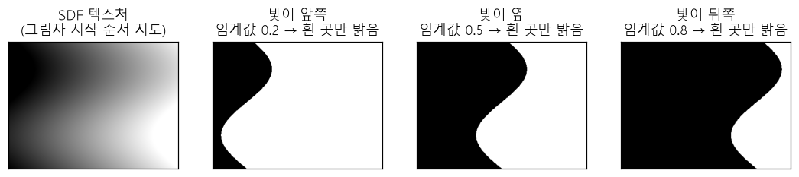

# Day 15. 얼굴 그림자 — SDF 지도로 그리는 깔끔한 그림자

## 작업 식별

| 항목 | 내용 |
|---|---|
| Task ID | GMD-TSS-016-DO |
| 유형 | D&O (개념) + 코드 읽기 + 실습 |
| 목적 | 얼굴 SDF 텍스처로 빛 각도에 따른 그림자 모양을 만드는 방식과 캐릭터별 얼굴 방향 전달을 설명한다 |
| 소요 시간 | 약 1시간 (읽기 25분, 코드 읽기 25분, 실습 10분) |
| 선수 지식 | [Day 06](day06-vectors-and-light.md) 내적, [Day 07](day07-toon-steps.md) 그림자 밴드 |
| 확인 상태 | 미검증 (소스를 읽고 작성했으며 Unity에서 컴파일·실행하지 않았다) |
| 개정 | R1 (2026-11-18) |

## 학습 목표

- [ ] 얼굴에 일반 `N·L` 그림자를 쓰면 왜 지저분한지 안다
- [ ] SDF 텍스처의 값이 그림자가 덮이는 순서라는 것을 이해한다
- [ ] 빛 방향을 얼굴 기준으로 바꿔 `coverage`를 만드는 과정을 따라간다
- [ ] `fwidth`로 경계를 매끈하게 만드는 방법을 안다
- [ ] 캐릭터마다 얼굴 방향을 따로 넣는 방법(MaterialPropertyBlock)을 안다

## 1. 정의

얼굴 SDF 그림자는 그림자 모양을 텍스처로 미리 그려 두고, 빛이 얼굴 기준으로 좌우·앞뒤 어디에 있는지를 하나의 임계 값(`coverage`)으로 바꿔 텍스처 값과 비교해 명암을 정하는 방식이다.

만화 얼굴의 그림자는 코 옆의 작은 삼각형, 볼을 가로지르는 매끈한 곡선처럼 정돈된 모양이다. `N·L` 방식을 그대로 쓰면 코, 눈두덩이, 입술의 작은 굴곡마다 그림자가 생겨 얼룩덜룩해진다.

비유: SDF 텍스처는 밀물 지도다. 물높이(빛 각도)가 오르면 낮은 곳부터 잠긴다(그림자).

## 2. 구성 요소

| 구성 요소 | 역할 |
|---|---|
| `_FaceSDF` | 각 픽셀의 값이 "그림자가 덮이는 순서"인 텍스처 |
| `_FaceForwardWS`, `_FaceRightWS` | 얼굴이 향한 방향과 오른쪽 방향(월드). C#이 갱신한다 |
| `coverage` | 빛 각도를 0~1로 환산한 물높이 |
| `faceLit` | 0이면 그림자, 1이면 빛 |
| `_SDFSoftness` | 경계 부드러움 |
| `_FaceSDFMask` | 얼굴 중 SDF를 적용할 영역(흰색 SDF, 검은색 일반 밴드) |
| 헤어 마스크 | 앞머리가 이마에 드리우는 그림자 |

## 3. 동작 원리



SDF 텍스처의 값은 빛이 옆으로 얼마나 돌아가야 그 자리가 그림자가 되는지의 순서다.

| 텍스처 값 | 의미 |
|---|---|
| 작은 값 | 빛이 조금만 옆으로 가도 그림자가 된다(밀물에 먼저 잠기는 낮은 땅) |
| 큰 값 | 빛이 거의 뒤로 가야 그림자가 된다(높은 언덕) |

판정: `값 > coverage`이면 밝음. `coverage`가 커질수록 그림자 영역이 넓어진다. 화가가 텍스처를 직접 그리므로 그림자 모양을 마음대로 정할 수 있다.

| 빛 위치 (얼굴 기준) | `FdotL` | `coverage` |
|---|---|---|
| 정면 | 1 | 0 (그림자 없음) |
| 옆 | 0 | 0.5 |
| 뒤 | -1 | 1 (전부 그림자) |


NOTE: SDF는 원래 Signed Distance Field(부호 있는 거리장)의 약자이며 경계선까지의 거리를 저장한다. 얼굴 그림자에서는 "그림자가 들어오는 순서"를 저장한 텍스처를 쓰며, 경계 근처 값이 연속적으로 변해서 확대해도 경계가 매끈하다. 이 구성(빛 방향을 얼굴 정면 기준 각도로 환산해 텍스처 임계와 비교, 좌우 반전은 좌우 부호로 처리)은 얼굴 SDF 그림자의 일반적 방식이며 구체 구현은 아래 소스를 따른다.


## 4. 코드 읽기

[CharacterToon.shader L365–405](https://github.com/JJH0204/GitBook/blob/main/GameDev/toon-shader-study/source/CharacterToon/Shaders/CharacterToon.shader#L365-L405). `_PART_FACE` 머티리얼에서만 컴파일된다.

### 4.1 바닥 평면으로 투영

```hlsl
float2 lightXZ = SafeNormalizeXZ(L.xz,              float2(0.0, 1.0));
float2 fwdXZ   = SafeNormalizeXZ(_FaceForwardWS.xz, float2(0.0, 1.0));   // 얼굴이 보는 방향
float2 rightXZ = SafeNormalizeXZ(_FaceRightWS.xz,   float2(1.0, 0.0));   // 얼굴의 오른쪽
```

빛이 좌우로 얼마나 돌았는지만 필요하므로 높이(y)를 버리고 수평면(xz)의 방향만 쓴다. 길이가 0이면 NaN이 되므로 안전 정규화에 예비 방향을 둔다.

### 4.2 얼굴 기준으로 빛 읽기

```hlsl
float FdotL = dot(fwdXZ, lightXZ);     //  1 = 빛이 정면,  0 = 옆, -1 = 뒤
float RdotL = dot(rightXZ, lightXZ);   //  + = 빛이 오른쪽, - = 왼쪽
```

### 4.3 좌우 반전

```hlsl
float2 uvFlip = float2(1.0 - input.uv.x, input.uv.y);
half sdfLeft  = SAMPLE_TEXTURE2D(_FaceSDF, sampler_FaceSDF, input.uv).r;
half sdfRight = SAMPLE_TEXTURE2D(_FaceSDF, sampler_FaceSDF, uvFlip).r;
half sdf = lerp(sdfLeft, sdfRight, step(0.0, RdotL));    // 빛이 오른쪽이면 뒤집은 지도
```

얼굴은 좌우 대칭이므로 한쪽 방향용 지도 하나만 그리고, 빛이 반대쪽이면 U를 뒤집어 읽는다.

### 4.4 물높이

```hlsl
half coverage = saturate((-FdotL + 1.0) * 0.5);   // 정면 0 → 옆 0.5 → 뒤 1
```

### 4.5 경계: 선형 + `fwidth`

```hlsl
half aa    = fwidth(sdf) * 1.5h;                          // 한 픽셀 사이에 sdf가 얼마나 변하나
half width = max(_SDFSoftness * 2.0h + aa, 1e-4h);
faceLit = saturate((sdf - coverage) / width + 0.5h);      // 0=그림자, 1=빛
```

`fwidth(x)`는 `abs(ddx(x)) + abs(ddy(x))`이며 이웃 픽셀과의 변화량이다([Day 16](day16-normal-maps-and-derivatives.md)). 경계 폭에 1픽셀 남짓을 더해 Softness가 0이어도 경계가 계단처럼 깨지지 않는다.

[L383–386 주석](https://github.com/JJH0204/GitBook/blob/main/GameDev/toon-shader-study/source/CharacterToon/Shaders/CharacterToon.shader#L383-L386)에 `smoothstep` 대신 선형을 쓴 이유가 있다. `smoothstep`은 중앙 기울기가 평균의 1.5배라, 폭을 1픽셀로 잡아도 실제로는 약 0.66픽셀 안에서 급하게 바뀌어 반짝임이 남았다.

### 4.6 추가 마스크

```hlsl
#if defined(_USE_HAIR_SHADOW)
    faceLit *= lerp(1.0h, hairMask, _HairShadowStrength);   // 앞머리가 이마에 드리우는 그림자
#endif
sdfApply = SAMPLE_TEXTURE2D(_FaceSDFMask, ...).r;            // 얼굴 중 SDF를 쓸 영역 (흰=SDF, 검=일반 밴드)
#if defined(_DEBUG_FACELIT)
    return half4(faceLit, faceLit, faceLit, 1.0h);           // 디버그: faceLit 을 흑백으로 보기
#endif
```

### 4.7 일반 밴드와 합치기 (L439–443)

```hlsl
half shadowSDF = (1.0h - faceLit) * _ShadowStrength;
half shadow1 = lerp(shadow1Band, shadowSDF, sdfApply);   // SDF 영역은 SDF 그림자
half shadow2 = shadow2Band * (1.0h - sdfApply);          // SDF 영역엔 2차 그림자 없음
```

SDF 영역(마스크 흰색)은 SDF 그림자, 나머지(목, 귀)는 [Day 07](day07-toon-steps.md)의 일반 밴드를 쓴다.

### 4.8 캐릭터별 얼굴 방향

`_FaceForwardWS`와 `_FaceRightWS`는 고개를 돌리면 바뀌므로 C# 스크립트가 매 프레임 넣는다.


CAUTION (이 프로젝트의 실제 사례, A3): 값을 `Shader.SetGlobalVector`(전역 설정, [Day 09](day09-many-lights.md))로 넣던 때는 캐릭터가 둘이면 마지막에 설정한 캐릭터의 방향을 모든 얼굴이 따랐다. 서로 다른 쪽을 보는데도 그림자가 같았다. 값을 머티리얼 프로퍼티(CBUFFER)로 옮기고 렌더러마다 MaterialPropertyBlock으로 넣어 해결했다.



[CharacterToonFace.cs L44–53](https://github.com/JJH0204/GitBook/blob/main/GameDev/toon-shader-study/source/CharacterToon/Runtime/CharacterToonFace.cs#L44-L53)

```csharp
public static void Apply(Renderer renderer, Vector3 forward, Vector3 right)
{
    s_block ??= new MaterialPropertyBlock();
    renderer.GetPropertyBlock(s_block);          // 이미 붙은 블록을 읽고
    s_block.SetVector(FaceForwardWSId, forward); // 얼굴 방향만 고쳐 쓰고
    s_block.SetVector(FaceRightWSId, right);
    renderer.SetPropertyBlock(s_block);          // 다시 붙인다
}
```


NOTE: MaterialPropertyBlock을 쓰는 렌더러는 SRP Batcher 묶음 처리에서 빠진다([Day 20](day20-performance.md)). 얼굴 메시는 캐릭터당 몇 개뿐이라 허용했다. SRP Batcher 호환 조건은 프로퍼티가 `UnityPerMaterial` CBUFFER에 있는 것이다.


## 5. 주의


CAUTION: `fwidth`는 2×2 쿼드 단위 미분이다. 분기 안에서 쓰면 값이 어긋날 수 있다([Day 16](day16-normal-maps-and-derivatives.md)). 위 코드에서는 `sdf`를 분기 밖에서 계산한다.


## 6. 실습

1. `coverage`를 계산한다. 빛이 정면(`FdotL = 1`), 옆(0), 뒤(-1)이다. → 결과: 각각 0, 0.5, 1이다.
2. `faceLit`을 계산한다. `coverage = 0.5`, `sdf = 0.7`, `width = 0.1`이다. → 결과: `(0.7−0.5)/0.1 + 0.5 = 2.5`, `saturate`로 1(밝음)이다.
3. `sdf = 0.48`로 바꿔 계산한다. → 결과: `(−0.02)/0.1 + 0.5 = 0.3`이며 경계 부근의 어두운 쪽이다.
4. 반전을 판단한다. `RdotL = −0.4`(빛이 왼쪽)이다. → 결과: `step(0, −0.4) = 0`이므로 원래 UV를 쓴다.
5. (Unity가 있다면) 얼굴 머티리얼에서 `DEBUG: Show faceLit`을 켜고 조명을 회전시킨다. 확인 후 디버그를 끈다. → 결과: 흑백 경계가 텍스처 순서대로 움직인다.

## 7. 참조

- [Day 15 액기스](essence.md#day-15)
- [Wikipedia — Signed distance function](https://en.wikipedia.org/wiki/Signed_distance_function), [Inigo Quilez — Distance functions](https://iquilezles.org/articles/distfunctions/)
- [Microsoft — fwidth](https://learn.microsoft.com/en-us/windows/win32/direct3dhlsl/dx-graphics-hlsl-fwidth)
- [Unity — MaterialPropertyBlock](https://docs.unity3d.com/ScriptReference/MaterialPropertyBlock.html)
- [3Blue1Brown — 내적](https://www.3blue1brown.com/lessons/dot-products): `FdotL`, `RdotL`은 내적 두 번이다

## 내 말로 채우기


AI 없이 답을 적는다. 다 쓰면 체크하고, 이 안내는 지워도 된다.


- [ ] 얼굴에 `N·L` 그림자를 쓰면 어떤 모양이 되는지, 내가 본 사례로 적는다.
- [ ] SDF 텍스처의 값을 "그림자가 덮이는 순서"로 이해한 대로 내 말로 설명한다.
- [ ] 전역 설정 대신 MaterialPropertyBlock을 쓰는 이유를 캐릭터가 둘인 상황으로 설명한다.

---

[← Day 14](day14-screen-space-outline.md) · [목차](README.md) · [다음: Day 16 →](day16-normal-maps-and-derivatives.md)
