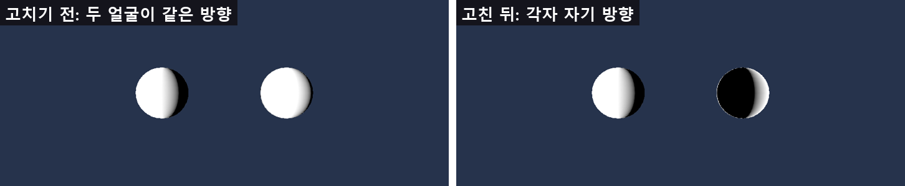

# Day 15. 얼굴 그림자 — SDF 지도로 그리는 깔끔한 그림자

> ⏱ **약 1시간** — 읽기 25분 · 코드 따라 읽기 25분 · 해보기 10분
> 🧸 **오늘의 비유**: SDF 텍스처는 **밀물 지도**예요. 물높이(빛 각도)가 올라오면 **낮은 곳부터** 물에 잠겨요(그림자).

## 오늘 배울 것

- [ ] 얼굴에 일반 `N·L` 그림자를 쓰면 왜 지저분한지 안다
- [ ] SDF 텍스처의 숫자가 "그림자가 덮이는 순서"라는 걸 이해한다
- [ ] 빛 방향을 얼굴 기준으로 바꿔 `coverage`를 만드는 과정을 따라갈 수 있다
- [ ] `fwidth`로 경계를 매끈하게 만드는 방법을 안다
- [ ] 캐릭터마다 얼굴 방향을 따로 넣는 방법(MaterialPropertyBlock)을 안다

---

## 1. 얼굴은 특별해요

만화 얼굴의 그림자는 **깔끔한 모양**이에요. 코 옆에 작은 삼각형, 볼을 가로지르는 매끈한 곡선. 그런데 Day 06의 `N·L` 방식을 그대로 쓰면 코, 눈두덩이, 입술의 **작은 굴곡마다** 그림자가 생겨서 얼룩덜룩해 보여요.

해결책은 **그림자 모양을 그림으로 미리 그려 두는 것**이에요.

## 2. SDF 텍스처 = 밀물 지도


왼쪽 그림이 SDF 텍스처예요. 각 픽셀의 숫자는 **"빛이 이만큼 옆으로 돌아가면 이 자리도 그림자가 된다"는 순서**예요.

- 숫자가 **작은** 곳 = 빛이 조금만 옆으로 가도 금방 그림자 (밀물에 먼저 잠기는 낮은 땅)
- 숫자가 **큰** 곳 = 빛이 거의 뒤로 가야 그림자 (높은 언덕)

빛 각도를 **물높이**(`coverage`)로 바꾸고, **"내 숫자 > 물높이"면 밝음**으로 판정해요. 오른쪽 세 그림처럼 물높이가 올라갈수록 그림자가 넓어져요. 화가가 지도를 직접 그리니까 그림자 모양을 **마음대로** 정할 수 있어요.


SDF는 원래 Signed Distance Field(부호 있는 거리장)의 약자예요. "경계선에서 얼마나 떨어져 있나"를 적은 지도인데, 얼굴 그림자에서는 "그림자가 들어오는 순서" 지도로 바꿔 써요. 경계 근처 값이 부드럽게 변해서 확대해도 경계가 매끈해요.


## 3. 코드 따라 읽기

[CharacterToon.shader L365–405](https://github.com/JJH0204/GitBook/blob/main/GameDev/toon-shader-study/source/CharacterToon/Shaders/CharacterToon.shader#L365-L405) — `_PART_FACE` 머티리얼에서만 컴파일돼요.

### ① 바닥 평면으로 누르기

```hlsl
float2 lightXZ = SafeNormalizeXZ(L.xz,              float2(0.0, 1.0));
float2 fwdXZ   = SafeNormalizeXZ(_FaceForwardWS.xz, float2(0.0, 1.0));   // 얼굴이 보는 방향
float2 rightXZ = SafeNormalizeXZ(_FaceRightWS.xz,   float2(1.0, 0.0));   // 얼굴의 오른쪽
```

얼굴 그림자는 **빛이 좌우로 얼마나 돌았나**만 중요해요. 그래서 높이(y)를 빼고 **위에서 내려다본 방향**(xz)만 써요. 길이 0이면 NaN이 되니까 안전 정규화(Day 06)로 예비 방향을 둬요.

### ② 얼굴 기준으로 빛 읽기

```hlsl
float FdotL = dot(fwdXZ, lightXZ);     //  1 = 빛이 정면,  0 = 옆, -1 = 뒤
float RdotL = dot(rightXZ, lightXZ);   //  + = 빛이 오른쪽, - = 왼쪽
```

내적 두 번으로 "빛이 앞뒤로 얼마나, 좌우로 어느 쪽"인지 알아내요.

### ③ 좌우 뒤집기

```hlsl
float2 uvFlip = float2(1.0 - input.uv.x, input.uv.y);
half sdfLeft  = SAMPLE_TEXTURE2D(_FaceSDF, sampler_FaceSDF, input.uv).r;
half sdfRight = SAMPLE_TEXTURE2D(_FaceSDF, sampler_FaceSDF, uvFlip).r;
half sdf = lerp(sdfLeft, sdfRight, step(0.0, RdotL));    // 빛이 오른쪽이면 뒤집은 지도
```

얼굴은 좌우 대칭이니까 지도를 **한쪽 방향용 하나만** 그리고, 빛이 반대쪽이면 UV를 좌우로 **뒤집어서** 읽어요. 텍스처를 절반만 쓰는 셈이에요.

### ④ 물높이 만들기

```hlsl
half coverage = saturate((-FdotL + 1.0) * 0.5);   // 정면 0 → 옆 0.5 → 뒤 1
```

빛이 정면이면 물높이 0(그림자 없음), 옆이면 0.5(절반), 뒤면 1(전부 그림자).

### ⑤ 경계 만들기 — `smoothstep` 대신 선형 + `fwidth`

```hlsl
half aa    = fwidth(sdf) * 1.5h;                          // 한 픽셀 사이에 sdf가 얼마나 변하나
half width = max(_SDFSoftness * 2.0h + aa, 1e-4h);
faceLit = saturate((sdf - coverage) / width + 0.5h);      // 0=그림자, 1=빛
```

`fwidth(x)`는 "옆 픽셀과 비교해 x가 얼마나 변했나"예요(Day 16에서 자세히). 경계 폭을 **최소 1픽셀 남짓**으로 잡아서, Softness를 0으로 해도 경계가 계단처럼 깨지지 않아요.

[L383–386 주석](https://github.com/JJH0204/GitBook/blob/main/GameDev/toon-shader-study/source/CharacterToon/Shaders/CharacterToon.shader#L383-L386)에 `smoothstep` 대신 **직선**을 쓴 이유가 있어요. `smoothstep`은 가운데 기울기가 평균의 1.5배라서, 폭을 1픽셀로 잡아도 실제로는 0.66픽셀 안에서 급하게 바뀌어 반짝임이 남았어요.

### ⑥ 덧붙이는 마스크들

```hlsl
#if defined(_USE_HAIR_SHADOW)
    faceLit *= lerp(1.0h, hairMask, _HairShadowStrength);   // 앞머리가 이마에 드리우는 그림자
#endif
sdfApply = SAMPLE_TEXTURE2D(_FaceSDFMask, ...).r;            // 얼굴 중 SDF를 쓸 영역 (흰=SDF, 검=일반 밴드)
#if defined(_DEBUG_FACELIT)
    return half4(faceLit, faceLit, faceLit, 1.0h);           // 디버그: faceLit 을 흑백으로 보기
#endif
```

### ⑦ 일반 밴드와 합치기 (L439–443)

```hlsl
half shadowSDF = (1.0h - faceLit) * _ShadowStrength;
half shadow1 = lerp(shadow1Band, shadowSDF, sdfApply);   // SDF 영역은 SDF 그림자
half shadow2 = shadow2Band * (1.0h - sdfApply);          // SDF 영역엔 2차 그림자 없음
```

얼굴 중 SDF 영역(마스크 흰색)은 SDF 그림자를, 나머지(목, 귀)는 Day 07의 일반 밴드를 써요.

## 4. 캐릭터마다 다른 얼굴 방향

`_FaceForwardWS`와 `_FaceRightWS`는 **얼굴이 지금 어디를 보는지**예요. 고개를 돌리면 계속 바뀌니까 C# 스크립트가 매 프레임 넣어 줘요.


**💡 이 프로젝트에서 실제로 있었던 일 (A3)**
예전엔 `Shader.SetGlobalVector`(Day 09의 **전체 방송**)로 넣었어요. 캐릭터가 **둘**이면 마지막에 방송한 캐릭터의 방향을 **모든 얼굴이** 따라갔어요. 왼쪽 사진처럼 서로 다른 쪽을 보는데 그림자가 똑같죠.



고친 방법: 값을 머티리얼 프로퍼티(CBUFFER)로 옮기고, 렌더러마다 **포스트잇**(MaterialPropertyBlock)을 붙여서 넣어요. 같은 얼굴 머티리얼을 여러 캐릭터가 같이 써도 섞이지 않아요.


[CharacterToonFace.cs L44–53](https://github.com/JJH0204/GitBook/blob/main/GameDev/toon-shader-study/source/CharacterToon/Runtime/CharacterToonFace.cs#L44-L53)

```csharp
public static void Apply(Renderer renderer, Vector3 forward, Vector3 right)
{
    s_block ??= new MaterialPropertyBlock();
    renderer.GetPropertyBlock(s_block);          // 이미 붙은 포스트잇을 읽고
    s_block.SetVector(FaceForwardWSId, forward); // 얼굴 방향만 고쳐 쓰고
    s_block.SetVector(FaceRightWSId, right);
    renderer.SetPropertyBlock(s_block);          // 다시 붙인다
}
```

포스트잇에도 대가가 있어요. 포스트잇을 붙인 렌더러는 SRP Batcher의 묶음 처리에서 **빠져요**(Day 20). 얼굴 메시는 캐릭터당 몇 개뿐이라 괜찮다고 판단했어요.

## 5. 해보기 (10분)

1. **coverage 계산** — 빛이 정면(`FdotL = 1`)이면 coverage = `(−1+1)×0.5 = 0`. 옆(`0`)이면 0.5. 뒤(`−1`)면 1.
2. **faceLit 계산** — coverage 0.5, sdf 0.7, `width = 0.1`이면 `(0.7−0.5)/0.1 + 0.5 = 2.5` → saturate → **1 (밝음)**. sdf 0.48이면? `(−0.02)/0.1 + 0.5 = 0.3` → 경계 근처 어두운 쪽.
3. **뒤집기 판단** — `RdotL = −0.4`(빛이 왼쪽)면 원래 UV와 뒤집은 UV 중 어느 쪽을 쓰나요? (`step(0, −0.4) = 0` → 원래 UV)
4. **(Unity가 있다면)** 얼굴 머티리얼에서 `DEBUG: Show faceLit`을 켜고 조명을 빙글 돌려 보세요. 흑백 경계가 지도 순서대로 움직여요.

## 6. 오늘의 액기스

👉 [ESSENCE.md — Day 15](essence.md#day-15)

## 더 읽을거리

- 수학: [Wikipedia — Signed distance function](https://en.wikipedia.org/wiki/Signed_distance_function) (영어) · [Inigo Quilez — Distance functions](https://iquilezles.org/articles/distfunctions/) — SDF의 대가가 정리한 거리 함수 모음 (영어, 고급)
- [Microsoft — fwidth](https://learn.microsoft.com/en-us/windows/win32/direct3dhlsl/dx-graphics-hlsl-fwidth)
- [Unity — MaterialPropertyBlock](https://docs.unity3d.com/ScriptReference/MaterialPropertyBlock.html)
- [3Blue1Brown — 내적](https://www.3blue1brown.com/lessons/dot-products) (FdotL, RdotL이 내적 두 번이에요)

---

[← Day 14](day14-screen-space-outline.md) · [목차](README.md) · [다음: Day 16 →](day16-normal-maps-and-derivatives.md)
