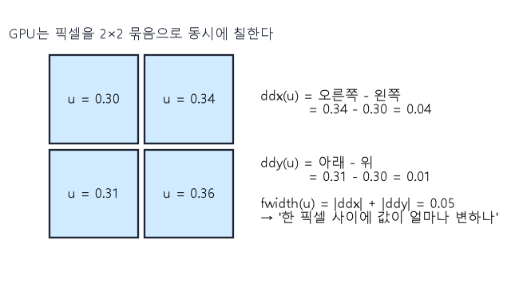

# Day 16. 노멀맵과 미분 — 옆 픽셀에게 물어보기

> ⏱ **약 1시간** — 읽기 25분 · 코드 따라 읽기 25분 · 해보기 10분
> 🧸 **오늘의 비유**: 노멀맵은 **빛에게만 하는 거짓말**("여기 울퉁불퉁해요"), `ddx/ddy`는 **옆자리 친구 답안 보기**예요.

## 오늘 배울 것

- [ ] 노멀맵이 무엇이고 색 (0.5, 0.5, 1)이 왜 "평평함"인지 안다
- [ ] 탄젠트 공간(T, B, N)이 무엇인지 안다
- [ ] `ddx`, `ddy`, `fwidth`가 2×2 픽셀 묶음에서 계산된다는 걸 안다
- [ ] 캐릭터 셰이더가 메시 탄젠트 없이 노멀맵을 쓰는 이유를 안다
- [ ] 미분을 쓰면 안 되는 곳(분기 안)을 안다

---

## 1. 노멀맵 = 빛에게 하는 거짓말

벽돌 벽을 진짜 울퉁불퉁하게 만들려면 점이 수백만 개 필요해요. 대신 **평평한 벽**에 "이 픽셀의 노멀은 사실 이쪽이야"라는 정보를 그림으로 붙여요. 빛 계산(Day 06)은 노멀만 보니까 **울퉁불퉁해 보여요.** 모양은 그대로인데 빛에게만 거짓말을 하는 거예요.

노멀맵은 화살표 `(x, y, z)`를 색 `(r, g, b)`로 저장해요. 화살표는 -1~1, 색은 0~1이니까 바꿔서 저장해요.

```
색 = 화살표 × 0.5 + 0.5        저장할 때
화살표 = 색 × 2 - 1            읽을 때 (UnpackNormal 이 해 줘요)
```

평평한 곳은 노멀이 "바로 위" `(0, 0, 1)` → 색 `(0.5, 0.5, 1)` = **연한 보라색**. 그래서 노멀맵이 보라색으로 보여요. 텍스처 기본값 `"bump"`도 이 색이에요.

## 2. 탄젠트 공간 = 표면 위의 작은 지도

노멀맵의 화살표는 **표면 기준**이에요. "표면의 오른쪽(T), 위쪽(B), 바깥쪽(N)" 세 방향으로 적혀 있어요. 이 세 방향이 **탄젠트 공간**이에요.

- **T** (탄젠트) — 텍스처의 u가 커지는 방향 (지도의 동쪽)
- **B** (바이탄젠트) — v가 커지는 방향 (지도의 북쪽)
- **N** (노멀) — 표면 바깥쪽 (하늘)

노멀맵 화살표를 월드로 옮기려면 이 세 방향으로 된 **기계(행렬)** 에 넣어요(Day 02).

### 보통 방법: 메시의 탄젠트 쓰기

배경 셰이더는 메시가 가진 탄젠트를 써요. [SceneToon.shader L211–217](https://github.com/JJH0204/GitBook/blob/main/GameDev/toon-shader-study/source/SceneToon/Shaders/SceneToon.shader#L211-L217)

```hlsl
half3 normalTS = UnpackNormalScale(SAMPLE_TEXTURE2D(_BumpMap, sampler_BumpMap, input.uv), _BumpScale);
half3 Tn = normalize(input.tangentWS.xyz);
half3 Bn = normalize(cross(N, Tn) * input.tangentWS.w);   // B = N과 T에 모두 수직 (cross)
N = normalize(mul(normalTS, half3x3(Tn, Bn, N)));          // 표면 지도 → 월드
```

`cross(A, B)`(외적)는 **A와 B 모두에 수직인 화살표**를 만들어요. `tangentWS.w`는 거울처럼 뒤집힌 UV를 위한 ±1 부호예요.

### 캐릭터는 탄젠트가 없어요!

Day 12에서 캐릭터는 **TANGENT 칸에 외곽선용 스무스 노멀을** 넣었죠. 진짜 탄젠트가 없어요. 그래서 **픽셀마다 옆 픽셀에게 물어서** 탄젠트를 즉석으로 만들어요.

## 3. `ddx`, `ddy` — 옆자리 친구 답안 보기

GPU는 픽셀을 하나씩이 아니라 **2×2 묶음(쿼드)** 으로 동시에 칠해요. 그래서 같은 묶음의 이웃 픽셀이 계산 중인 값을 **살짝 볼 수 있어요.**



| 함수 | 뜻 |
|---|---|
| `ddx(v)` | 오른쪽 픽셀의 v − 왼쪽 픽셀의 v (가로로 한 칸 갈 때 변화량) |
| `ddy(v)` | 아래 픽셀의 v − 위 픽셀의 v (세로로 한 칸 갈 때 변화량) |
| `fwidth(v)` | `abs(ddx(v)) + abs(ddy(v))` (한 픽셀 사이 변화량의 대략) |

이걸 **유한 차분**이라고 해요. 미분(순간 변화율)을 "이웃과의 차이"로 어림잡는 거예요.


**미분은 묶음의 4픽셀이 같은 길을 갈 때만** 믿을 수 있어요. `if` 안에서 일부 픽셀만 들어가면 이웃의 값이 엉망이에요. 텍스처를 읽을 때 밉맵 크기를 고르는 것(Day 05)도 내부적으로 미분을 써요.

그래서 품질 페이드(Day 20)는 픽셀 위치가 아니라 **물체 원점**으로 거리를 재요. 한 물체의 모든 픽셀이 같은 결과를 내니까 `if` 안에서 미분을 써도 안전해요. [CharacterToon.shader L323–325 주석](https://github.com/JJH0204/GitBook/blob/main/GameDev/toon-shader-study/source/CharacterToon/Shaders/CharacterToon.shader#L323-L325)


## 4. 미분으로 노멀맵 하기

[ToonLighting.hlsl L33–55](https://github.com/JJH0204/GitBook/blob/main/GameDev/toon-shader-study/source/CharacterToon/ShaderLibrary/ToonLighting.hlsl#L33-L55)

```hlsl
half3 ApplyNormalMapDerivative(half3 N, float3 positionWS, float2 uv, half3 normalTS)
{
    float3 dp1 = ddx(positionWS); float3 dp2 = ddy(positionWS);   // 옆 픽셀로 갈 때 위치가 어떻게 변하나
    float2 duv1 = ddx(uv);        float2 duv2 = ddy(uv);          // 옆 픽셀로 갈 때 UV가 어떻게 변하나

    float3 dp2perp = cross(dp2, (float3)N);
    float3 dp1perp = cross((float3)N, dp1);
    float3 T = dp2perp * duv1.x + dp1perp * duv2.x;               // "u가 커지는 월드 방향"
    float3 B = dp2perp * duv1.y + dp1perp * duv2.y;               // "v가 커지는 월드 방향"

    float maxLenSq = max(dot(T, T), dot(B, B));
    float invmax = rsqrt(max(maxLenSq, 1e-30));                   // 크기 맞추기 (0 나눗셈만 방지)
    float3x3 tangentToWorld = float3x3(T * invmax, B * invmax, (float3)N);
    return (half3)normalize(mul((float3)normalTS, tangentToWorld));
}
```

핵심 아이디어: "**옆 픽셀로 가면 위치가 이만큼, UV가 이만큼 변한다**" → 둘을 연결하면 "u가 커지는 방향이 월드에서 어디인지"(T)를 알 수 있어요. 이 방법은 Christian Schüler의 글에서 왔어요(아래 링크).

장점: 메시 탄젠트가 필요 없고, 캐릭터가 애니메이션으로 **휘어도** 그 순간의 표면으로 계산해서 자동으로 맞아요.


**💡 실제로 있었던 일 — "가까이 가면 노멀맵이 사라져요"**
예전엔 `if (maxLenSq < 1e-12) return N;` — "T, B가 너무 작으면 포기"하는 절대 기준이 있었어요. 그런데 T, B의 크기는 **픽셀이 덮는 면적**에 비례해서, 카메라가 가까이 가면 정상인데도 아주 작아져요. 결국 **가까이 갈수록 노멀맵이 꺼졌어요.** 방향만 쓰니까 크기는 상관없다는 걸 깨닫고, 0 나눗셈만 막는 아주 작은 바닥으로 바꿨어요. [L45–49 주석](https://github.com/JJH0204/GitBook/blob/main/GameDev/toon-shader-study/source/CharacterToon/ShaderLibrary/ToonLighting.hlsl#L45-L49)


## 5. UV 방향 화살표만 따로: `GetUVTangentWS`

[ToonLighting.hlsl L18–26](https://github.com/JJH0204/GitBook/blob/main/GameDev/toon-shader-study/source/CharacterToon/ShaderLibrary/ToonLighting.hlsl#L18-L26)

```hlsl
float3 GetUVTangentWS(float3 positionWS, float2 uv)
{
    float3 dpdx = ddx(positionWS); float3 dpdy = ddy(positionWS);
    float2 duvdx = ddx(uv);        float2 duvdy = ddy(uv);
    float det = duvdx.x * duvdy.y - duvdy.x * duvdx.y;
    float3 t = (dpdx * duvdy.y - dpdy * duvdx.y) * (det >= 0.0 ? 1.0 : -1.0);
    float lenSq = dot(t, t);
    return lenSq > 1e-8 ? t * rsqrt(lenSq) : float3(1.0, 0.0, 0.0);
}
```

같은 아이디어로 "u가 커지는 방향" 하나만 구해요. 머리카락의 **결 방향**이 필요한 천사 고리(Day 17)와 눈 시차 효과가 써요.

## 6. 해보기 (10분)

1. **노멀맵 색 해석** — 색 (0.5, 0.5, 1) → 화살표 `(0, 0, 1)` (평평). 색 (1, 0.5, 0.5)면? `(1, 0, 0)` — 완전히 오른쪽으로 누운 노멀.
2. **쿼드 미분** — 2×2 묶음의 u 값이 왼쪽 위 0.30, 오른쪽 위 0.34, 왼쪽 아래 0.31이면 `ddx(u)`는? (0.04) `ddy(u)`는? (0.01) `fwidth(u)`는? (0.05)
3. **멀리 vs 가까이** — 카메라가 2배 가까워지면 한 픽셀이 덮는 표면이 반으로 줄어요. 그럼 `ddx(positionWS)`의 길이는? (약 절반) T의 크기는 dp × duv 꼴이라 약 **1/4**. 그래서 절대 기준은 근거리에서 틀려요.
4. **분기 퀴즈** — 아래 코드는 안전할까요? `if (input.uv.x > 0.5) { x = fwidth(sdf); }` (아니요 — 같은 2×2 묶음 안에서 일부만 들어갈 수 있어요)

## 7. 오늘의 액기스

👉 [ESSENCE.md — Day 16](essence.md#day-16)

## 수학 참고 자료

- [LearnOpenGL — Normal Mapping](https://learnopengl.com/Advanced-Lighting/Normal-Mapping) — 탄젠트 공간을 그림으로 (영어)
- [Christian Schüler — Followup: Normal Mapping Without Precomputed Tangents](http://www.thetenthplanet.de/archives/1180) — 이 셰이더가 쓴 방법의 원문 (영어, 고급)
- [Wikipedia — Normal mapping](https://en.wikipedia.org/wiki/Normal_mapping) · [Finite difference](https://en.wikipedia.org/wiki/Finite_difference) (영어)
- 🎥 [3Blue1Brown — 외적(cross product)](https://www.3blue1brown.com/lessons/cross-products) · [위키백과 — 벡터곱](https://ko.wikipedia.org/wiki/%EB%B2%A1%ED%84%B0%EA%B3%B1)
- [Microsoft — ddx](https://learn.microsoft.com/en-us/windows/win32/direct3dhlsl/dx-graphics-hlsl-ddx) · [fwidth](https://learn.microsoft.com/en-us/windows/win32/direct3dhlsl/dx-graphics-hlsl-fwidth)
- [Catlike Coding — Rendering 6: Bumpiness](https://catlikecoding.com/unity/tutorials/rendering/part-6/) (영어)

---

[← Day 15](day15-face-sdf.md) · [목차](README.md) · [다음: Day 17 →](day17-highlights.md)
