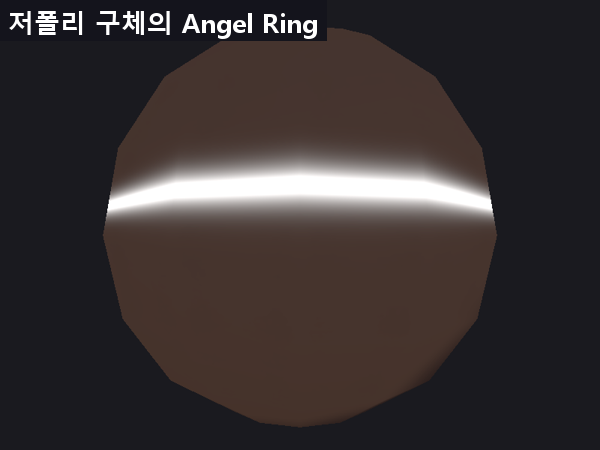
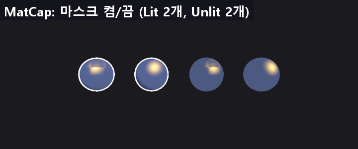

# Day 17. 반짝임 3종 — 스펙큘러, 천사 고리, MatCap

> ⏱ **약 1시간** — 스펙큘러 20분 · 천사 고리 15분 · MatCap 15분 · 해보기 10분
> 🧸 **오늘의 비유**: 스펙큘러는 **거울에 비친 해**, 천사 고리는 **머리카락 결을 따라 흐르는 빛 띠**, MatCap은 **반사를 그려 둔 구슬 사진 스티커**예요.

## 오늘 배울 것

- [ ] 블린-퐁 하이라이트의 하프 벡터 H를 설명할 수 있다
- [ ] `pow`의 지수가 하이라이트 크기를 정하는 원리를 안다
- [ ] 이방성(천사 고리) 하이라이트가 T·H를 쓰는 이유를 안다
- [ ] MatCap이 뷰 공간 노멀을 UV로 쓰는 원리를 안다

---

## 1. 스펙큘러 — 거울에 비친 해

반짝이는 공을 보면 한 점이 하얗게 빛나요. 빛이 표면에서 튕겨서 **정확히 내 눈으로** 들어오는 자리예요. 이게 **스펙큘러 하이라이트**예요.

### 하프 벡터 H

"빛이 튕겨서 눈으로 온다"를 확인하는 쉬운 방법이 있어요. 빛 방향 L과 눈 방향 V의 **딱 중간 방향** H를 만들어요.

```
H = normalize(L + V)
```

표면의 노멀 N이 이 H와 **같은 방향**이면, 빛이 거울처럼 튕겨 눈으로 들어와요. 그러니까 `dot(N, H)`가 1에 가까울수록 반짝임이 강해요. 이걸 **블린-퐁**(Blinn-Phong) 모델이라고 해요.


### `pow`로 크기 정하기

`dot(N, H)`는 넓게 퍼져 있어요. 하이라이트를 **작고 날카롭게** 만들려면 거듭제곱을 해요.

| `dot(N, H)` | `pow(…, 20)` | `pow(…, 200)` |
|---|---|---|
| 1.00 | 1.00 | 1.00 |
| 0.99 | 0.82 | 0.13 |
| 0.95 | 0.36 | 0.00 |
| 0.90 | 0.12 | 0.00 |

지수가 클수록 **1에 아주 가까운 곳만** 남아서 점이 작아져요. 매끈한 표면일수록 하이라이트가 작고 날카롭죠.

### 툰 스펙큘러 코드

[CharacterToon.shader L590–600](https://github.com/JJH0204/GitBook/blob/main/GameDev/toon-shader-study/source/CharacterToon/Shaders/CharacterToon.shader#L590-L600)

```hlsl
half3 Hspec = SafeNormalize(L + V);                     // L = -V 이면 0 벡터 → 안전 정규화
half ndoth  = saturate(dot(N, Hspec));
half specPower = exp2(smoothness * 11.0h);              // 2^(0~11) = 1 ~ 2048
half spec      = pow(ndoth, specPower) * (ilm.b * 0.5h + 0.5h);   // ILM.B: 부위별 폭 가중
half specStep  = max(_SpecularStep, 1e-4h);
half toonSpec  = smoothstep(0.5h - specStep, 0.5h + specStep, spec);   // ★ 또 계단!
half3 specTint = _SpecularTint.rgb * lerp((half3)1.0h, baseColor.rgb, metallic);   // 금속은 자기 색으로 반짝
shaded += toonSpec * specTint * lightColor * rcvShadow * hqAmount;    // 그림자 속에선 끔 (Day 08, B6)
```

- `exp2(x)` = 2의 x제곱. Smoothness 슬라이더 0~1을 지수 1~2048로 바꿔요.
- 부드러운 하이라이트를 `smoothstep`으로 **딱 끊긴 만화 하이라이트**로 바꿔요. 툰 셰이더의 단골 기술이죠.
- 금속은 반사광이 자기 색을 띠어요(금은 금색으로 반짝). 그래서 metallic만큼 albedo 색을 섞어요.

바로 아래 [L605–607](https://github.com/JJH0204/GitBook/blob/main/GameDev/toon-shader-study/source/CharacterToon/Shaders/CharacterToon.shader#L605-L607)은 **환경 반사**예요. 주변 풍경을 360° 찍어 둔 사진(리플렉션 프로브)에서 `reflect(-V, N)` 방향의 색을 가져와 금속에 비춰요.

## 2. 천사 고리 — 머리카락 결을 따라 흐르는 빛

애니메이션 캐릭터 머리 위에 생기는 **반짝이는 띠**를 천사 고리(Angel Ring)라고 해요. 머리카락은 가는 실이 한 방향으로 늘어서 있어서, 하이라이트가 점이 아니라 **결과 수직인 띠**로 생겨요. 방향에 따라 다르게 반짝인다고 해서 **이방성**(anisotropic) 하이라이트라고 해요.

[CharacterToon.shader L612–628](https://github.com/JJH0204/GitBook/blob/main/GameDev/toon-shader-study/source/CharacterToon/Shaders/CharacterToon.shader#L612-L628)

```hlsl
#if defined(_PART_HAIR) && defined(_USE_ANGELRING)
    half3 hairT = (half3)GetUVTangentWS(input.positionWS, input.uv);   // 머리카락 결 방향 (Day 16)
    half3 hairB = SafeNormalize(cross(N, hairT));
    half a = radians(_AngelRingAngle);
    half3 ringT = SafeNormalize(hairT * cos(a) + hairB * sin(a));       // 결 방향을 각도만큼 돌림
    half3 H = SafeNormalize(L + V);
    half aniso = 1.0h - saturate(abs(dot(ringT, H)));                   // ★ 결과 H가 수직일수록 1
    half ring = pow(aniso, _AngelRingPower) * _AngelRingIntensity;
    ring *= SAMPLE_TEXTURE2D(_AngelRingMask, sampler_AngelRingMask, input.uv).r;
    shaded += ring * _AngelRingColor.rgb * hqAmount;
#endif
```

일반 스펙큘러는 `N·H`(노멀과 H가 **같은지**)를 봤어요. 천사 고리는 `T·H`(결 방향과 H가 **수직인지**)를 봐요. 실 하나하나는 **둘레 어느 방향으로든** 빛을 튕길 수 있어서, H가 결과 수직이기만 하면 반짝여요. 그 자리를 이으면 **띠**가 돼요.

`cos(a)`, `sin(a)`로 결 방향을 돌리는 건 **원 위의 점 = (cos, sin)** 이라는 삼각함수의 기본이에요. UV를 어떻게 펼쳤느냐에 따라 고리가 세로로 보일 수도 있어서 각도 다이얼을 달았어요.




**💡 보류 중인 개선 (B9)**: 결 방향을 UV에서 구하니까 UV 펼침에 따라 고리 모양이 흔들려요. "위 방향과 노멀의 외적(cross(up, N))"으로 결을 정하면 UV와 무관해지지만, 지금 쓰는 `_AngelRingAngle`의 느낌이 바뀌어서 아트 결정을 기다리고 있어요.


## 3. MatCap — 반사를 그려 둔 구슬 스티커

**MatCap**(Material Capture)은 반짝이는 공 사진 한 장으로 재질을 흉내 내요. 빛 계산을 안 해요!


원리는 이래요.

1. 노멀을 **내 눈 기준**(뷰 공간)으로 바꿔요. 그러면 "화면에서 이 표면이 어느 쪽을 보나"가 돼요.
2. 노멀의 x, y는 -1~1이에요. `× 0.5 + 0.5`로 0~1로 옮기면 **UV**가 돼요.
3. 정면을 보는 표면 → UV (0.5, 0.5) = 공 사진 가운데. 오른쪽을 보는 표면 → 공 사진 오른쪽 끝.

공 사진은 원래 **모든 방향의 표면**을 한 장에 담고 있으니까, 노멀만 알면 "그 방향 표면이 어떻게 보였는지"를 찾아올 수 있어요.

[CharacterToon.shader L535–549](https://github.com/JJH0204/GitBook/blob/main/GameDev/toon-shader-study/source/CharacterToon/Shaders/CharacterToon.shader#L535-L549)

```hlsl
half3 mcN = SafeNormalize(lerp((half3)normalize(input.normalWS), N, _MatCapNormalStrength));   // 노멀맵 영향 조절
float3 normalVS = mul((float3x3)UNITY_MATRIX_V, mcN);            // ① 뷰 공간 노멀
float2 matcapUV = normalVS.xy * 0.5 + 0.5;                        // ② UV로
half3 matcap = SAMPLE_TEXTURE2D_BIAS(_MatCap, sampler_MatCap, matcapUV, _MatCapBlur * CHAR_MATCAP_BLUR_MAX).rgb
             * _MatCapColor.rgb;                                  // ③ 공 사진에서 읽기 (흐림 = 밉 바이어스)
half matcapMask = 1.0h;
#if defined(_USE_ILM)
    matcapMask = ilm.r;                                           // ILM.R: 어디에 붙일지
#endif
if (_UseMatCapMask > 0.5h)
    matcapMask = SAMPLE_TEXTURE2D(_MatCapMask, sampler_MatCapMask, input.uv).r;
shaded += matcap * matcapMask * _MatCapStrength * mcLight * hqAmount;
```

- `SAMPLE_TEXTURE2D_BIAS`: 밉맵(Day 05)을 일부러 **더 작은 사본**으로 읽어서 흐리게 해요. Blur 슬라이더예요.
- `_MatCapNormalStrength`: 노멀맵의 잔 굴곡을 MatCap에 얼마나 반영할지. 뷰 공간이라 카메라가 움직이면 반사가 **출렁거려 보이는(swim)** 문제가 있어서 다이얼을 달았어요.
- `mcLight`: 0이면 빛과 무관하게 빛나는 스티커, 1이면 장면 빛을 따라 어두워져요.




**💡 실제로 있었던 일 (C7)**: 별도 마스크를 안 쓰는데도 마스크 텍스처를 **항상 읽고** 있었어요. 지금은 `_UseMatCapMask`가 켜졌을 때만 읽어요. 이 `if`는 머티리얼 값 하나로 갈려서 **한 물체의 모든 픽셀이 같은 길**로 가니까 GPU에서 거의 공짜예요(Day 19). 렌더 결과는 그대로이고, 텍스처 읽기만 줄었어요.


두 번째 MatCap 슬롯([L555–573](https://github.com/JJH0204/GitBook/blob/main/GameDev/toon-shader-study/source/CharacterToon/Shaders/CharacterToon.shader#L555-L573))은 **더하기**(반짝임) 또는 **곱하기**(어둡게 = 가짜 그늘) 중에서 고를 수 있어요.

## 4. 해보기 (10분)

1. **pow 감각** — `pow(0.9, 20) ≈ 0.12`, `pow(0.99, 20) ≈ 0.82`. 계산기로 `pow(0.95, 100)`을 구해 보세요. (≈ 0.006 — 거의 안 보임)
2. **exp2** — Smoothness 0.5면 지수는? (`2^5.5 ≈ 45`) Smoothness 1이면? (2048)
3. **MatCap UV** — 뷰 공간 노멀 (0, 0, 1)(나를 정면으로 봄)이면 UV는? (0.5, 0.5) 노멀 (1, 0, 0)(오른쪽을 봄)이면? (1, 0.5)
4. **천사 고리** — `ringT`와 H가 수직이면 `dot = 0` → `aniso = 1` → 가장 밝음. 평행이면? (`aniso = 0` → 어두움)

## 5. 오늘의 액기스

👉 [ESSENCE.md — Day 17](essence.md#day-17)

## 수학 참고 자료

- [Wikipedia — Blinn–Phong reflection model](https://en.wikipedia.org/wiki/Blinn%E2%80%93Phong_reflection_model) · [Specular highlight](https://en.wikipedia.org/wiki/Specular_highlight) (영어)
- [LearnOpenGL — Advanced Lighting (Blinn-Phong)](https://learnopengl.com/Advanced-Lighting/Advanced-Lighting) — 퐁과 블린-퐁 비교 그림 (영어)
- [Wikipedia — Sphere mapping](https://en.wikipedia.org/wiki/Sphere_mapping) — MatCap의 원조 기법 (영어)
- [위키백과 — 삼각함수](https://ko.wikipedia.org/wiki/%EC%82%BC%EA%B0%81%ED%95%A8%EC%88%98) (cos, sin과 단위원) · [The Book of Shaders — 7장 Shapes (한국어)](https://thebookofshaders.com/07/?lan=kr)
- [Desmos](https://www.desmos.com/calculator)에서 `y = x^n` (n 슬라이더 1~200, x는 0~1)을 그려 보세요.

---

[← Day 16](day16-normal-maps-and-derivatives.md) · [목차](README.md) · [다음: Day 18 →](day18-passes.md)
