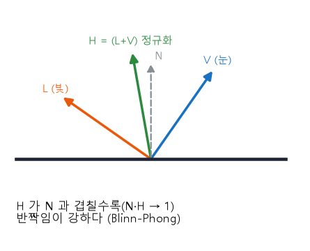
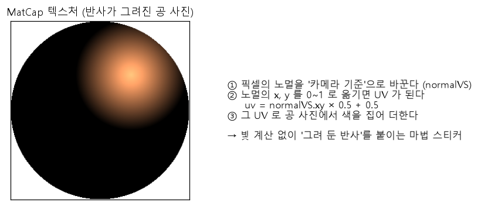

# Day 17. 반짝임 3종 — 스펙큘러, 천사 고리, MatCap

## 작업 식별

| 항목 | 내용 |
|---|---|
| Task ID | GMD-TSS-018-DO |
| 유형 | D&O (개념) + 코드 읽기 + 실습 |
| 목적 | 블린-퐁 스펙큘러, 이방성 천사 고리, MatCap의 원리와 이 셰이더의 구현을 설명한다 |
| 소요 시간 | 약 1시간 (스펙큘러 20분, 천사 고리 15분, MatCap 15분, 실습 10분) |
| 선수 지식 | [Day 06](day06-vectors-and-light.md) 내적, [Day 07](day07-toon-steps.md) 계단, [Day 16](day16-normal-maps-and-derivatives.md) |
| 확인 상태 | 미검증 (소스를 읽고 작성했으며 Unity에서 컴파일·실행하지 않았다) |
| 개정 | R1 (2026-11-18) |

## 학습 목표

- [ ] 블린-퐁 하이라이트의 하프 벡터 H를 설명할 수 있다
- [ ] `pow`의 지수가 하이라이트 크기를 정하는 원리를 안다
- [ ] 이방성(천사 고리) 하이라이트가 T·H를 쓰는 이유를 안다
- [ ] MatCap이 뷰 공간 노멀을 UV로 쓰는 원리를 안다

## 1. 정의

| 기법 | 정의 | 비유 |
|---|---|---|
| 스펙큘러 하이라이트 | 빛이 표면에서 반사돼 눈으로 들어오는 자리의 밝은 점 | 거울에 비친 해 |
| 천사 고리 (이방성 하이라이트) | 머리카락 결 방향에 수직인 H에서 생기는 띠 모양 하이라이트 | 결을 따라 흐르는 빛 띠 |
| MatCap (Material Capture) | 구에 재질을 렌더한 사진 한 장을 뷰 공간 노멀로 조회해 음영과 반사를 흉내 내는 기법 | 반사를 그려 둔 구슬 스티커 |

## 2. 구성 요소

| 구성 요소 | 쓰는 곳 | 역할 |
|---|---|---|
| 하프 벡터 H = `normalize(L + V)` | 스펙큘러, 천사 고리 | 빛 방향 L과 눈 방향 V의 중간 방향 |
| `pow` 지수 | 스펙큘러 | 하이라이트 크기 결정 |
| `smoothstep` | 툰 스펙큘러 | 부드러운 하이라이트를 계단으로 자른다 |
| `GetUVTangentWS` | 천사 고리 | 머리카락 결 방향([Day 16](day16-normal-maps-and-derivatives.md)) |
| `_MatCap` 텍스처, `normalVS` | MatCap | 구 사진과 뷰 공간 노멀 |
| ILM.R/B, 마스크 | MatCap, 스펙큘러 | 적용 부위와 폭 가중 |

## 3. 동작 원리

### 3.1 스펙큘러: 블린-퐁

```
H = normalize(L + V)
스펙큘러 = pow(saturate(dot(N, H)), 지수)
```

노멀 N이 H와 같은 방향이면 빛이 눈으로 반사된다. `dot(N, H)`가 1에 가까울수록 반짝임이 강하다.



`dot(N, H)`는 넓게 퍼져 있다. 거듭제곱으로 1 부근만 남기면 하이라이트가 작고 날카로워진다.

| `dot(N, H)` | `pow(…, 20)` | `pow(…, 200)` |
|---|---|---|
| 1.00 | 1.00 | 1.00 |
| 0.99 | 0.82 | 0.13 |
| 0.95 | 0.36 | 0.00 |
| 0.90 | 0.12 | 0.00 |

지수가 클수록 매끈한 표면처럼 하이라이트가 작아진다.

### 3.2 천사 고리: 이방성

머리카락은 가는 실이 한 방향으로 늘어서 있어 하이라이트가 점이 아니라 결에 수직인 띠가 된다. 방향에 따라 반사가 다르므로 이방성(anisotropic)이라 한다.

| 비교 | 일반 스펙큘러 | 천사 고리 |
|---|---|---|
| 보는 값 | `N·H` (같은 방향일수록 강함) | `T·H` (수직일수록 강함) |
| 모양 | 점 | 결에 수직인 띠 |

실 하나는 둘레의 어느 방향으로든 빛을 반사하므로 H가 결과 수직이기만 하면 반짝인다. 그 위치를 이으면 띠가 된다.


NOTE: 이방성 하이라이트의 정석 모델(Kajiya-Kay)은 `sqrt(1 − (T·H)²)`를 쓴다. 아래 코드의 `1 − abs(dot(T, H))`는 이를 단순화한 근사식이다.


### 3.3 MatCap

빛 계산 없이 노멀만으로 조회한다.

| 단계 | 내용 |
|---|---|
| 1 | 노멀을 뷰 공간으로 바꾼다. 화면 기준으로 표면이 향한 방향이 된다 |
| 2 | `normalVS.xy`(-1~1)에 `× 0.5 + 0.5`를 적용해 UV(0~1)로 만든다 |
| 3 | UV로 구 사진을 읽는다 |

| 뷰 공간 노멀 | UV | 구 사진 위치 |
|---|---|---|
| (0, 0, 1) 정면 | (0.5, 0.5) | 가운데 |
| (1, 0, 0) 오른쪽 | (1, 0.5) | 오른쪽 끝 |



## 4. 코드 읽기

### 4.1 툰 스펙큘러

[CharacterToon.shader L590–600](https://github.com/JJH0204/GitBook/blob/main/GameDev/toon-shader-study/source/CharacterToon/Shaders/CharacterToon.shader#L590-L600)

```hlsl
half3 Hspec = SafeNormalize(L + V);                     // L = -V 이면 0 벡터 → 안전 정규화
half ndoth  = saturate(dot(N, Hspec));
half specPower = exp2(smoothness * 11.0h);              // 2^(0~11) = 1 ~ 2048
half spec      = pow(ndoth, specPower) * (ilm.b * 0.5h + 0.5h);   // ILM.B: 부위별 폭 가중
half specStep  = max(_SpecularStep, 1e-4h);
half toonSpec  = smoothstep(0.5h - specStep, 0.5h + specStep, spec);   // ★ 또 계단!
half3 specTint = _SpecularTint.rgb * lerp((half3)1.0h, baseColor.rgb, metallic);   // 금속은 자기 색으로 반짝
shaded += toonSpec * specTint * lightColor * rcvShadow * hqAmount;    // 그림자 속에선 끔 (Day 08, B6)
```

| 줄 | 설명 |
|---|---|
| `SafeNormalize(L + V)` | `L = -V`이면 합이 0 벡터이므로 안전 정규화를 쓴다 |
| `exp2(smoothness * 11.0h)` | Smoothness 0~1을 지수 1~2048로 바꾼다 |
| `smoothstep(0.5 ± specStep)` | 부드러운 하이라이트를 경계가 뚜렷한 만화 하이라이트로 바꾼다. 툰 셰이더의 단골 기법이다 |
| `lerp(1, baseColor, metallic)` | 금속은 반사광이 자기 색을 띠므로 metallic만큼 albedo 색을 섞는다 |
| `rcvShadow` | 그림자 안에서는 하이라이트를 끈다([Day 08](day08-shadows.md)) |

바로 아래 [L605–607](https://github.com/JJH0204/GitBook/blob/main/GameDev/toon-shader-study/source/CharacterToon/Shaders/CharacterToon.shader#L605-L607)은 환경 반사다. 주변을 360도 찍은 리플렉션 프로브에서 `reflect(-V, N)` 방향의 색을 읽어 금속에 반영한다.

### 4.2 천사 고리

[CharacterToon.shader L612–628](https://github.com/JJH0204/GitBook/blob/main/GameDev/toon-shader-study/source/CharacterToon/Shaders/CharacterToon.shader#L612-L628)

```hlsl
#if defined(_PART_HAIR) && defined(_USE_ANGELRING)
    half3 hairT = (half3)GetUVTangentWS(input.positionWS, input.uv);   // 머리카락 결 방향 (Day 16)
    half3 hairB = SafeNormalize(cross(N, hairT));
    half a = radians(_AngelRingAngle);
    half3 ringT = SafeNormalize(hairT * cos(a) + hairB * sin(a));       // 결 방향을 각도만큼 돌림
    half3 H = SafeNormalize(L + V);
    half aniso = 1.0h - saturate(abs(dot(ringT, H)));                   // ★ 결과 H가 수직일수록 1
    half ring = pow(aniso, _AngelRingPower) * _AngelRingIntensity;
    ring *= SAMPLE_TEXTURE2D(_AngelRingMask, sampler_AngelRingMask, input.uv).r;
    shaded += ring * _AngelRingColor.rgb * hqAmount;
#endif
```

| 줄 | 설명 |
|---|---|
| `hairT`, `hairB` | UV 기반 결 방향과 그에 수직인 방향 |
| `cos(a)`, `sin(a)` | 단위원 위의 점은 (cos, sin)이다. `hairT`와 `hairB` 평면에서 결 방향을 각도만큼 돌린다. UV 펼침에 따라 고리가 세로로 보일 수 있어 각도 조절을 둔다 |
| `aniso` | `ringT`와 H가 수직이면 `dot = 0`이고 `aniso = 1`이다 |
| `pow(aniso, _AngelRingPower)` | 띠의 폭을 정한다 |



NOTE: 보류 중인 개선(B9). 결 방향을 UV에서 구하므로 UV 펼침에 따라 고리 모양이 달라진다. `cross(up, N)`로 결을 정하면 UV와 무관해지지만 `_AngelRingAngle`의 느낌이 바뀌어 아트 결정을 기다리고 있다.


### 4.3 MatCap

[CharacterToon.shader L535–549](https://github.com/JJH0204/GitBook/blob/main/GameDev/toon-shader-study/source/CharacterToon/Shaders/CharacterToon.shader#L535-L549)

```hlsl
half3 mcN = SafeNormalize(lerp((half3)normalize(input.normalWS), N, _MatCapNormalStrength));   // 노멀맵 영향 조절
float3 normalVS = mul((float3x3)UNITY_MATRIX_V, mcN);            // ① 뷰 공간 노멀
float2 matcapUV = normalVS.xy * 0.5 + 0.5;                        // ② UV로
half3 matcap = SAMPLE_TEXTURE2D_BIAS(_MatCap, sampler_MatCap, matcapUV, _MatCapBlur * CHAR_MATCAP_BLUR_MAX).rgb
             * _MatCapColor.rgb;                                  // ③ 공 사진에서 읽기 (흐림 = 밉 바이어스)
half matcapMask = 1.0h;
#if defined(_USE_ILM)
    matcapMask = ilm.r;                                           // ILM.R: 어디에 붙일지
#endif
if (_UseMatCapMask > 0.5h)
    matcapMask = SAMPLE_TEXTURE2D(_MatCapMask, sampler_MatCapMask, input.uv).r;
shaded += matcap * matcapMask * _MatCapStrength * mcLight * hqAmount;
```

| 대상 | 설명 |
|---|---|
| `(float3x3)UNITY_MATRIX_V` | 방향만 변환하므로 4×4의 회전 부분만 쓴다 |
| `SAMPLE_TEXTURE2D_BIAS` | 밉 레벨에 바이어스를 줘 더 작은 밉으로 읽어 흐리게 한다([Day 05](day05-textures-and-uv.md)). Blur 슬라이더다 |
| `_MatCapNormalStrength` | 노멀맵의 잔 굴곡을 MatCap에 반영하는 정도. 뷰 공간 기반이라 카메라가 움직이면 반사가 출렁이는(swim) 문제가 있어 조절 값을 뒀다 |
| `mcLight` | 0이면 빛과 무관하게 빛나고, 1이면 장면 빛에 따라 어두워진다 |



CAUTION (이 프로젝트의 실제 사례, C7): 별도 마스크를 쓰지 않을 때도 마스크 텍스처를 항상 읽고 있었다. 지금은 `_UseMatCapMask`가 켜졌을 때만 읽는다. 이 `if`는 머티리얼 값 하나로 분기하므로 한 물체의 모든 픽셀이 같은 경로를 간다. 렌더 결과는 같고 텍스처 읽기만 줄었다([Day 19](day19-keywords-and-variants.md)).


두 번째 MatCap 슬롯([L555–573](https://github.com/JJH0204/GitBook/blob/main/GameDev/toon-shader-study/source/CharacterToon/Shaders/CharacterToon.shader#L555-L573))은 더하기(반짝임) 또는 곱하기(어둡게, 가짜 그늘)를 고를 수 있다.

## 5. 주의


NOTE: `SAMPLE_TEXTURE2D_BIAS`, `UNITY_MATRIX_V`, `GetWorldToHClipMatrix` 같은 매크로와 변수는 URP 기준이다. Built-in 파이프라인에서는 `tex2Dbias`와 다른 매크로를 쓴다. 이 셰이더는 URP 전용이다.


## 6. 실습

1. `pow` 감각을 익힌다. `pow(0.9, 20) ≈ 0.12`, `pow(0.99, 20) ≈ 0.82`를 확인하고 `pow(0.95, 100)`을 계산기로 구한다. → 결과: 약 0.006이며 거의 보이지 않는다.
2. 지수를 계산한다. Smoothness 0.5와 1이다. → 결과: `2^5.5 ≈ 45`, `2^11 = 2048`이다.
3. MatCap UV를 계산한다. 뷰 공간 노멀 (0, 0, 1)과 (1, 0, 0)이다. → 결과: (0.5, 0.5)와 (1, 0.5)이다.
4. 천사 고리 값을 구한다. `ringT`와 H가 수직인 경우와 평행인 경우다. → 결과: 수직이면 `dot = 0`, `aniso = 1`로 가장 밝고, 평행이면 `aniso = 0`으로 어둡다.
5. [Desmos](https://www.desmos.com/calculator)에서 `y = x^n`(n 슬라이더 1~200, x는 0~1)을 그린다. → 결과: n이 클수록 1 부근만 남는다.

## 7. 참조

- [Day 17 액기스](essence.md#day-17)
- [Wikipedia — Blinn–Phong reflection model](https://en.wikipedia.org/wiki/Blinn%E2%80%93Phong_reflection_model), [Specular highlight](https://en.wikipedia.org/wiki/Specular_highlight)
- [LearnOpenGL — Advanced Lighting (Blinn-Phong)](https://learnopengl.com/Advanced-Lighting/Advanced-Lighting)
- [Wikipedia — Sphere mapping](https://en.wikipedia.org/wiki/Sphere_mapping): MatCap의 원조 기법
- [위키백과 — 삼각함수](https://ko.wikipedia.org/wiki/%EC%82%BC%EA%B0%81%ED%95%A8%EC%88%98), [The Book of Shaders — 7장 Shapes](https://thebookofshaders.com/07/?lan=kr)

## 내 말로 채우기


AI 없이 답을 적는다. 다 쓰면 체크하고, 이 안내는 지워도 된다.


- [ ] 하프 벡터 H가 반사 방향 확인에 쓰이는 이유를 내 말로 설명한다.
- [ ] 천사 고리가 점이 아니라 띠가 되는 이유를 머리카락 구조로 설명한다.
- [ ] MatCap이 빛 계산 없이 재질을 표현할 수 있는 이유와 그 한계를 적는다.

---

[← Day 16](day16-normal-maps-and-derivatives.md) · [목차](README.md) · [다음: Day 18 →](day18-passes.md)
