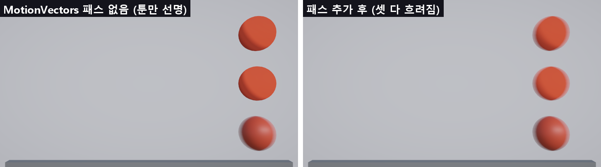

# Day 18. 패스 총정리 — 한 캐릭터를 찍는 촬영 팀들

## 작업 식별

| 항목 | 내용 |
|---|---|
| Task ID | GMD-TSS-019-DO |
| 유형 | D&O (개념) + 코드 읽기 + 실습 |
| 목적 | 캐릭터 셰이더의 6개 패스가 각각 무엇을 출력하고 누가 그 결과를 쓰는지 설명한다 |
| 소요 시간 | 약 1시간 (읽기 25분, 코드 읽기 25분, 실습 10분) |
| 선수 지식 | Day 05(클리핑), Day 08(그림자), Day 12–14(외곽선) |
| 확인 상태 | 미검증 (소스를 읽고 작성했으며 Unity에서 컴파일·실행하지 않았다) |
| 개정 | R1 (2026-11-18) |

## 학습 목표

- [ ] 6개 패스가 각각 무엇을 만드는지, 누가 그 결과를 쓰는지 안다
- [ ] 모든 패스가 같은 곳을 잘라야 하는 규칙과 그 이유를 안다
- [ ] 양면 렌더링에서 뒷면 노멀을 뒤집는 이유를 안다
- [ ] 모션 벡터가 무엇이고 TAA·모션 블러에 왜 필요한지 안다
- [ ] 스텐실로 앞머리 너머로 눈썹을 보이게 하는 원리를 안다

## 1. 정의

패스(Pass)는 한 셰이더 안에서 같은 물체를 한 번 그리는 단위다. 패스마다 `LightMode` 태그가 있고, 렌더 파이프라인이 필요한 시점에 해당 태그의 패스만 골라 실행한다. 한 캐릭터는 용도가 다른 여러 패스로 그려진다.

비유: 캐릭터 하나를 촬영 팀 여섯이 각자 다른 결과물로 찍는다. 모든 팀은 같은 대본(같은 모양, 같은 구멍)을 따라야 한다.

## 2. 구성 요소

| 패스 (Name) | LightMode 태그 | 출력 | 결과를 쓰는 곳 |
|---|---|---|---|
| ForwardToon | `UniversalForwardOnly` | 색 | 화면 |
| Outline | `SRPDefaultUnlit` | 외곽선 | 화면 (Day 12–13) |
| ShadowCaster | `ShadowCaster` | 빛에서 본 거리(깊이) | 그림자 판정 (Day 08) |
| DepthOnly | `DepthOnly` | 카메라에서 본 깊이 | 깊이 림(Day 11), 화면 외곽선(Day 14), Depth Priming |
| DepthNormals | `DepthNormals` | 깊이 + 노멀 | SSAO(Day 10), 화면 외곽선의 노멀 엣지 |
| MotionVectors | `MotionVectors` | 픽셀별 이동량 | TAA, 모션 블러 |

DepthOnly 패스는 짧다([CharacterToon.shader L829–864](https://github.com/JJH0204/GitBook/blob/main/GameDev/toon-shader-study/source/CharacterToon/Shaders/CharacterToon.shader#L829-L864)). 위치를 클립 공간으로 옮기고, 오려 낼 곳을 오리고, 색은 `return 0`으로 반환한다. 깊이는 GPU가 기록한다.


NOTE: `LightMode` 태그 이름과 패스 구성은 URP 버전에 따라 다르다. 이 소스는 `UniversalForwardOnly`를 쓰며, URP 버전과 렌더링 경로(Forward/Forward+/Deferred) 조건은 확인이 필요하다.


## 3. 동작 원리

### 3.1 규칙 1: 모든 패스가 같은 곳을 자른다

Day 05의 `ClipToonSurface()`를 모든 패스가 호출한다. 한 패스만 자르면 패스끼리 결과가 어긋난다.


| 자르지 않은 패스 | 증상 |
|---|---|
| ShadowCaster | 잘려 나간 부분이 그림자를 드리운다 |
| Outline | 부푼 껍질이 그 자리를 검게 채운다 |
| DepthOnly, DepthNormals | SSAO, 깊이 림, 화면 외곽선이 잘려 나간 모양(유령 모양)을 인식한다 |


CAUTION: 이 프로젝트에서 실제로 있었던 일(A4)이다. 스텐실 마스크로 잘라 낸 부분을 색 패스만 잘랐다. 자르는 규칙을 함수 하나로 모으고 모든 패스가 호출하게 해서 고쳤다.


`Cull [_Cull]`도 모든 패스에 같은 값으로 둔다. 색 패스가 양면이고 그림자 패스가 앞면만 그리면 뒷면이 그림자를 드리우지 않는다.

### 3.2 규칙 2: 뒷면은 노멀을 뒤집는다

`Cull Off`(양면)이면 뒷면도 그린다. 메시의 노멀은 앞면 기준이라 뒷면에서는 반대 방향을 가리키고, 빛 계산이 거꾸로 된다.

| 상태 | 노멀 방향 | 처리 |
|---|---|---|
| 앞면 | 그대로 | `× 1` |
| 뒷면 | 반대 | `× -1` |


DepthNormals 패스도 같은 방식으로 뒤집어 기록한다([L913](https://github.com/JJH0204/GitBook/blob/main/GameDev/toon-shader-study/source/CharacterToon/Shaders/CharacterToon.shader#L913)). 뒤집지 않으면 SSAO가 잘못된 노멀을 읽는다.


NOTE: 이 프로젝트에서 실제로 있었던 일(A6, B3)이다. Unlit 셰이더는 `Cull Back` 고정에 노멀 뒤집기도 없어서 Lit에서 Unlit으로 바꾸면 양면 설정이 사라졌다(A6). 배경 셰이더는 DepthNormals 패스만 뒤집기를 빠뜨려서 나뭇잎 뒷면이 SSAO에 틀린 노멀을 남겼다(B3).


### 3.3 MotionVectors

모션 벡터는 픽셀마다 지난 프레임의 화면 위치와 현재 위치의 차이를 적은 텍스처다.

| 사용처 | 방식 |
|---|---|
| 모션 블러 | 빠르게 움직이는 물체를 이동 방향으로 번지게 한다 |
| TAA (Temporal Anti-Aliasing) | 카메라를 프레임마다 아주 조금 흔들어(지터) 여러 프레임을 겹쳐 계단 현상을 줄인다. 겹칠 때 모션 벡터로 지난 프레임의 같은 픽셀을 찾는다. 값이 틀리면 잔상이 남는다 |

이동량 = 현재 위치(NDC) − 지난 프레임 위치(NDC). 지난 프레임 위치는 `_PrevViewProjMatrix × UNITY_PREV_MATRIX_M × 지난 프레임 정점 위치`로 구한다. 캐릭터는 스키닝으로 정점이 움직이므로 엔진이 지난 프레임 정점 위치를 `TEXCOORD4`(`positionOld`)로 넘긴다. 이 패스는 `ColorMask RG`라서 x, y 두 채널에만 쓴다.

### 3.4 스텐실

스텐실 버퍼는 화면 크기의 정수 버퍼(픽셀당 0~255)다. 눈썹이 앞머리 위로 보이게 하는 순서는 다음과 같다.

| 단계 | 머티리얼 | 설정 | 결과 |
|---|---|---|---|
| 1 | 눈썹·눈 | `Pass Replace`, `Ref 1` | 그린 픽셀의 스텐실 값이 1이 된다 |
| 2 | 앞머리 | `Comp NotEqual`, `Ref 1` | 값이 1이 아닌 곳에만 그린다. 눈썹 자리에는 머리카락이 그려지지 않는다 |
| 대안 | 읽기 머티리얼 | `ZTest Always` | 깊이를 무시하고 머리카락 위에 덧그린다 |

| 설정 | 뜻 |
|---|---|
| `Ref` | 비교하거나 기록할 값 |
| `Comp` | 비교 방법(`Always`, `Equal`, `NotEqual` 등). 통과해야 그린다 |
| `Pass` | 비교를 통과했을 때 버퍼에 할 동작(`Keep`, `Replace` 등) |

`_USE_STENCIL_MASK`는 스텐실을 기록할 범위를 텍스처로 제한한다. 앞머리 전체가 아니라 눈썹 근처만 비치게 한다.

### 3.5 투명 모드

`_Surface`를 Transparent로 바꾸면 인스펙터 스크립트가 `_SrcBlend = SrcAlpha`, `_DstBlend = OneMinusSrcAlpha`, `_ZWrite = 0`, 렌더 큐 Transparent(3000)로 설정한다. 결과 색은 `새 색 × α + 원래 색 × (1 − α)`다.

## 4. 코드 읽기

### 4.1 앞면 판정과 노멀 뒤집기

[L285, L290](https://github.com/JJH0204/GitBook/blob/main/GameDev/toon-shader-study/source/CharacterToon/Shaders/CharacterToon.shader#L285-L290)

```hlsl
half4 frag(Varyings input, FRONT_FACE_TYPE faceSign : FRONT_FACE_SEMANTIC) : SV_TARGET
{
    input.normalWS *= IS_FRONT_VFACE(faceSign, 1.0, -1.0);   // 앞면이면 ×1, 뒷면이면 ×(-1)
```

### 4.2 UsePass

Unlit 셰이더는 색 패스만 갖고 나머지는 Lit 셰이더의 패스를 가져다 쓴다. [CharacterToon_Unlit.shader L289–293](https://github.com/JJH0204/GitBook/blob/main/GameDev/toon-shader-study/source/CharacterToon/Shaders/CharacterToon_Unlit.shader#L289-L293)

```shaderlab
UsePass "com.blueigloo/CharacterToon/Character/OUTLINE"
UsePass "com.blueigloo/CharacterToon/Character/SHADOWCASTER"
UsePass "com.blueigloo/CharacterToon/Character/DEPTHONLY"
UsePass "com.blueigloo/CharacterToon/Character/DEPTHNORMALS"
UsePass "com.blueigloo/CharacterToon/Character/MOTIONVECTORS"
```

패스를 복사해 두면 Lit 쪽만 고치고 복사본을 고치지 않아 버그가 남는다. `UsePass`는 한 곳만 고치면 된다. 패스 이름은 대문자로 적는다.

### 4.3 MotionVectors 패스

[ToonMotionVectors.hlsl](https://github.com/JJH0204/GitBook/blob/main/GameDev/toon-shader-study/source/CharacterToon/ShaderLibrary/ToonMotionVectors.hlsl) (44줄)

```hlsl
ToonMotionVaryings ToonMotionVert(ToonMotionAttributes input)
{
    ToonMotionVaryings o = (ToonMotionVaryings)0;
    o.positionCS = TransformObjectToHClip(input.positionOS.xyz);                       // 지금 (흔들림 포함)
    o.positionCSNoJitter = mul(_NonJitteredViewProjMatrix, mul(UNITY_MATRIX_M, input.positionOS));   // 지금 (흔들림 없이)
    float4 prevPos = (unity_MotionVectorsParams.x == 1) ? float4(input.positionOld, 1) : input.positionOS;
    o.previousPositionCSNoJitter = mul(_PrevViewProjMatrix, mul(UNITY_PREV_MATRIX_M, prevPos));      // 지난 프레임
    ...
}

float4 ToonMotionFrag(ToonMotionVaryings input) : SV_Target
{
    ClipToonSurface(input.uv);   // 여기서도 같은 곳을 자른다
    return float4(CalcNdcMotionVectorFromCsPositions(input.positionCSNoJitter, input.previousPositionCSNoJitter), 0, 0);
}
```

| 줄 | 설명 |
|---|---|
| `positionCS` | 지터가 포함된 현재 클립 위치. 래스터화에 쓴다 |
| `positionCSNoJitter` | 지터 없는 현재 클립 위치. 모션 계산에 쓴다 |
| `prevPos` | `unity_MotionVectorsParams.x == 1`이면 엔진이 준 이전 프레임 정점, 아니면 현재 정점 |
| `previousPositionCSNoJitter` | 이전 프레임의 VP × M × 정점 |
| `ToonMotionFrag` | 두 위치의 NDC 차이를 RG에 기록 |


CAUTION: 이 프로젝트에서 실제로 있었던 일(C1)이다. 이 패스가 없어서 모션 블러를 켜면 툰 캐릭터만 선명했다. URP 파일을 `include_with_pragmas`로 가져오자 그 안의 선언 때문에 GPU Resident Drawer(Day 20)가 캐릭터를 가져가 마젠타(에러 색)로 그렸다. 그래서 같은 식을 담은 파일을 직접 만들었다. 이유는 [파일 첫머리 주석 L4–8](https://github.com/JJH0204/GitBook/blob/main/GameDev/toon-shader-study/source/CharacterToon/ShaderLibrary/ToonMotionVectors.hlsl#L4-L8)에 있다.




### 4.4 스텐실 설정

[CharacterToon.shader L169–177](https://github.com/JJH0204/GitBook/blob/main/GameDev/toon-shader-study/source/CharacterToon/Shaders/CharacterToon.shader#L169-L177)과 패스 머리 [L205–206](https://github.com/JJH0204/GitBook/blob/main/GameDev/toon-shader-study/source/CharacterToon/Shaders/CharacterToon.shader#L205-L206)

```shaderlab
ZTest [_ZTestMode]
Stencil { Ref [_StencilRef] Comp [_StencilComp] Pass [_StencilPass] }
```

## 5. 주의


CAUTION: Depth Priming(Day 13)은 `ZTest Always`도 덮어쓴다. 켜져 있으면 앞머리 투과가 사라진다(C2).



NOTE: 모션 벡터·TAA·Depth Priming 지원 범위는 Unity와 URP 버전에 따라 다르다. 사용하는 버전의 문서를 확인한다.


## 6. 실습 (10분)

1. [CharacterToon.shader](https://github.com/JJH0204/GitBook/blob/main/GameDev/toon-shader-study/source/CharacterToon/Shaders/CharacterToon.shader)에서 6개 패스의 `ColorMask`, `ZWrite`, `Cull`을 찾아 표로 정리한다. → 결과: ShadowCaster `ColorMask 0`, DepthOnly `ColorMask R`, MotionVectors `ColorMask RG`가 확인된다.
2. 지난 프레임 NDC x = 0.2, 현재 0.3일 때 이동량을 구한다. → 결과: +0.1(NDC) = 화면 폭의 5%. 1920px 화면에서 약 96px이다.
3. 눈썹이 `Ref 2, Pass Replace`, 앞머리가 `Ref 2, Comp NotEqual`일 때 눈썹 자리에 앞머리가 그려지는지 판단한다. → 결과: 그려지지 않는다(값이 같아 NotEqual이 거짓이다).

## 7. 참조

- 오늘의 액기스: [ESSENCE.md — Day 18](essence.md#day-18)
- Unity: [Stencil](https://docs.unity3d.com/Manual/SL-Stencil.html), [Cull](https://docs.unity3d.com/Manual/SL-Cull.html), [ZTest](https://docs.unity3d.com/Manual/SL-ZTest.html), [UsePass](https://docs.unity3d.com/Manual/SL-UsePass.html), [Blend](https://docs.unity3d.com/Manual/SL-Blend.html)
- [URP — Motion vectors](https://docs.unity3d.com/Packages/com.unity.render-pipelines.universal@17.0/manual/features/motion-vectors.html)
- [LearnOpenGL — Stencil testing](https://learnopengl.com/Advanced-OpenGL/Stencil-testing), [Blending](https://learnopengl.com/Advanced-OpenGL/Blending) (영어)
- [Wikipedia — Stencil buffer](https://en.wikipedia.org/wiki/Stencil_buffer), [Temporal anti-aliasing](https://en.wikipedia.org/wiki/Temporal_anti-aliasing), [Motion blur](https://en.wikipedia.org/wiki/Motion_blur), [Alpha compositing](https://en.wikipedia.org/wiki/Alpha_compositing) (영어)

## 내 말로 채우기


AI 없이 답을 적는다. 다 쓰면 체크하고, 이 안내는 지워도 된다.


- [ ] 한 패스만 클리핑을 빠뜨리면 어떤 증상이 나오는지, 패스 두 개를 골라 내 말로 설명한다.
- [ ] 뒷면 노멀을 뒤집지 않으면 빛 계산이 왜 틀어지는지 적는다.
- [ ] 모션 벡터가 없을 때 TAA에서 어떤 문제가 생기는지 겪었거나 상상한 장면으로 적는다.

---

[← Day 17](day17-highlights.md) · [목차](README.md) · [다음: Day 19 →](day19-keywords-and-variants.md)
