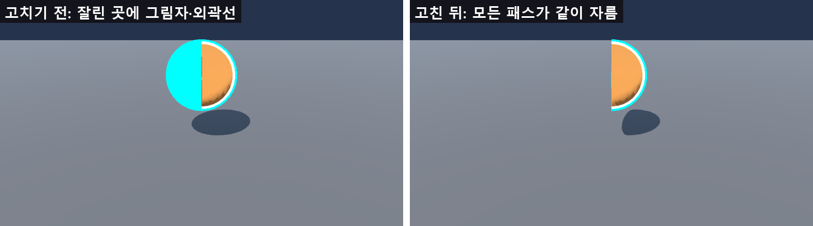
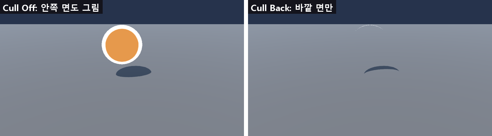

# Day 18. 패스 총정리 — 한 캐릭터를 찍는 촬영 팀들

> ⏱ **약 1시간** — 읽기 25분 · 코드 따라 읽기 25분 · 해보기 10분
> 🧸 **오늘의 비유**: 캐릭터 하나를 그리는 데 **촬영 팀이 여섯** 있어요. 모든 팀이 **같은 대본**(같은 모양, 같은 구멍)을 따라야 해요.

## 오늘 배울 것

- [ ] 6개 패스가 각각 무엇을 만드는지, 누가 그 결과를 쓰는지 안다
- [ ] "모든 패스가 같은 곳을 잘라야 한다"는 규칙과 그 이유를 안다
- [ ] 양면 렌더링에서 뒷면 노멀을 뒤집는 이유를 안다
- [ ] 모션 벡터가 무엇이고 TAA·모션 블러에 왜 필요한지 안다
- [ ] 스텐실로 "앞머리 너머로 눈썹 보이기"를 하는 원리를 안다

---

## 1. 촬영 팀 소개

| 팀 (패스) | 만드는 것 | 누가 쓰나 |
|---|---|---|
| 🎨 ForwardToon | **색** | 화면 |
| ✏️ Outline | 외곽선 | 화면 (Day 12–13) |
| 🌑 ShadowCaster | 빛에서 본 **거리 사진** | 그림자 판정 (Day 08) |
| 📏 DepthOnly | 카메라에서 본 **깊이 지도** | 깊이 림(Day 11), 화면 외곽선(Day 14), Depth Priming |
| 🧭 DepthNormals | 깊이 + **노멀 지도** | SSAO(Day 10), 화면 외곽선의 노멀 엣지 |
| 🏃 MotionVectors | 픽셀마다 **움직인 거리** | TAA, 모션 블러 |

DepthOnly는 아주 짧아요. [CharacterToon.shader L829–864](https://github.com/JJH0204/GitBook/blob/main/GameDev/toon-shader-study/source/CharacterToon/Shaders/CharacterToon.shader#L829-L864) — 위치를 클립 공간으로 옮기고, 오려 낼 곳을 오리고, 색은 `return 0`. 깊이는 GPU가 알아서 적어요.

## 2. 규칙 ①: 모든 팀이 같은 곳을 자른다

Day 05에서 본 `ClipToonSurface()`를 모든 패스가 불러요. 왜 그래야 할까요?




**💡 실제로 있었던 일 (A4)**
스텐실 마스크로 잘라 낸 부분을 **색칠 팀만** 잘랐어요. 그러자 이런 일이 생겼어요.
- 그림자 팀은 몰라서 → 없는 부분이 **그림자를 드리움**
- 외곽선 팀은 몰라서 → 부푼 껍질이 그 자리를 **검게 채움** (왼쪽 사진)
- 깊이·노멀 팀은 몰라서 → SSAO, 깊이 림, 화면 외곽선이 **유령 모양**을 봄

자르는 규칙을 함수 하나로 모으고 모든 패스가 부르게 해서 고쳤어요.


같은 이유로 **`Cull [_Cull]`도 모든 패스에** 있어요. 색 팀은 양면으로 그리는데 그림자 팀은 앞면만 그리면, 뒷면이 그림자를 안 드리우겠죠.

## 3. 규칙 ②: 뒷면은 노멀을 뒤집는다

`Cull Off`(양면)이면 판때기의 **뒷면**도 그려요. 그런데 메시의 노멀은 **앞면 기준**이라 뒷면에서는 화살표가 **반대**를 가리켜요. 빛 계산이 거꾸로 되죠.



프래그먼트 셰이더는 "지금 칠하는 게 앞면인지 뒷면인지"를 받을 수 있어요. [L285, L290](https://github.com/JJH0204/GitBook/blob/main/GameDev/toon-shader-study/source/CharacterToon/Shaders/CharacterToon.shader#L285-L290)

```hlsl
half4 frag(Varyings input, FRONT_FACE_TYPE faceSign : FRONT_FACE_SEMANTIC) : SV_TARGET
{
    input.normalWS *= IS_FRONT_VFACE(faceSign, 1.0, -1.0);   // 앞면이면 ×1, 뒷면이면 ×(-1)
```

DepthNormals 패스도 똑같이 뒤집어서 기록해요([L913](https://github.com/JJH0204/GitBook/blob/main/GameDev/toon-shader-study/source/CharacterToon/Shaders/CharacterToon.shader#L913)). 안 그러면 SSAO가 잘못된 노멀을 봐요.


**💡 실제로 있었던 일 (A6, B3)**: Unlit 셰이더는 `Cull Back` 고정에 노멀 뒤집기도 없어서 Lit에서 Unlit으로 바꾸면 양면 설정이 사라졌어요(A6). 배경 셰이더는 DepthNormals 패스만 뒤집기를 빠뜨려서 나뭇잎 뒷면이 SSAO에 틀린 노멀을 남겼어요(B3).


## 4. 팀 빌려 쓰기: `UsePass`

Unlit 셰이더는 색칠 팀만 따로 있고, 나머지 팀은 Lit 셰이더의 팀을 **빌려 써요**. [CharacterToon_Unlit.shader L289–293](https://github.com/JJH0204/GitBook/blob/main/GameDev/toon-shader-study/source/CharacterToon/Shaders/CharacterToon_Unlit.shader#L289-L293)

```shaderlab
UsePass "com.blueigloo/CharacterToon/Character/OUTLINE"
UsePass "com.blueigloo/CharacterToon/Character/SHADOWCASTER"
UsePass "com.blueigloo/CharacterToon/Character/DEPTHONLY"
UsePass "com.blueigloo/CharacterToon/Character/DEPTHNORMALS"
UsePass "com.blueigloo/CharacterToon/Character/MOTIONVECTORS"
```

예전엔 이 팀들을 **복사**해서 갖고 있었는데, Lit 쪽만 고치고 복사본은 안 고쳐서 버그가 남았어요. 빌려 쓰면 한 곳만 고치면 돼요. (패스 이름은 대문자로 적어요.)

## 5. MotionVectors — 지난 프레임에서 얼마나 움직였나

**모션 벡터**는 픽셀마다 "지난 프레임에 화면 어디에 있었나"를 적은 지도예요.

- **모션 블러**: 빨리 움직이는 것을 움직인 방향으로 번지게 그려요.
- **TAA**(Temporal Anti-Aliasing): 카메라를 프레임마다 **아주 살짝 흔들어**(지터) 여러 프레임을 겹쳐서 계단 현상을 줄여요. 겹칠 때 "이 픽셀이 지난 프레임엔 어디였지?"를 모션 벡터로 찾아요. 틀리면 **잔상**이 남아요.

[ToonMotionVectors.hlsl](https://github.com/JJH0204/GitBook/blob/main/GameDev/toon-shader-study/source/CharacterToon/ShaderLibrary/ToonMotionVectors.hlsl) — 44줄 전부 읽어 볼 만해요.

```hlsl
ToonMotionVaryings ToonMotionVert(ToonMotionAttributes input)
{
    ToonMotionVaryings o = (ToonMotionVaryings)0;
    o.positionCS = TransformObjectToHClip(input.positionOS.xyz);                       // 지금 (흔들림 포함)
    o.positionCSNoJitter = mul(_NonJitteredViewProjMatrix, mul(UNITY_MATRIX_M, input.positionOS));   // 지금 (흔들림 없이)
    float4 prevPos = (unity_MotionVectorsParams.x == 1) ? float4(input.positionOld, 1) : input.positionOS;
    o.previousPositionCSNoJitter = mul(_PrevViewProjMatrix, mul(UNITY_PREV_MATRIX_M, prevPos));      // 지난 프레임
    ...
}

float4 ToonMotionFrag(ToonMotionVaryings input) : SV_Target
{
    ClipToonSurface(input.uv);   // 여기서도 같은 곳을 자른다!
    return float4(CalcNdcMotionVectorFromCsPositions(input.positionCSNoJitter, input.previousPositionCSNoJitter), 0, 0);
}
```

- **지난 프레임 위치** = 지난 프레임의 카메라 기계(`_PrevViewProjMatrix`) × 지난 프레임의 물체 기계(`UNITY_PREV_MATRIX_M`) × 지난 프레임의 정점 위치
- 캐릭터는 **애니메이션으로 정점이 움직이니까**(스키닝) 엔진이 지난 프레임 정점 위치를 `TEXCOORD4`(`positionOld`)에 넣어 줘요.
- 지금 위치 − 지난 위치 = 움직인 양. `ColorMask RG`라서 빨강·초록 두 칸(x, y)에만 적어요.



**💡 실제로 있었던 일 (C1)**: 이 패스가 없어서 모션 블러를 켜면 **툰 캐릭터만 선명**했어요(왼쪽). URP의 파일을 그대로 `include_with_pragmas`로 가져왔더니, 그 안의 선언 때문에 GPU Resident Drawer(Day 20)가 캐릭터를 "내가 그릴게" 하고 가져가서 **마젠타(에러)** 로 그렸어요. 그래서 같은 식을 담은 파일을 직접 만들었어요. 파일 첫머리 [주석 L4–8](https://github.com/JJH0204/GitBook/blob/main/GameDev/toon-shader-study/source/CharacterToon/ShaderLibrary/ToonMotionVectors.hlsl#L4-L8)에 이유가 적혀 있어요.


## 6. 스텐실 — 도장 찍은 곳만 칠하기

**스텐실 버퍼**는 화면 크기의 **도장판**이에요. 픽셀마다 0~255 숫자를 찍어 둘 수 있어요.

애니메이션에서는 **눈썹이 앞머리 위로** 비쳐 보이게 그리곤 해요. 이걸 스텐실로 해요.

1. 눈썹·눈 머티리얼: 그리면서 도장판에 **"1"을 찍어요** (`Pass Replace`, `Ref 1`).
2. 앞머리 머티리얼: 도장이 **1이 아닌 곳에만** 그려요 (`Comp NotEqual`). → 눈썹 자리에는 머리카락이 안 그려져서 눈썹이 보여요.
3. 또는 "읽기 머티리얼"이 `ZTest Always`로 깊이를 무시하고 머리카락 위에 덧그려요.

[CharacterToon.shader L169–177](https://github.com/JJH0204/GitBook/blob/main/GameDev/toon-shader-study/source/CharacterToon/Shaders/CharacterToon.shader#L169-L177)과 패스 머리 [L205–206](https://github.com/JJH0204/GitBook/blob/main/GameDev/toon-shader-study/source/CharacterToon/Shaders/CharacterToon.shader#L205-L206)

```shaderlab
ZTest [_ZTestMode]
Stencil { Ref [_StencilRef] Comp [_StencilComp] Pass [_StencilPass] }
```

| 설정 | 뜻 |
|---|---|
| `Ref` | 비교하거나 찍을 숫자 |
| `Comp` | 비교 방법 (Always, Equal, NotEqual …) — 통과해야 칠함 |
| `Pass` | 통과하면 도장판을 어떻게 할지 (Keep, Replace …) |

`_USE_STENCIL_MASK`는 "도장을 찍을 **범위**"를 텍스처로 제한해요. 앞머리 전체가 아니라 눈썹 근처만 비치게요.


Day 13의 Depth Priming은 `ZTest Always`도 덮어써요. 그러면 앞머리 투과도 사라져요(C2).


## 7. 투명 모드

[L9–12](https://github.com/JJH0204/GitBook/blob/main/GameDev/toon-shader-study/source/CharacterToon/Shaders/CharacterToon.shader#L9-L12)의 `_Surface`를 Transparent로 바꾸면 인스펙터 스크립트가 `_SrcBlend = SrcAlpha`, `_DstBlend = OneMinusSrcAlpha`, `_ZWrite = 0`, 그리고 그리는 순서를 Transparent(3000)로 바꿔요. "새 색 × 투명도 + 원래 색 × (1 − 투명도)"로 **섞어서** 칠하는 거예요.

## 8. 해보기 (10분)

1. **표 채우기** — 6개 패스 각각의 `ColorMask`, `ZWrite`, `Cull`을 [CharacterToon.shader](https://github.com/JJH0204/GitBook/blob/main/GameDev/toon-shader-study/source/CharacterToon/Shaders/CharacterToon.shader)에서 찾아 표로 정리하세요. (ShadowCaster `ColorMask 0`, DepthOnly `ColorMask R`, MotionVectors `ColorMask RG` …)
2. **모션 벡터 손계산** — 지난 프레임 NDC x = 0.2, 지금 0.3이면 움직임은 +0.1(NDC) = 화면 폭의 5%. 1920px 화면이면 약 96px 움직였어요.
3. **스텐실 퀴즈** — 눈썹이 `Ref 2, Pass Replace`로 찍고, 앞머리가 `Ref 2, Comp NotEqual`이면 눈썹 자리에 앞머리가 그려질까요? (아니요)

## 9. 오늘의 액기스

👉 [ESSENCE.md — Day 18](essence.md#day-18)

## 더 읽을거리

- Unity: [Stencil](https://docs.unity3d.com/Manual/SL-Stencil.html) · [Cull](https://docs.unity3d.com/Manual/SL-Cull.html) · [ZTest](https://docs.unity3d.com/Manual/SL-ZTest.html) · [UsePass](https://docs.unity3d.com/Manual/SL-UsePass.html) · [Blend](https://docs.unity3d.com/Manual/SL-Blend.html)
- [URP — Motion vectors](https://docs.unity3d.com/Packages/com.unity.render-pipelines.universal@17.0/manual/features/motion-vectors.html)
- [LearnOpenGL — Stencil testing](https://learnopengl.com/Advanced-OpenGL/Stencil-testing) · [Blending](https://learnopengl.com/Advanced-OpenGL/Blending) (영어)
- [Wikipedia — Stencil buffer](https://en.wikipedia.org/wiki/Stencil_buffer) · [Temporal anti-aliasing](https://en.wikipedia.org/wiki/Temporal_anti-aliasing) · [Motion blur](https://en.wikipedia.org/wiki/Motion_blur) · [Alpha compositing](https://en.wikipedia.org/wiki/Alpha_compositing) (영어)

---

[← Day 17](day17-highlights.md) · [목차](README.md) · [다음: Day 19 →](day19-keywords-and-variants.md)
