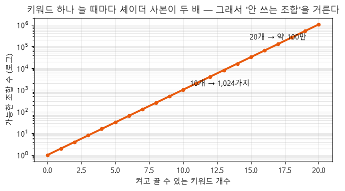
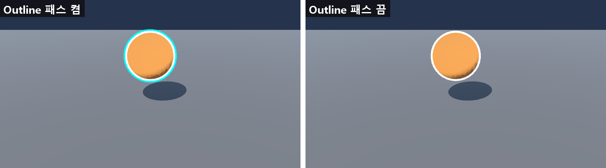

# Day 19. 키워드와 배리언트 — 옵션마다 따로 굽는 빵집

> ⏱ **약 1시간** — 읽기 25분 · 코드 따라 읽기 25분 · 해보기 10분
> 🧸 **오늘의 비유**: 셰이더는 **옵션별 완성품을 미리 구워 두는 빵집**이에요. 옵션(키워드)이 하나 늘 때마다 빵 종류가 **두 배**가 돼요.

## 오늘 배울 것

- [ ] 키워드와 배리언트(셰이더 사본)의 관계를 안다
- [ ] `shader_feature`와 `multi_compile`의 차이를 안다
- [ ] `_local`, `_fragment` 꼬리말의 뜻을 안다
- [ ] 키워드 대신 "머티리얼 값 분기"를 쓰는 경우를 안다
- [ ] 스트리퍼가 무엇을 하고, 왜 정리기(Sanitizer)가 먼저 돌아야 하는지 안다

---

## 1. `#if`로 갈린 코드 = 다른 셰이더

Day 04에서 `#if defined(_USE_RIM)`은 "키워드가 꺼져 있으면 이 코드는 **아예 없는 것**"이라고 했어요. 그러니까 림을 켠 셰이더와 끈 셰이더는 **다른 프로그램**이에요. 이 각각을 **배리언트**(variant, 변형)라고 해요.

- 장점: 꺼진 기능은 **비용 0**. `if`로 건너뛰는 것보다 빨라요.
- 단점: 키워드 하나에 사본 2배. 10개면 1,024개, 20개면 약 100만 개.



빵 종류가 너무 많으면 굽는 데(빌드 시간) 오래 걸리고 진열대(메모리, 앱 크기)가 모자라요. 그래서 **안 팔리는 빵은 굽지 않는** 장치들이 필요해요.

## 2. 두 종류의 주문서

[CharacterToon.shader L215–249](https://github.com/JJH0204/GitBook/blob/main/GameDev/toon-shader-study/source/CharacterToon/Shaders/CharacterToon.shader#L215-L249)

```hlsl
#pragma multi_compile _ _MAIN_LIGHT_SHADOWS _MAIN_LIGHT_SHADOWS_CASCADE _MAIN_LIGHT_SHADOWS_SCREEN
#pragma multi_compile_fragment _ _SHADOWS_SOFT
#pragma multi_compile _ _ADDITIONAL_LIGHTS
...
#pragma shader_feature_local _ _USE_RIM
#pragma shader_feature_local_fragment _ _ALPHATEST_ON
```

| 종류 | 비유 | 누가 켜나 | 빌드에 포함 |
|---|---|---|---|
| `multi_compile` | **매일 굽는 기본 빵** | 엔진이 실행 중에 (그림자 켬/끔, 추가광 유무…) | **전부** |
| `shader_feature` | **주문 들어온 것만 굽는 빵** | 머티리얼 체크박스 | 머티리얼이 **실제로 쓰는 조합만** |

엔진 설정(그림자 품질 등)은 게임 중에 바뀔 수 있으니 다 구워 둬야 해요(`multi_compile`). 머티리얼 옵션은 빌드할 때 이미 정해져 있으니 쓰는 것만 구워요(`shader_feature`).

`_ _USE_RIM`의 맨 앞 `_`는 **"아무 키워드도 없음"** 이라는 선택지예요. 그래서 "끔 / 켬" 두 가지가 돼요. `_ _A _B _C`처럼 여러 개를 쓰면 **그중 하나만** 켜지는 묶음이에요(파트 선택 `_PART_FACE/HAIR/SKIN`이 그래요).

### 꼬리말

| 꼬리말 | 뜻 |
|---|---|
| `_local` | 이 셰이더 전용 키워드. 프로젝트 전체 키워드 한도(수백 개)를 아껴요 |
| `_fragment` | **프래그먼트에서만** 코드가 갈림. 버텍스 셰이더는 사본을 안 만들어서 절반을 아껴요 |
| `_vertex` | 반대로 버텍스에서만 (`_CASTING_PUNCTUAL_LIGHT_SHADOW`, L765) |

`_ALPHATEST_ON`이 `_fragment`인 이유: 알파 클립은 프래그먼트의 `clip()`에만 쓰이니까요.

## 3. 체크박스와 키워드 연결

[Properties](https://github.com/JJH0204/GitBook/blob/main/GameDev/toon-shader-study/source/CharacterToon/Shaders/CharacterToon.shader#L5-L184)의 꾸밈말이 키워드를 켜고 꺼요.

```shaderlab
[Toggle(_USE_RIM)] _UseRim ("Use Rim Light", Float) = 1                    // 체크 → _USE_RIM 켬
[KeywordEnum(None, Face, Hair, Skin, Cloth)] _Part ("Part Type", Float) = 0  // 선택 → _PART_FACE 등
[ToggleUI] _UseShadowMask ("Use Shadow Suppress Mask", Float) = 0          // 체크 → 숫자만 1 (키워드 없음)
```


**💡 실제로 있었던 일 (B5, C8)**
- `KeywordEnum`은 `_PART_NONE`, `_PART_CLOTH`도 만들지만, 코드에서 갈리는 건 Face/Hair/Skin뿐이었어요. 그래서 None과 Cloth가 **똑같은 셰이더를 두 번** 굽고 있었어요. `#pragma`에서 둘을 빼서 기본(`_`) 빵을 쓰게 했어요(L225–227 주석).
- 숫자로만 쓰는 토글에 `[Toggle]`을 붙였더니 셰이더에 없는 `_USEMATCAPMASK_ON` 같은 키워드가 머티리얼에 **쓸데없이** 붙었어요. `[ToggleUI]`로 바꿨어요.


## 4. 키워드 대신 숫자로 갈라도 될 때

모든 옵션을 키워드로 만들면 빵이 너무 많아요. 그래서 **가벼운 옵션은 숫자 하나로** `if`를 해요. [L415–420](https://github.com/JJH0204/GitBook/blob/main/GameDev/toon-shader-study/source/CharacterToon/Shaders/CharacterToon.shader#L415-L420)

```hlsl
if (_UseShadowMask > 0.5h)      // 머티리얼 값 — 한 물체의 모든 픽셀이 같은 답
{
    half shadowMaskTex = SAMPLE_TEXTURE2D(_ShadowMaskTex, sampler_ShadowMaskTex, input.uv).r;
    ...
}
```

GPU는 수천 명이 **같은 줄을 동시에** 읽어요. 한 물체를 그리는 동안 `_UseShadowMask`는 모두에게 같은 값이라 **다 같이 건너뛰거나 다 같이 들어가요.** 이런 `if`는 거의 공짜예요. 사본도 안 늘어요. (반대로 픽셀마다 답이 다른 `if`는 양쪽을 다 실행하게 될 수 있어서 비싸요.)

## 5. 안 팔리는 빵 버리기: 스트리퍼

빌드할 때 Unity는 굽기 전에 **"이 빵 진짜 구울까?"** 하고 물어봐요. 그 질문에 답하는 게 **스트리퍼**예요. [CharacterToonShaderStripper.cs L31–58](https://github.com/JJH0204/GitBook/blob/main/GameDev/toon-shader-study/source/CharacterToon/Editor/CharacterToonShaderStripper.cs#L31-L58)

```csharp
public void OnProcessShader(Shader shader, ShaderSnippetData snippet, IList<ShaderCompilerData> data)
{
    if (shader == null || shader.name != TargetShaderName) return;
    ...
    for (int i = data.Count - 1; i >= 0; i--)
    {
        var ks = data[i].shaderKeywordSet;
        bool strip = ks.IsEnabled(kDebug);                                                   // 디버그용은 빌드에서 빼고
        if (!strip && ks.IsEnabled(kHairShadow) && !ks.IsEnabled(kPartFace)) strip = true;   // 말이 안 되는 조합도 빼고
        if (!strip && ks.IsEnabled(kAngelRing)  && !ks.IsEnabled(kPartHair)) strip = true;
        if (!strip && ks.IsEnabled(kSSS)        && !ks.IsEnabled(kPartSkin)) strip = true;
        if (strip) data.RemoveAt(i);
    }
}
```

"얼굴이 아닌데 앞머리 그림자 켬" 같은 조합은 코드상 아무 효과가 없어요(`#if defined(_PART_FACE)` 안에 있으니까). 그러니 안 구워도 돼요.


**💡 실제로 있었던 일 (A1 → Sanitizer)**
1. 셰이더 이름을 `com.blueigloo/...`로 바꿨는데 스트리퍼는 **옛 이름**을 찾고 있었어요. 그래서 아무것도 안 버리고 있었어요(A1). 이름을 고치고, 점검 도구 [CompileCheck.cs](https://github.com/JJH0204/GitBook/blob/main/GameDev/toon-shader-study/source/CharacterToon/Editor/CompileCheck.cs)에 "C#이 찾는 셰이더 이름이 실제로 있나" 검사를 추가했어요.
2. 그런데 스트리퍼가 **살아나자** 새 문제가 생겼어요. `_UseAngelRing`의 기본값이 1이라 헤어가 아닌 머티리얼 대부분이 "헤어 아님 + 천사 고리 켬" 상태였어요. 스트리퍼가 그 조합을 버리면 그 머티리얼은 **구울 빵이 하나도 없어서** 빌드에서 깨져요.
3. 그래서 빌드 **전에** 머티리얼을 정리하는 [CharacterToonKeywordSanitizer.cs](https://github.com/JJH0204/GitBook/blob/main/GameDev/toon-shader-study/source/CharacterToon/Editor/CharacterToonKeywordSanitizer.cs)를 만들었어요. 파트와 안 맞는 키워드를 머티리얼에서 먼저 꺼요. 그다음 스트리퍼가 돌아요.


## 6. 패스 통째로 끄기

외곽선을 끈 머티리얼은 키워드가 꺼져도 Outline 패스가 **여전히 실행**돼요(Day 12의 "화면 밖 한 점" 트릭). 그래서 정리기가 **패스 자체를** 꺼요. [CharacterToonKeywordSanitizer.cs L59–62](https://github.com/JJH0204/GitBook/blob/main/GameDev/toon-shader-study/source/CharacterToon/Editor/CharacterToonKeywordSanitizer.cs#L59-L62)

```csharp
bool outlineOn = m.IsKeywordEnabled("_USE_OUTLINE");
...
m.SetShaderPassEnabled(OutlinePassTag, outlineOn);   // "SRPDefaultUnlit" 패스를 켜고 끔
```



화면은 같지만, 끈 쪽은 드로우콜과 (스키닝된) 정점 계산이 사라져요(B4).

## 7. 인스펙터 꾸미기: ShaderGUI

[CharacterToon.shader L943](https://github.com/JJH0204/GitBook/blob/main/GameDev/toon-shader-study/source/CharacterToon/Shaders/CharacterToon.shader#L943)의 `CustomEditor "CharacterToon.Editor.CharacterToonShaderGUI"`가 머티리얼 인스펙터를 C#으로 그려요. [CharacterToonShaderGUI.cs](https://github.com/JJH0204/GitBook/blob/main/GameDev/toon-shader-study/source/CharacterToon/Editor/CharacterToonShaderGUI.cs)

- 섹션 접기, 파트에 맞는 옵션만 보여 주기
- Surface 모드에 맞춰 Blend/ZWrite/큐 설정 (Day 18)
- `ValidateMaterial`에서 정리기 실행, Depth Priming 경고(Day 13)

## 8. 해보기 (10분)

1. **사본 세기** — `shader_feature_local _ _A`가 3줄, `multi_compile _ _B _C`가 1줄이면 이론상 최대 몇 가지? (`2 × 2 × 2 × 3 = 24`)
2. **꼬리말 고르기** — 새 옵션 `_USE_GLITTER`가 프래그먼트에서만 반짝이를 더하고, 머티리얼 체크박스로 켠다면? (`#pragma shader_feature_local_fragment _ _USE_GLITTER`)
3. **키워드 vs 숫자** — "마스크 텍스처를 쓸까 말까"처럼 텍스처 한 번 읽기만 아끼는 옵션은 무엇이 좋을까요? (숫자 분기 — 사본이 안 늘어요)
4. **(Unity가 있다면)** 머티리얼 인스펙터 우측 상단 ⋮ → Debug 모드로 바꾸면 **Valid Keywords**와 **Invalid Keywords**가 보여요. 체크박스를 켜고 끄며 키워드 목록이 바뀌는 걸 확인하세요.

## 9. 오늘의 액기스

👉 [ESSENCE.md — Day 19](essence.md#day-19)

## 더 읽을거리

- [Unity — 셰이더 배리언트와 키워드](https://docs.unity3d.com/Manual/SL-MultipleProgramVariants.html) · [배리언트 스트리핑](https://docs.unity3d.com/Manual/shader-variant-stripping.html) · [pragma 지시어](https://docs.unity3d.com/Manual/SL-PragmaDirectives.html)
- [Unity — Material.SetShaderPassEnabled](https://docs.unity3d.com/ScriptReference/Material.SetShaderPassEnabled.html) · [MaterialPropertyDrawer (Toggle, KeywordEnum…)](https://docs.unity3d.com/ScriptReference/MaterialPropertyDrawer.html)
- 수학: 2의 거듭제곱 — 스위치 n개로 만들 수 있는 조합은 2ⁿ개 (경우의 수)

---

[← Day 18](day18-passes.md) · [목차](README.md) · [다음: Day 20 →](day20-performance.md)
