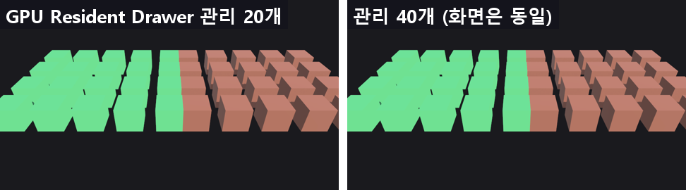

# Day 20. 성능 — 택배를 적게, 짐을 가볍게

## 작업 식별

| 항목 | 내용 |
|---|---|
| Task ID | GMD-TSS-021-DO |
| 유형 | D&O (개념) + 코드 읽기 + 실습 |
| 목적 | 드로우콜 비용을 줄이는 SRP Batcher, GPU 인스턴싱, GPU Resident Drawer와 셰이더 측 최적화 습관을 설명한다 |
| 소요 시간 | 약 1시간 (읽기 30분, 코드 읽기 15분, 실습 15분) |
| 선수 지식 | Day 04(CBUFFER), Day 15(MaterialPropertyBlock), Day 18–19 |
| 확인 상태 | 미검증 (소스를 읽고 작성했으며 Unity에서 컴파일·실행하지 않았다) |
| 개정 | R1 (2026-11-18) |

## 학습 목표

- [ ] 드로우콜과 상태 변경이 왜 비싼지 안다
- [ ] SRP Batcher가 CBUFFER 레이아웃이 같아야 동작하는 이유를 안다
- [ ] MaterialPropertyBlock을 쓰면 SRP Batcher에서 빠진다는 대가를 안다
- [ ] GPU 인스턴싱과 GPU Resident Drawer가 무엇인지 안다
- [ ] LOD 크로스페이드와 거리 품질 페이드를 안다

## 1. 정의

드로우콜은 CPU가 GPU에게 "이 메시를 이 셰이더·머티리얼로 그려라"고 요청하는 한 번의 호출이다. 호출마다 셰이더, 텍스처, 상수 값 같은 렌더 상태를 바꾸는 준비가 필요하며, 이 CPU 쪽 준비 비용이 GPU가 그리는 시간보다 클 때가 많다.

비유: 드로우콜은 택배 발송 건수다. 물건보다 포장과 송장 작성이 오래 걸린다.

목표는 두 가지다.

1. 상태 변경 비용을 줄인다. → SRP Batcher
2. 같은 메시를 한 번의 요청으로 그린다. → GPU 인스턴싱, GPU Resident Drawer

## 2. 구성 요소

| 기법 | 줄이는 것 | 조건 | 주 사용처 |
|---|---|---|---|
| SRP Batcher | 머티리얼 전환의 CPU 비용(드로우콜 수는 그대로) | SRP Batcher 호환 셰이더 | 캐릭터, 배경 전반 |
| GPU 인스턴싱 | 드로우콜 수 | 같은 메시 + 같은 머티리얼 | 나무, 풀, 돌 |
| GPU Resident Drawer (GRD) | CPU 컬링·배칭 부담 | DOTS 인스턴싱 배리언트 | 정적 배경 |
| LOD 크로스페이드 | 전환 시 튀는 현상 | 모든 패스에 같은 클리핑 | 배경 |
| 거리 품질 페이드 | 먼 캐릭터의 장식 계산 | 키워드 `_USE_QUALITY_FADE` | 캐릭터 |

## 3. 동작 원리

### 3.1 SRP Batcher

SRP Batcher는 머티리얼의 상수 값(`UnityPerMaterial` CBUFFER)을 GPU 버퍼에 상주시키고, 그릴 때 버퍼 위치만 지정한다. 같은 셰이더(배리언트)를 쓰는 물체는 머티리얼이 달라도 상태 변경 없이 이어서 그린다. 비유하면 재료표를 창고에 미리 두고 번호만 부르는 방식이다.

SRP Batcher 호환 조건은 다음과 같다.

| 조건 | 설명 |
|---|---|
| 모든 머티리얼 프로퍼티가 `CBUFFER_START(UnityPerMaterial)` 안에 있다 | 텍스처·샘플러는 제외. 값 프로퍼티(Float, Color, Vector 등)만 해당한다 |
| 모든 패스의 `UnityPerMaterial` 레이아웃이 같다 | 패스마다 선언이 다르면 호환되지 않는다 |
| `MaterialPropertyBlock`을 쓰지 않는다 | 쓰는 렌더러는 SRP Batcher 경로에서 빠진다 |

그래서 이 패키지는 CBUFFER를 한 파일에서만 정의한다.

[ToonInput.hlsl L4–5](https://github.com/JJH0204/GitBook/blob/main/GameDev/toon-shader-study/source/CharacterToon/ShaderLibrary/ToonInput.hlsl#L4-L5)

```hlsl
// 모든 패스가 이 파일 하나만 include 한다.
// UnityPerMaterial CBUFFER 레이아웃을 단일 정의로 강제 -> 전 패스 동일 레이아웃 (SRP Batcher 핵심)
```

[L33](https://github.com/JJH0204/GitBook/blob/main/GameDev/toon-shader-study/source/CharacterToon/ShaderLibrary/ToonInput.hlsl#L33)에는 "순서/타입 변경 금지"라고 적혀 있다. 한 패스에만 변수를 추가하면 그 패스의 레이아웃이 달라져 배처가 꺼진다.

- `_UseNormalMap`, `_UseRim` 같은 키워드용 숫자도 CBUFFER에 넣는다([L49](https://github.com/JJH0204/GitBook/blob/main/GameDev/toon-shader-study/source/CharacterToon/ShaderLibrary/ToonInput.hlsl#L49), "batcher 유지 위해 CBUFFER 포함").
- 매 프레임 바뀌는 캐릭터 조명은 CBUFFER 밖의 글로벌 변수로 둔다(Day 09). 글로벌 값은 머티리얼 프로퍼티가 아니므로 SRP Batcher 호환을 깨지 않는다.

### 3.2 MaterialPropertyBlock의 대가

Day 15에서 얼굴 방향을 렌더러마다 다르게 넣으려고 `MaterialPropertyBlock`(MPB)을 썼다. MPB는 머티리얼 값을 렌더러별로 덮어쓰는 방식이라 그 렌더러는 SRP Batcher 경로에서 빠진다.

| 방법 | 렌더러마다 다른 값 | SRP Batcher |
|---|---|---|
| 머티리얼을 캐릭터마다 복사 | 가능 | 유지(머티리얼 관리가 번거롭다) |
| `MaterialPropertyBlock` | 가능 | 빠짐 |
| 글로벌 (`Shader.SetGlobal*`) | 불가(모두 같은 값) | 유지 |

얼굴 렌더러는 캐릭터당 몇 개뿐이라 MPB를 골랐다. 정답은 상황에 따라 다르며, 대가를 알고 고른다.

### 3.3 GPU 인스턴싱

같은 메시와 같은 머티리얼인 물체가 많으면 한 번의 요청으로 여러 개를 그린다. 물체마다 다른 것은 변환 행렬 등 인스턴스 데이터뿐이므로 그 목록만 따로 넘긴다.


NOTE: SRP Batcher 호환 셰이더를 쓰는 MeshRenderer는 URP에서 SRP Batcher 경로가 우선하며, GPU 인스턴싱은 SRP Batcher에서 빠지는 렌더러나 호환되지 않는 셰이더에서 의미가 크다. 두 기법의 적용 우선순위는 Unity·URP 버전에 따라 다르므로 Frame Debugger로 확인한다.


### 3.4 GPU Resident Drawer

GPU Resident Drawer(GRD)는 정적 오브젝트의 정보를 GPU 메모리에 상주시키고 GPU 쪽에서 컬링·배칭하게 하는 기능이다. CPU 부담이 줄어든다. 셰이더에 DOTS 인스턴싱 배리언트가 있어야 GRD 대상이 된다.


NOTE: GRD는 Unity 6(6000.x) 이후의 URP 기능이다. 사용 조건(렌더링 경로, SRP Batcher 활성화, BatchRendererGroup 배리언트 설정 등)은 사용하는 버전의 문서에서 확인한다.





CAUTION: 이 프로젝트에서 실제로 있었던 일(B1)이다. PC 설정에서 GRD를 켜 두었는데 배경 셰이더에 DOTS 배리언트가 없어 GRD가 배경 물체를 모두 건너뛰었다. URP Lit 큐브 20개와 SceneToon 큐브 20개를 놓고 플레이 모드에서 세었을 때 GRD 관리 수는 20(Lit만)이었고, 아래 4.1의 선언을 넣은 뒤 40이 됐다. 반대로 캐릭터 셰이더에는 DOTS를 넣지 않는다. 캐릭터는 스킨드 메시라 GRD 대상이 아니며, 실수로 DOTS 선언이 들어가자 GRD가 캐릭터를 가져가 에러 색으로 그렸다(C1).


### 3.5 LOD 크로스페이드

멀리 있는 물체는 정점 수가 적은 LOD 모델로 바꾼다. 갑자기 바뀌면 튀어 보이므로 크로스페이드는 전환 동안 두 모델을 디더링으로 섞는다. 한쪽은 일부 픽셀을 버리고 다른 쪽은 나머지를 버린다. 그림자와 깊이도 같은 패턴으로 버려야 전환 중 그림자만 튀지 않는다(Day 18의 "모든 패스가 같은 곳을 자른다").

### 3.6 거리 품질 페이드

먼 캐릭터의 MatCap, 천사 고리, 깊이 림 같은 비싼 장식은 눈에 거의 띄지 않는다. 거리에 따라 건너뛰거나 서서히 줄인다.

| 수식 | 의미 |
|---|---|
| `hqAmount = saturate(1 − (d − Start) / max(End − Start, 1e-3))` | d는 물체 원점과 카메라의 거리. Start 이하면 1, End 이상이면 0 |
| `if (hqAmount > 0)`으로 장식 계산 | 0이면 건너뛴다 |
| 장식 결과 × `hqAmount` | 경계 근처에서 서서히 사라진다 |

물체 원점으로 거리를 재는 이유는 Day 16에서 다뤘다. 한 물체의 모든 픽셀이 같은 답을 내야 `if`가 싸고 `if` 안의 미분과 밉맵이 안전하다.

## 4. 코드 읽기

### 4.1 인스턴싱과 DOTS 선언 (SceneToon)

[SceneToon.shader](https://github.com/JJH0204/GitBook/blob/main/GameDev/toon-shader-study/source/SceneToon/Shaders/SceneToon.shader)

```hlsl
#pragma multi_compile_instancing                               // L135: 인스턴싱 배리언트
struct Attributes { ... UNITY_VERTEX_INPUT_INSTANCE_ID };      // L151: 인스턴스 번호 칸
Varyings vert(Attributes input)
{
    UNITY_SETUP_INSTANCE_ID(input);          // L170: 번호로 내 인스턴스 데이터 찾기
    UNITY_TRANSFER_INSTANCE_ID(input, o);    // L171: 프래그먼트에도 번호 전달
```

이 매크로를 넣으면 `TransformObjectToWorld`가 해당 인스턴스의 행렬을 사용한다.

[SceneToon.shader L134–137](https://github.com/JJH0204/GitBook/blob/main/GameDev/toon-shader-study/source/SceneToon/Shaders/SceneToon.shader#L134-L137)

```hlsl
#pragma multi_compile _ LOD_FADE_CROSSFADE
#pragma multi_compile_instancing
#include_with_pragmas "Packages/com.unity.render-pipelines.universal/ShaderLibrary/DOTS.hlsl"   // DOTS 인스턴싱
#pragma instancing_options renderinglayer      // 라이트 레이어(Day 09)를 인스턴스마다
```

### 4.2 LOD 페이드

[SceneToonInput.hlsl L18–23](https://github.com/JJH0204/GitBook/blob/main/GameDev/toon-shader-study/source/SceneToon/ShaderLibrary/SceneToonInput.hlsl#L18-L23)

```hlsl
void SceneLODFade(float4 positionCS)
{
#if defined(LOD_FADE_CROSSFADE)
    LODFadeCrossFade(positionCS);     // 내부에서 clip() — 화면 위치에 따라 점점이 버림
#endif
}
```

모든 패스의 프래그먼트 첫머리에서 호출한다.

### 4.3 거리 품질 페이드

[CharacterToon.shader L321–329](https://github.com/JJH0204/GitBook/blob/main/GameDev/toon-shader-study/source/CharacterToon/Shaders/CharacterToon.shader#L321-L329)

```hlsl
half hqAmount = 1.0h;
#if defined(_USE_QUALITY_FADE)
    float3 objPosWS = float3(unity_ObjectToWorld._m03, unity_ObjectToWorld._m13, unity_ObjectToWorld._m23);   // 물체 원점
    float distToCam = distance(objPosWS, _WorldSpaceCameraPos);
    hqAmount = saturate(1.0h - (half)((distToCam - _QualityFadeStart) / max(_QualityFadeEnd - _QualityFadeStart, 1e-3)));
#endif
```

각 장식은 `if (hqAmount > 0.0h) { ... * hqAmount }` 형태로 감싼다.

## 5. 주의


CAUTION: SRP Batcher는 드로우콜 수를 줄이지 않는다. 줄이는 것은 드로우콜 사이의 CPU 설정 비용이다. 효과는 Frame Debugger의 "SRP Batch" 항목과 프로파일러로 확인한다.


셰이더 측 작은 습관은 다음과 같다.

| 습관 | 내용 |
|---|---|
| `half` 사용 | 모바일 GPU는 `half` 연산이 더 빠르다. 색·노멀·밝기는 `half`, 위치·깊이·UV는 `float`(Day 04) |
| 안 쓰는 텍스처 읽기 생략 | 숫자 분기로 건너뛴다(Day 19, C7) |
| 안 쓰는 패스 끄기 | `SetShaderPassEnabled`(Day 19, B4) |
| 안 쓰는 배리언트 안 굽기 | `shader_feature`, `_fragment`, 스트리퍼(Day 19) |

## 6. 실습 (15분)

1. (Unity 사용 시) Window > Analysis > Frame Debugger를 열고 Enable을 누른다. → 결과: 왼쪽 목록에 "SRP Batch" 항목이 보인다.
2. 항목을 클릭하고 오른쪽 패널의 "이전 배치와 이어지지 않은 이유"를 읽는다. → 결과: 얼굴 렌더러가 MPB 때문에 따로 그려지는지 확인된다. 종료하려면 Disable을 누른다.
3. Start 15, End 40에서 거리 30과 45의 `hqAmount`를 계산한다. → 결과: 30은 1 − 15/25 = 0.4, 45는 saturate(1 − 1.2) = 0(장식 전부 생략).
4. 색 패스의 CBUFFER에만 `half _Glitter;`를 추가하면 어떻게 되는지 판단한다. → 결과: 다른 패스와 레이아웃이 달라져 SRP Batcher가 꺼진다. 그래서 반드시 [ToonInput.hlsl](https://github.com/JJH0204/GitBook/blob/main/GameDev/toon-shader-study/source/CharacterToon/ShaderLibrary/ToonInput.hlsl)에 넣는다.

## 7. 참조

- 오늘의 액기스: [ESSENCE.md — Day 20](essence.md#day-20)
- Unity: [SRP Batcher](https://docs.unity3d.com/Manual/SRPBatcher.html), [GPU 인스턴싱](https://docs.unity3d.com/Manual/GPUInstancing.html), [Frame Debugger](https://docs.unity3d.com/Manual/FrameDebugger.html), [LOD Group](https://docs.unity3d.com/Manual/class-LODGroup.html), [MaterialPropertyBlock](https://docs.unity3d.com/ScriptReference/MaterialPropertyBlock.html)
- [URP — GPU Resident Drawer](https://docs.unity3d.com/Packages/com.unity.render-pipelines.universal@17.0/manual/gpu-resident-drawer.html)
- [LearnOpenGL — Instancing](https://learnopengl.com/Advanced-OpenGL/Instancing), [Wikipedia — Geometry instancing](https://en.wikipedia.org/wiki/Geometry_instancing) (영어)

## 내 말로 채우기


AI 없이 답을 적는다. 다 쓰면 체크하고, 이 안내는 지워도 된다.


- [ ] SRP Batcher가 CBUFFER 레이아웃에 민감한 이유를 내 말로 설명한다.
- [ ] 렌더러마다 다른 값이 필요할 때 머티리얼 복사, MPB, 글로벌 중 무엇을 고를지 내 상황으로 적는다.
- [ ] 성능 문제를 겪었다면 어느 기법으로 해결했는지(또는 하려는지) 적는다.

---

[← Day 19](day19-keywords-and-variants.md) · [목차](README.md) · [다음: Day 21 →](day21-background-shaders.md)
