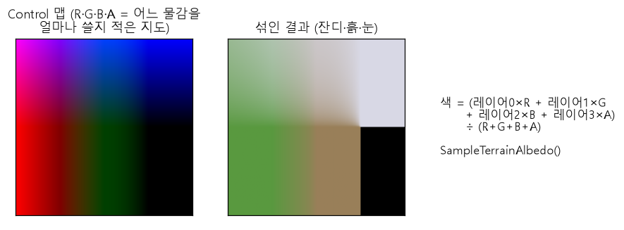
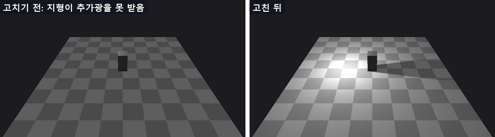
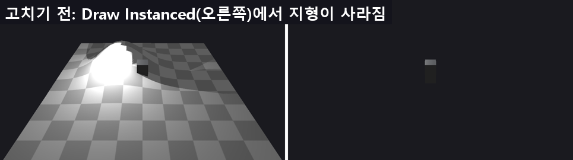

# Day 21. 배경 셰이더 — 건물, 나무, 지형, 하늘

> ⏱ **약 1시간** — 읽기 25분 · 코드 따라 읽기 25분 · 해보기 10분
> 🧸 **오늘의 비유**: 지형의 스플랫맵은 **물감 네 통을 어디에 얼마나 칠할지 적은 지도**예요.

## 오늘 배울 것

- [ ] 배경 셰이더가 캐릭터와 같은 톤을 유지하는 방법(공유 코어)을 안다
- [ ] 트라이플래너, 정점 색 블렌딩, 바람 흔들림을 설명할 수 있다
- [ ] 지형의 스플랫맵 블렌딩을 손으로 계산할 수 있다
- [ ] 지형 "Draw Instanced"와 Meta 패스, BaseMapShader의 역할을 안다

---

## 1. 배경은 무엇이 다를까

| | 캐릭터 | 배경 |
|---|---|---|
| 움직임 | 애니메이션으로 휨 | 대부분 **가만히** 있음 → 라이트맵(Day 10) |
| 개수 | 몇 명 | **수천 개** → 인스턴싱·GRD(Day 20) |
| 특별 기능 | 얼굴 SDF, 천사 고리, MatCap | 트라이플래너, 바람, 지형 |
| 공식 | 직접 씀 | `ToonShared` 함수를 부름 |

배경 셰이더는 [SceneToonInput.hlsl L8–11](https://github.com/JJH0204/GitBook/blob/main/GameDev/toon-shader-study/source/SceneToon/ShaderLibrary/SceneToonInput.hlsl#L8-L11)에서 공유 공구함 세 개를 가져와요.

```hlsl
#include "../../ToonShared/ShaderLibrary/ToonRamp.hlsl"         // 하프 램버트, 램프 (Day 06–07)
#include "../../ToonShared/ShaderLibrary/ToonBandShadow.hlsl"   // 1·2차 밴드, GI 계단 (Day 07, 10)
#include "../../ToonShared/ShaderLibrary/ToonRim.hlsl"          // 림 (Day 11)
```

[SceneToon.shader의 frag](https://github.com/JJH0204/GitBook/blob/main/GameDev/toon-shader-study/source/SceneToon/Shaders/SceneToon.shader#L188-L299)를 열어 보세요. 지금까지 배운 것들이 **함수 이름으로** 줄지어 있어요. 이제 이 코드가 읽혀요!

## 2. 트라이플래너 — 세 방향 프로젝터

바위나 절벽을 UV로 펼치면 경사면에서 텍스처가 **쭉 늘어나요**. 트라이플래너는 UV를 쓰지 않고 **위·옆·앞 세 방향에서 프로젝터로 그림을 쏘아서** 섞어요.

[SceneToonInput.hlsl L127–135](https://github.com/JJH0204/GitBook/blob/main/GameDev/toon-shader-study/source/SceneToon/ShaderLibrary/SceneToonInput.hlsl#L127-L135)

```hlsl
half3 SampleTriplanar(TEXTURE2D_PARAM(tex, smp), float3 positionWS, half3 N, half scale, half sharp)
{
    half3 bw = pow(abs(N), max(sharp, 1.0h));    // 노멀이 그 축을 향할수록 그 프로젝터를 많이
    bw /= (bw.x + bw.y + bw.z + 1e-4h);          // 합이 1이 되게
    half3 cx = SAMPLE_TEXTURE2D(tex, smp, positionWS.zy * scale).rgb;   // 옆(X)에서 쏜 그림
    half3 cy = SAMPLE_TEXTURE2D(tex, smp, positionWS.xz * scale).rgb;   // 위(Y)에서 쏜 그림
    half3 cz = SAMPLE_TEXTURE2D(tex, smp, positionWS.xy * scale).rgb;   // 앞(Z)에서 쏜 그림
    return cx * bw.x + cy * bw.y + cz * bw.z;
}
```

- **월드 위치 자체를 UV로** 써요. 바닥은 위에서 보면 `xz` 평면이니까 `positionWS.xz`.
- `pow(abs(N), sharp)` — 노멀이 위를 보면 `N.y`가 커서 위 프로젝터 그림이 많이 섞여요. sharp가 클수록 경계가 또렷해요(Day 17의 `pow`와 같은 원리).

## 3. 정점 색으로 이끼 칠하기

모델러가 정점마다 색을 칠해 두면, 그 색을 **"여기에 이끼를 얼마나"** 로 쓸 수 있어요. [SceneToon.shader L199–204](https://github.com/JJH0204/GitBook/blob/main/GameDev/toon-shader-study/source/SceneToon/Shaders/SceneToon.shader#L199-L204)

```hlsl
half3 layer = SAMPLE_TEXTURE2D(_LayerMap, sampler_LayerMap, input.uv).rgb * _LayerColor.rgb;   // 이끼 그림
half vblend = saturate(SelectVertexChannel(input.vertexColor, _LayerBlendChannel));        // 정점 색 R/G/B/A 중 하나
baseColor.rgb = lerp(baseColor.rgb, layer, vblend);                                        // 물감 섞기
```

## 4. 바람 — 밑동은 고정, 끝은 흔들흔들

[SceneToonInput.hlsl L111–123](https://github.com/JJH0204/GitBook/blob/main/GameDev/toon-shader-study/source/SceneToon/ShaderLibrary/SceneToonInput.hlsl#L111-L123)

```hlsl
float3 ApplyWindWS(float3 positionWS, float3 positionOS)
{
#if defined(_USE_WIND)
    float t = _Time.y * _WindSpeed;                                    // 시간 (초)
    float stiffness = max(positionOS.y, 0.0);                          // 땅에서 높을수록 많이 흔들림
    float phase = (positionWS.x + positionWS.z) * _WindParams.x + t;   // 위치마다 박자가 조금씩 다름
    float sway    = sin(phase) + _WindParams.y * sin(phase * 2.37 + 1.3);         // 큰 흔들림 + 잔물결
    float flutter = _WindParams.z * sin(t * 6.0 + (positionWS.x + positionWS.z) * 3.0);   // 잎 파르르
    float2 dir = normalize(float2(1.0, 0.3));
    positionWS.xz += dir * ((sway + flutter) * stiffness * _WindStrength * 0.1);
#endif
    return positionWS;
}
```

- `sin`은 **-1과 1 사이를 오가는 파도**예요. 시간을 넣으면 앞뒤로 흔들려요. 값이 -1~1로 묶여 있어서 아무리 오래 돌려도 폭주하지 않아요.
- 위치를 `phase`에 섞어서 **나무마다 박자가 달라요.** 모두 같은 박자면 군무처럼 보이거든요.
- 서로 다른 속도의 파도 두세 개를 더하면 자연스러운 불규칙함이 생겨요.
- 이 함수는 **모든 패스**의 버텍스 셰이더가 불러요. 그래야 그림자와 깊이도 같이 흔들려요(Day 18의 규칙).

**잎 투과**([L286–291](https://github.com/JJH0204/GitBook/blob/main/GameDev/toon-shader-study/source/SceneToon/Shaders/SceneToon.shader#L286-L291))는 해를 등지고 잎을 볼 때 빛이 비쳐 보이는 효과예요. `dot(-V, L)` — 내가 보는 방향 반대쪽에 해가 있을수록 커요.

## 5. 지형 — 물감 네 통 지도

Unity Terrain은 땅에 여러 레이어(잔디, 흙, 바위, 눈)를 칠해요. 어디에 무엇을 얼마나 칠했는지는 **Control 텍스처**(스플랫맵)에 R·G·B·A로 적혀 있어요(Day 05의 채널 패킹).



[SceneTerrainInput.hlsl L73–82](https://github.com/JJH0204/GitBook/blob/main/GameDev/toon-shader-study/source/SceneToon/ShaderLibrary/SceneTerrainInput.hlsl#L73-L82)

```hlsl
half3 SampleTerrainAlbedo(float2 uv)
{
    half4 ctrl = SAMPLE_TEXTURE2D(_Control, sampler_Control, uv * _Control_ST.xy + _Control_ST.zw);
    half3 a0 = SAMPLE_TEXTURE2D(_Splat0, sampler_Splat0, uv * _Splat0_ST.xy + _Splat0_ST.zw).rgb;   // 잔디
    half3 a1 = ...;   // 흙
    half3 a2 = ...;   // 바위
    half3 a3 = ...;   // 눈
    half wsum = max(ctrl.r + ctrl.g + ctrl.b + ctrl.a, 1e-4h);
    return (a0 * ctrl.r + a1 * ctrl.g + a2 * ctrl.b + a3 * ctrl.a) / wsum;   // 무게 평균
}
```

**무게 평균**이에요. R=0.7, G=0.3이면 "잔디 70% + 흙 30%". 합으로 나누는 건 합이 1이 아니어도 밝기가 변하지 않게 하려는 거예요.

지형도 같은 공유 코어로 셀 음영과 GI 계단, 그리고 추가 조명까지 받아요.


**💡 실제로 있었던 일 (B8)**: 지형 셰이더는 해만 계산해서, 지형 위에 놓은 포인트 라이트가 **지형에는 안 닿고 그 위 소품에만** 닿았어요. 배경 셰이더와 같은 추가광 함수, 라이트 레이어, SSAO를 넣어 고쳤어요.




## 6. 지형의 특별한 세 가지

### ① Draw Instanced — 높이 지도에서 땅 만들기

Terrain 설정의 **Draw Instanced**를 켜면, Unity는 지형을 작은 **조각(패치)** 들로 나눠 인스턴싱으로 그려요. 이때 정점의 진짜 높이는 메시가 아니라 **높이 지도(heightmap) 텍스처**에 있어요. 셰이더가 그걸 읽어서 땅 모양을 만들어야 해요.

[SceneTerrainInput.hlsl L59–70](https://github.com/JJH0204/GitBook/blob/main/GameDev/toon-shader-study/source/SceneToon/ShaderLibrary/SceneTerrainInput.hlsl#L59-L70)

```hlsl
void TerrainInstancing(inout float4 positionOS, inout float3 normalOS, inout float2 uv)
{
#ifdef UNITY_INSTANCING_ENABLED
    float4 instanceData = UNITY_ACCESS_INSTANCED_PROP(Terrain, _TerrainPatchInstanceData);   // 이 조각의 위치·크기
    float2 sampleCoords = (positionOS.xy + instanceData.xy) * instanceData.z;
    float height = UnpackHeightmap(_TerrainHeightmapTexture.Load(int3(sampleCoords, 0)));     // 높이 지도 읽기
    positionOS.xz = sampleCoords * _TerrainHeightmapScale.xz;
    positionOS.y = height * _TerrainHeightmapScale.y;                                          // ★ 높이 세우기
    normalOS = _TerrainNormalmapTexture.Load(int3(sampleCoords, 0)).rgb * 2 - 1;               // 노멀도 지도에서
    uv = sampleCoords * _TerrainHeightmapRecipSize.zw;
#endif
}
```

`inout`은 "받아서 고쳐서 돌려줌"이에요. `.Load()`는 샘플러 없이 **정확히 그 칸**의 값을 읽어요.


**💡 실제로 있었던 일 (B12)**: 이 함수가 없을 땐 Draw Instanced를 켜면 툰 지형이 **통째로 사라졌어요**(아래 첫 사진의 오른쪽). 모든 패스의 버텍스 셰이더에 넣어서 고쳤어요.





### ② Meta 패스 — 라이트맵 굽는 사람에게 색 알려 주기

라이트맵을 구울 때(Day 10) 베이커는 "이 표면은 무슨 색이라 빛을 얼마나 튕기나"를 알아야 해요. 그걸 알려 주는 게 **Meta 패스**예요. [SceneToon_Terrain.shader L265–301](https://github.com/JJH0204/GitBook/blob/main/GameDev/toon-shader-study/source/SceneToon/Shaders/SceneToon_Terrain.shader#L265-L301) — 스플랫 색을 계산해서 `UnityMetaFragment`에 넘겨요.

### ③ BaseMapShader — "나 여기 있어요"

[L307](https://github.com/JJH0204/GitBook/blob/main/GameDev/toon-shader-study/source/SceneToon/Shaders/SceneToon_Terrain.shader#L307)

```shaderlab
Dependency "BaseMapShader" = "com.blueigloo/SceneToon/Terrain"
```

지형은 멀리서 볼 때와 라이트맵을 구울 때 "BaseMapShader"라는 **대표 셰이더**를 찾아요. 이 줄이 없으면 베이커가 지형을 "머티리얼 없는 물체"로 보고 **라이트맵에서 빼 버렸어요**(B12). 자기 자신을 대표로 지정해서 고쳤어요.

그 밖에 `"Queue" = "Geometry-100"`([L37](https://github.com/JJH0204/GitBook/blob/main/GameDev/toon-shader-study/source/SceneToon/Shaders/SceneToon_Terrain.shader#L37))은 지형을 다른 물체보다 **조금 먼저** 그리라는 뜻이에요. 넓은 지형이 깊이를 먼저 채우면 뒤에 가려지는 픽셀 계산을 아낄 수 있어요.

## 7. 하늘

하늘 셰이더는 Day 03에서 통째로 읽었어요. 배경 셰이더 가족의 막내예요. [SceneToon_Sky.shader](https://github.com/JJH0204/GitBook/blob/main/GameDev/toon-shader-study/source/SceneToon/Shaders/SceneToon_Sky.shader)

## 8. 해보기 (10분)

1. **트라이플래너 무게** — N = (0.6, 0.8, 0), sharp = 4면 `bw = (0.6⁴, 0.8⁴, 0) = (0.13, 0.41, 0)` → 합으로 나누면 약 **(0.24, 0.76, 0)**. 위 프로젝터 76%, 옆 프로젝터 24%.
2. **스플랫 계산** — ctrl = (0.5, 0.5, 0, 0), 잔디 (0.3, 0.6, 0.2), 흙 (0.6, 0.5, 0.3)이면 섞인 색은? (0.45, 0.55, 0.25)
3. **바람 감각** — 밑동(`positionOS.y = 0`)은 얼마나 움직이나요? (0 — stiffness가 0) 높이 2m 가지 끝은? (stiffness 2 → 가장 많이)
4. **Desmos** — `y = \sin(x) + 0.5\sin(2.37x + 1.3)`을 그려 보세요. 단순한 sin보다 자연스러운 흔들림이 보여요.

## 9. 오늘의 액기스

👉 [ESSENCE.md — Day 21](essence.md#day-21)

## 더 읽을거리

- [Catlike Coding — Triplanar Mapping](https://catlikecoding.com/unity/tutorials/advanced-rendering/triplanar-mapping/) (영어)
- [Unity — Terrain 사용하기](https://docs.unity3d.com/Manual/terrain-UsingTerrains.html)
- 수학: [Wikipedia — Sine wave](https://en.wikipedia.org/wiki/Sine_wave) · [Heightmap](https://en.wikipedia.org/wiki/Heightmap) (영어) · [위키백과 — 삼각함수](https://ko.wikipedia.org/wiki/%EC%82%BC%EA%B0%81%ED%95%A8%EC%88%98)

---

[← Day 20](day20-performance.md) · [목차](README.md) · [다음: Day 22 →](day22-graduation.md)
