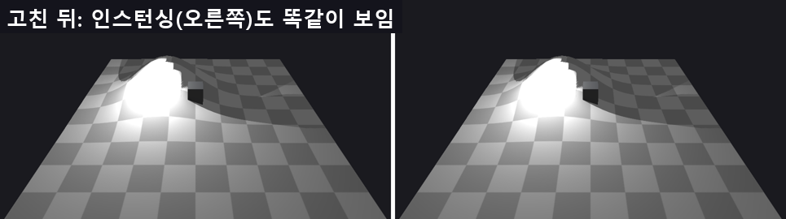

# Day 21. 배경 셰이더 — 건물, 나무, 지형, 하늘

## 작업 식별

| 항목 | 내용 |
|---|---|
| Task ID | GMD-TSS-022-DO |
| 유형 | D&O (개념) + 코드 읽기 + 실습 |
| 목적 | 배경 셰이더의 공유 코어, 트라이플래너, 정점 색 블렌딩, 바람 흔들림, 지형 스플랫맵 블렌딩을 설명한다 |
| 소요 시간 | 약 1시간 (읽기 25분, 코드 읽기 25분, 실습 10분) |
| 선수 지식 | Day 05(채널 패킹), Day 10(라이트맵), Day 18, Day 20 |
| 확인 상태 | 미검증 (소스를 읽고 작성했으며 Unity에서 컴파일·실행하지 않았다) |
| 개정 | R1 (2026-11-18) |

## 학습 목표

- [ ] 배경 셰이더가 캐릭터와 같은 톤을 유지하는 방법(공유 코어)을 안다
- [ ] 트라이플래너, 정점 색 블렌딩, 바람 흔들림을 설명할 수 있다
- [ ] 지형의 스플랫맵 블렌딩을 손으로 계산할 수 있다
- [ ] 지형 Draw Instanced, Meta 패스, BaseMapShader의 역할을 안다

## 1. 정의

배경 셰이더는 건물, 나무, 지형, 하늘처럼 캐릭터가 아닌 장면 요소를 그리는 셰이더 군이다. 캐릭터 셰이더와 음영 공식을 공유해 톤을 맞추고, 배경에 필요한 기능(트라이플래너, 바람, 지형 블렌딩)을 더한다.

비유: 지형의 스플랫맵은 물감 네 통을 어디에 얼마나 칠할지 적은 지도다.

## 2. 구성 요소

| | 캐릭터 | 배경 |
|---|---|---|
| 움직임 | 애니메이션으로 변형 | 대부분 정적. 라이트맵 사용(Day 10) |
| 개수 | 몇 명 | 수천 개. 인스턴싱·GRD 사용(Day 20) |
| 특별 기능 | 얼굴 SDF, 천사 고리, MatCap | 트라이플래너, 바람, 지형 |
| 음영 공식 | 직접 작성 | `ToonShared` 함수 호출 |

공유 코어는 [SceneToonInput.hlsl L8–11](https://github.com/JJH0204/GitBook/blob/main/GameDev/toon-shader-study/source/SceneToon/ShaderLibrary/SceneToonInput.hlsl#L8-L11)에서 include한다.

```hlsl
#include "../../ToonShared/ShaderLibrary/ToonRamp.hlsl"         // 하프 램버트, 램프 (Day 06–07)
#include "../../ToonShared/ShaderLibrary/ToonBandShadow.hlsl"   // 1·2차 밴드, GI 계단 (Day 07, 10)
#include "../../ToonShared/ShaderLibrary/ToonRim.hlsl"          // 림 (Day 11)
```

[SceneToon.shader의 frag](https://github.com/JJH0204/GitBook/blob/main/GameDev/toon-shader-study/source/SceneToon/Shaders/SceneToon.shader#L188-L299)는 지금까지 배운 단계가 함수 이름으로 나열된 구조다.

## 3. 동작 원리

### 3.1 트라이플래너 매핑

UV로 펼친 텍스처는 경사면에서 늘어난다. 트라이플래너(triplanar)는 UV 대신 월드 위치를 UV로 쓰고, X·Y·Z 세 축 방향 투영 결과를 노멀 방향 가중치로 섞는다.

| 항목 | 식 |
|---|---|
| 가중치 | `bw = pow(abs(N), sharp)` 후 `bw /= (bw.x + bw.y + bw.z)` |
| X축 투영 UV | `positionWS.zy * scale` |
| Y축 투영 UV | `positionWS.xz * scale` (바닥을 위에서 본 평면) |
| Z축 투영 UV | `positionWS.xy * scale` |
| 결과 | `cx*bw.x + cy*bw.y + cz*bw.z` |

`sharp`가 클수록 투영 사이의 경계가 또렷해진다(Day 17의 `pow`와 같은 원리).

### 3.2 정점 색 블렌딩

모델러가 정점마다 칠한 색의 한 채널(R/G/B/A 중 선택)을 "이 위치에 이끼를 얼마나 섞을지"의 가중치로 쓴다. `lerp(바탕색, 이끼색, 가중치)`로 섞는다.

### 3.3 바람

| 요소 | 식·동작 | 효과 |
|---|---|---|
| 시간 | `t = _Time.y * _WindSpeed` | 시간에 따라 진행 |
| 강성 | `stiffness = max(positionOS.y, 0)` | 오브젝트 원점(밑동)에서 높을수록 많이 움직인다. 높이 0은 고정 |
| 위상 | `phase = (positionWS.x + positionWS.z) * _WindParams.x + t` | 위치마다 박자가 달라 군무처럼 보이지 않는다 |
| 흔들림 | `sin(phase) + _WindParams.y * sin(phase * 2.37 + 1.3)` | 큰 흔들림 + 잔물결 |
| 파르르 | `_WindParams.z * sin(t * 6 + (x + z) * 3)` | 잎의 빠른 떨림 |
| 적용 | `positionWS.xz += dir * ((sway + flutter) * stiffness * _WindStrength * 0.1)` | 수평 이동 |

`sin`의 값은 -1과 1 사이로 제한되므로 오래 돌려도 값이 커지지 않는다. 속도가 다른 파형 두세 개를 더하면 불규칙해 보인다.

잎 투과는 해를 등지고 볼 때 빛이 비쳐 보이는 효과다([SceneToon.shader L286–291](https://github.com/JJH0204/GitBook/blob/main/GameDev/toon-shader-study/source/SceneToon/Shaders/SceneToon.shader#L286-L291)). `dot(-V, L)`이 클수록, 즉 시선 반대쪽에 해가 있을수록 강해진다.

### 3.4 지형 스플랫맵

Unity Terrain의 레이어(잔디, 흙, 바위, 눈)별 비중은 Control 텍스처(스플랫맵)의 R, G, B, A 채널에 저장된다(Day 05의 채널 패킹).

| 채널 | 레이어 | 예시 값 |
|---|---|---|
| R | `_Splat0` 잔디 | 0.7 |
| G | `_Splat1` 흙 | 0.3 |
| B | `_Splat2` 바위 | 0 |
| A | `_Splat3` 눈 | 0 |

색 = 가중 평균: `(a0*R + a1*G + a2*B + a3*A) / (R + G + B + A)`. R=0.7, G=0.3이면 잔디 70%, 흙 30%다. 합으로 나누므로 합이 1이 아니어도 밝기가 변하지 않는다.



NOTE: 이 프로젝트에서 실제로 있었던 일(B8)이다. 지형 셰이더는 메인 라이트만 계산해서 지형 위 포인트 라이트가 지형에는 닿지 않고 그 위 소품에만 닿았다. 배경 셰이더와 같은 추가광 함수, 라이트 레이어, SSAO를 넣어 고쳤다.



### 3.5 지형의 특수 기능

| 기능 | 역할 |
|---|---|
| Draw Instanced | 지형을 패치로 나눠 인스턴싱으로 그린다. 정점 높이를 메시가 아니라 높이 지도 텍스처에서 읽어야 한다 |
| Meta 패스 | 라이트맵 베이커에 표면 색(알베도)과 발광을 알린다. 스플랫 색을 계산해 `UnityMetaFragment`에 넘긴다 |
| `Dependency "BaseMapShader"` | 먼 거리 표시와 라이트맵 베이크에서 쓰는 대표 셰이더를 지정한다 |
| `"Queue" = "Geometry-100"` | 지형을 다른 불투명 물체보다 조금 먼저 그린다 |


NOTE: Terrain의 Draw Instanced, BaseMapShader 의존 선언, 베이크 동작은 Unity와 URP 버전에 따라 다르다. 사용하는 버전의 Terrain 셰이더와 비교한다.


## 4. 코드 읽기

### 4.1 트라이플래너

[SceneToonInput.hlsl L127–135](https://github.com/JJH0204/GitBook/blob/main/GameDev/toon-shader-study/source/SceneToon/ShaderLibrary/SceneToonInput.hlsl#L127-L135)

```hlsl
half3 SampleTriplanar(TEXTURE2D_PARAM(tex, smp), float3 positionWS, half3 N, half scale, half sharp)
{
    half3 bw = pow(abs(N), max(sharp, 1.0h));    // 노멀이 그 축을 향할수록 그 투영을 많이
    bw /= (bw.x + bw.y + bw.z + 1e-4h);          // 합이 1이 되게
    half3 cx = SAMPLE_TEXTURE2D(tex, smp, positionWS.zy * scale).rgb;   // X축 투영
    half3 cy = SAMPLE_TEXTURE2D(tex, smp, positionWS.xz * scale).rgb;   // Y축 투영
    half3 cz = SAMPLE_TEXTURE2D(tex, smp, positionWS.xy * scale).rgb;   // Z축 투영
    return cx * bw.x + cy * bw.y + cz * bw.z;
}
```

### 4.2 정점 색 블렌딩

[SceneToon.shader L199–204](https://github.com/JJH0204/GitBook/blob/main/GameDev/toon-shader-study/source/SceneToon/Shaders/SceneToon.shader#L199-L204)

```hlsl
half3 layer = SAMPLE_TEXTURE2D(_LayerMap, sampler_LayerMap, input.uv).rgb * _LayerColor.rgb;   // 이끼 그림
half vblend = saturate(SelectVertexChannel(input.vertexColor, _LayerBlendChannel));        // 정점 색 R/G/B/A 중 하나
baseColor.rgb = lerp(baseColor.rgb, layer, vblend);                                        // 물감 섞기
```

### 4.3 바람

[SceneToonInput.hlsl L111–123](https://github.com/JJH0204/GitBook/blob/main/GameDev/toon-shader-study/source/SceneToon/ShaderLibrary/SceneToonInput.hlsl#L111-L123)

```hlsl
float3 ApplyWindWS(float3 positionWS, float3 positionOS)
{
#if defined(_USE_WIND)
    float t = _Time.y * _WindSpeed;                                    // 시간 (초)
    float stiffness = max(positionOS.y, 0.0);                          // 땅에서 높을수록 많이 흔들림
    float phase = (positionWS.x + positionWS.z) * _WindParams.x + t;   // 위치마다 박자가 조금씩 다름
    float sway    = sin(phase) + _WindParams.y * sin(phase * 2.37 + 1.3);         // 큰 흔들림 + 잔물결
    float flutter = _WindParams.z * sin(t * 6.0 + (positionWS.x + positionWS.z) * 3.0);   // 잎 파르르
    float2 dir = normalize(float2(1.0, 0.3));
    positionWS.xz += dir * ((sway + flutter) * stiffness * _WindStrength * 0.1);
#endif
    return positionWS;
}
```

이 함수는 모든 패스의 버텍스 셰이더가 호출한다. 그림자와 깊이도 같이 흔들려야 하기 때문이다(Day 18의 규칙).

### 4.4 지형 알베도

[SceneTerrainInput.hlsl L73–82](https://github.com/JJH0204/GitBook/blob/main/GameDev/toon-shader-study/source/SceneToon/ShaderLibrary/SceneTerrainInput.hlsl#L73-L82)

```hlsl
half3 SampleTerrainAlbedo(float2 uv)
{
    half4 ctrl = SAMPLE_TEXTURE2D(_Control, sampler_Control, uv * _Control_ST.xy + _Control_ST.zw);
    half3 a0 = SAMPLE_TEXTURE2D(_Splat0, sampler_Splat0, uv * _Splat0_ST.xy + _Splat0_ST.zw).rgb;   // 잔디
    half3 a1 = ...;   // 흙
    half3 a2 = ...;   // 바위
    half3 a3 = ...;   // 눈
    half wsum = max(ctrl.r + ctrl.g + ctrl.b + ctrl.a, 1e-4h);
    return (a0 * ctrl.r + a1 * ctrl.g + a2 * ctrl.b + a3 * ctrl.a) / wsum;   // 가중 평균
}
```

### 4.5 Draw Instanced 지형

[SceneTerrainInput.hlsl L59–70](https://github.com/JJH0204/GitBook/blob/main/GameDev/toon-shader-study/source/SceneToon/ShaderLibrary/SceneTerrainInput.hlsl#L59-L70)

```hlsl
void TerrainInstancing(inout float4 positionOS, inout float3 normalOS, inout float2 uv)
{
#ifdef UNITY_INSTANCING_ENABLED
    float4 instanceData = UNITY_ACCESS_INSTANCED_PROP(Terrain, _TerrainPatchInstanceData);   // 이 조각의 위치·크기
    float2 sampleCoords = (positionOS.xy + instanceData.xy) * instanceData.z;
    float height = UnpackHeightmap(_TerrainHeightmapTexture.Load(int3(sampleCoords, 0)));     // 높이 지도 읽기
    positionOS.xz = sampleCoords * _TerrainHeightmapScale.xz;
    positionOS.y = height * _TerrainHeightmapScale.y;                                          // 높이 적용
    normalOS = _TerrainNormalmapTexture.Load(int3(sampleCoords, 0)).rgb * 2 - 1;               // 노멀도 지도에서
    uv = sampleCoords * _TerrainHeightmapRecipSize.zw;
#endif
}
```

`inout`은 값을 받아 수정해 돌려주는 매개변수다. `.Load()`는 샘플러 없이 지정한 텍셀의 값을 그대로 읽는다.


CAUTION: 이 프로젝트에서 실제로 있었던 일(B12)이다. 이 함수가 없을 때 Draw Instanced를 켜면 툰 지형이 통째로 사라졌다. 모든 패스의 버텍스 셰이더에 넣어 고쳤다.





### 4.6 Meta 패스, BaseMapShader, 큐

Meta 패스: [SceneToon_Terrain.shader L265–301](https://github.com/JJH0204/GitBook/blob/main/GameDev/toon-shader-study/source/SceneToon/Shaders/SceneToon_Terrain.shader#L265-L301)

[L307](https://github.com/JJH0204/GitBook/blob/main/GameDev/toon-shader-study/source/SceneToon/Shaders/SceneToon_Terrain.shader#L307)

```shaderlab
Dependency "BaseMapShader" = "com.blueigloo/SceneToon/Terrain"
```

이 줄이 없으면 베이커가 지형을 머티리얼 없는 물체로 취급해 라이트맵에서 뺐다(B12). 자기 자신을 대표 셰이더로 지정해 고쳤다. `"Queue" = "Geometry-100"`은 [L37](https://github.com/JJH0204/GitBook/blob/main/GameDev/toon-shader-study/source/SceneToon/Shaders/SceneToon_Terrain.shader#L37)에 있다. 넓은 지형이 먼저 깊이를 채우면 뒤에 가려지는 픽셀 계산을 줄일 수 있다.

### 4.7 하늘

하늘 셰이더는 Day 03에서 통째로 읽었다. [SceneToon_Sky.shader](https://github.com/JJH0204/GitBook/blob/main/GameDev/toon-shader-study/source/SceneToon/Shaders/SceneToon_Sky.shader)

## 5. 주의


NOTE: 바람은 정점 위치를 바꾸므로 모든 패스(ShadowCaster, DepthOnly, DepthNormals 등)에서 같은 함수를 호출해야 한다. 하나라도 빠지면 그림자와 깊이가 어긋난다.



NOTE: 트라이플래너는 텍스처를 3번 읽으므로 UV 매핑보다 샘플링 비용이 3배다. 필요한 재질에만 쓴다.


## 6. 실습 (10분)

1. N = (0.6, 0.8, 0), sharp = 4의 트라이플래너 가중치를 구한다. → 결과: bw = (0.6^4, 0.8^4, 0) = (0.13, 0.41, 0), 합 0.54로 나누면 약 (0.24, 0.76, 0). Y축 투영 76%, X축 투영 24%.
2. ctrl = (0.5, 0.5, 0, 0), 잔디 (0.3, 0.6, 0.2), 흙 (0.6, 0.5, 0.3)의 혼합 색을 구한다. → 결과: (0.45, 0.55, 0.25).
3. 밑동(`positionOS.y = 0`)과 높이 2의 가지 끝에서 움직임을 비교한다. → 결과: 밑동은 stiffness 0이라 움직이지 않고, 가지 끝은 stiffness 2라 가장 많이 움직인다.
4. [Desmos](https://www.desmos.com/calculator)에 `y = \sin(x) + 0.5\sin(2.37x + 1.3)`을 입력한다. → 결과: 단일 `sin`보다 불규칙한 파형이 그려진다.

## 7. 참조

- 오늘의 액기스: [ESSENCE.md — Day 21](essence.md#day-21)
- [Catlike Coding — Triplanar Mapping](https://catlikecoding.com/unity/tutorials/advanced-rendering/triplanar-mapping/) (영어)
- [Unity — Terrain 사용하기](https://docs.unity3d.com/Manual/terrain-UsingTerrains.html)
- 수학: [Wikipedia — Sine wave](https://en.wikipedia.org/wiki/Sine_wave), [Heightmap](https://en.wikipedia.org/wiki/Heightmap) (영어), [위키백과 — 삼각함수](https://ko.wikipedia.org/wiki/%EC%82%BC%EA%B0%81%ED%95%A8%EC%88%98)

## 내 말로 채우기


AI 없이 답을 적는다. 다 쓰면 체크하고, 이 안내는 지워도 된다.


- [ ] UV 매핑 대신 트라이플래너를 쓰고 싶은 상황을 내가 본 장면으로 설명한다.
- [ ] 바람 흔들림에서 위치를 위상에 섞는 이유를 내 말로 적는다.
- [ ] 배경과 캐릭터가 음영 공식을 공유할 때의 장점과 위험을 적는다.

---

[← Day 20](day20-performance.md) · [목차](README.md) · [다음: Day 22 →](day22-graduation.md)
