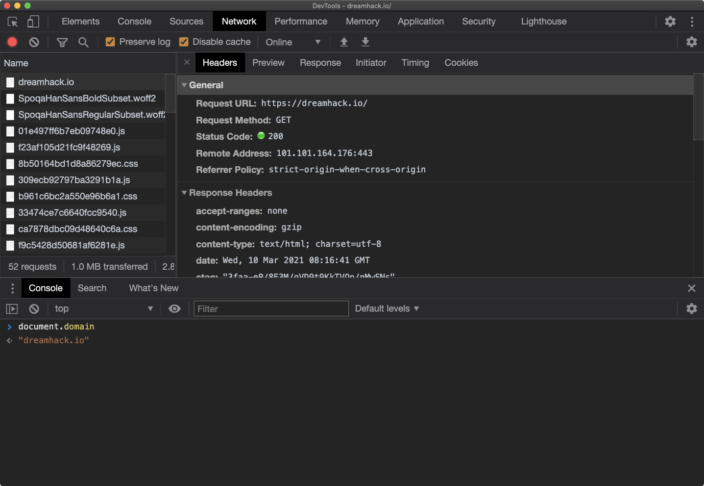

# 브라우저 자바스크립트 콘솔

## 작업 식별

| 항목 | 내용 |
|---|---|
| Task ID | LNX-LAC-004-DO |
| 유형 | D&O (개념) |
| 목적 | 브라우저 자바스크립트 콘솔이 무엇이고 어떻게 여는지 설명한다 |
| 확인 상태 | 미검증 (원본 페이지와 브라우저 개발자 도구 문서 지식을 정리한 것이며 이 환경에서 실행해 확인하지 않았다) |
| 개정 | R1 (2026-11-18) |


NOTE: 이 문서의 "콘솔"은 웹 브라우저 개발자 도구의 콘솔이다. 리눅스의 가상 콘솔(`Ctrl + Alt + F1`~`F6`)과는 다르다. 리눅스 콘솔 명령은 [리눅스 기본 필수 명령어](../../../commands/linuxcommand.md)(LNX-CMD-002-REF)를 본다. 이 페이지는 리눅스 관리자 가이드 폴더에 있으나 내용은 웹 개발 도구다. 링크 보존을 위해 위치는 옮기지 않았다.


## 1. 목적

콘솔(Console)은 프런트엔드 자바스크립트 코드에서 발생한 메시지를 출력하고, 사용자가 입력한 자바스크립트 코드를 바로 실행하는 도구다. 변수의 값을 중간에 출력하거나 코드 한 줄을 시험할 때 쓴다.

## 2. 구성 요소

| 번호 | 이름 | 역할 | 비고 |
|---|---|---|---|
| 1 | `console` 오브젝트 | 개발자 도구의 콘솔에 접근하는 함수(`log`, `debug`, `info`, `warn`, `error` 등)를 담는다 | NodeJS에도 있다 |
| 2 | 콘솔 패널 | 메시지를 출력하고 입력한 코드를 실행한다 | |
| 3 | Console Drawer | 다른 패널 아래에 콘솔을 함께 띄운다 | `ESC`로 연다 |

NodeJS의 `console` 오브젝트 출력 예(일부):

```
> console
Console {
  log: [Function: bound consoleCall],
  debug: [Function: bound consoleCall],
  info: [Function: bound consoleCall],
  dirxml: [Function: bound consoleCall],
  warn: [Function: bound consoleCall],
  error: [Function: bound consoleCall],
  ...
  context: [Function: context],
  [Symbol(counts)]: Map {},
  [Symbol(kColorMode)]: 'auto' }
```

## 3. 동작 원리

1. 단축키로 개발자 도구의 콘솔을 연다.
2. 코드를 입력하고 `Enter`를 누르면 현재 페이지의 맥락에서 실행된다.
3. 실행 결과나 반환값이 콘솔에 출력된다.
4. 페이지의 코드가 `console.log`를 호출하면 그 값도 콘솔에 출력된다.

| 환경 | 콘솔 열기 |
|---|---|
| Windows, Linux (Chrome 계열) | `Ctrl + Shift + J` |
| macOS (Chrome 계열) | `Option(⌥) + Cmd(⌘) + J` |
| Console Drawer | `ESC` (개발자 도구가 열린 상태) |


NOTE: 위 단축키는 Chrome 계열 기준이다. Firefox 등은 단축키가 다를 수 있으며 미검증이다.


콘솔에 입력해 볼 코드:


```javascript
// "hello" 문자열을 출력하는 alert 함수를 실행한다.
alert("hello");

// prompt는 팝업 상자로 사용자 입력을 받는 함수다.
// 사용자가 입력한 데이터가 반환값이 된다.
var value = prompt('input')

// confirm은 확인/취소를 사용자에게 묻는 함수다.
// 선택에 따라 Boolean(true/false) 반환값을 가진다.
var true_false = confirm('yes or no ?');

// document.body를 변경한다.
document.body.innerHTML = '<h1>Refresh!</h1>';

// document.body에 새 HTML 코드를 추가한다.
document.body.innerHTML += '<h1>HI!</h1>';
```



CAUTION: 콘솔에서 `document.body.innerHTML`을 바꾸면 현재 페이지 화면이 바뀐다. 새로고침하면 원래대로 돌아온다. 출처를 모르는 코드를 콘솔에 붙여 넣어 실행하지 않는다.


Console Drawer를 쓰면 네트워크 패널과 콘솔 패널을 동시에 볼 수 있다.



## 4. 약어와 용어

| 용어 | 뜻 |
|---|---|
| 콘솔 (console) | 메시지 출력과 코드 실행을 제공하는 개발자 도구 패널 |
| 개발자 도구 (DevTools) | 브라우저에 내장된 웹 개발 보조 도구 |
| 반환값 (return value) | 함수가 실행을 끝내고 돌려주는 값 |

## 5. 개정 이력

| 개정 | 날짜 | 변경 내용 |
|---|---|---|
| R1 | 2026-11-18 | D&O 형식으로 재작성. 리눅스 가상 콘솔과의 구분 NOTE와 CAUTION을 추가했다. 대화체를 평서체로 바꿨다 |

## 내 말로 채우기


AI 없이 답을 적는다. 다 쓰면 체크하고, 이 안내는 지워도 된다.


- [ ] 콘솔에서 `console.log`를 써 본 경험을 적고, `alert`로 값을 보는 것과 어떻게 다른지 적는다.
- [ ] 리눅스 가상 콘솔과 브라우저 콘솔의 공통점과 차이를 내 말로 적는다.
