# 0. 7일차 실습 명령어 — 수업 흐름 그대로 (이어치기 대본)

> 상위: [7일차 · 스위칭 심화](README.md) · 이론 설명은 [4_스위칭_실습](lesson-4.md)
> **위에서 아래로 그대로 따라 치면 오늘 실습이 끝난다.** 실습 중 화면에 띄워두거나 인쇄해 나눠줄 것.

## 📌 읽는 법 — 4~6일차와 같은 약속

- 블록 하나 = **한 장비에서 끊지 않고 이어 치는 한 덩어리**
- 블록 머리의 `🖥 PC0` / `🔀 SW1` / `🔁 R1` = **어느 장비의 어느 창**인지 · 블록 끝의 `👉` = **다음 행선지**
- `# 뒤 회색 글씨` = 설명. 안 쳐도 된다
- ⏳ **오늘은 스위치가 주인공이다.** 선을 꽂거나 포트를 켜면 **주황 점 30초**(STP)를 기다린다

## 🧰 오늘의 실습은 하나 — **새 파일에 처음부터 만든다**

> 라우터가 **한 대**뿐이다. 대신 스위치 두 대를 **깊이** 만진다.
> 🚨 **오늘 파일은 8일차에 그대로 이어 쓴다.** 끝나면 반드시 `7일차_스위칭.pkt` 로 저장.

## 🗺 오늘의 그림 — 코리아IT 2층(SW1) · 3층(SW2)

```
                     [R1]
                      │ G0/0   ← .10 · .20 둘로 쪼갠다 (STEP 3)
                      │ trunk
                      │ Gi0/1
  PC0 ──Fa0/1──┐      │      ┌──Fa0/1── PC2
             [SW1]════════════[SW2]
  PC1 ──Fa0/2──┘ Fa0/23 ═══ Fa0/23 └──Fa0/2── PC3
                 Fa0/24 ═══ Fa0/24   ← STEP 4 에서 추가
```

| 장비 | 꽂는 곳 | VLAN | IP | 게이트웨이 |
|------|---------|------|-----|------------|
| **PC0** | SW1 Fa0/1 | **10 영업** | 192.168.10.1 /24 | 192.168.10.254 |
| **PC1** | SW1 Fa0/2 | **20 개발** | 192.168.20.1 /24 | 192.168.20.254 |
| **PC2** | SW2 Fa0/1 | **10 영업** | 192.168.10.2 /24 | 192.168.10.254 |
| **PC3** | SW2 Fa0/2 | **20 개발** | 192.168.20.2 /24 | 192.168.20.254 |

| 라우터 R1 | 주소 | 누구의 게이트웨이 |
|-----------|------|-------------------|
| G0/0 (물리) | **없음** — 켜기만 | — |
| G0/0.10 | 192.168.10.254 /24 | VLAN 10 |
| G0/0.20 | 192.168.20.254 /24 | VLAN 20 |

> 🗣 **오늘의 질문 세 개**: ① 스위치 한 대를 **나눌** 수 있나? ② 나눈 걸 **층을 넘어** 이을 수 있나? ③ 선 두 줄을 **둘 다** 쓸 수 있나?

---

# ▶ 준비 · 그림 만들기 (15분)

### 0-1 🖱 마우스로 (명령 아님)

1. 라우터 **1대**(2911) · 스위치 **2대**(2960) · PC **4대** 배치
2. 케이블

| 연결 | 케이블 |
|------|--------|
| PC ↔ 스위치 | **다이렉트** (Copper Straight-Through) |
| **R1 G0/0 ↔ SW1 Gi0/1** | **다이렉트** |
| **SW1 Fa0/23 ↔ SW2 Fa0/23** | **크로스오버** (스위치끼리) |

3. 🚨 **Fa0/24 는 아직 꽂지 않는다.** (STEP 4 의 주인공)
4. PC 4대에 IP · 마스크 · **게이트웨이** 입력 (위 표)

### 0-2 🔀 SW1 · SW2 CLI — 이름만 붙인다

```bash
# ── SW1 ──
enable
configure terminal
no ip domain-lookup
hostname SW1
end
```

```bash
# ── SW2 ──
enable
configure terminal
no ip domain-lookup
hostname SW2
end
```

**✅ 준비 체크** — 스위치 사이 링크 **양쪽 초록** (주황이면 30초 기다린다)

---

# ▶ STEP 1 · 스위치를 **부서별로 나눈다** — VLAN (20분)

### 1-1 🖥 PC0 — 나누기 **전**: 지금은 전부 한 동네

```bash
ping 192.168.10.2              # PC2 (3층 영업) — 성공한다
```

> 👀 **(관찰, 추천)** 시뮬레이션 모드 → `Edit Filters` 에서 **ARP · ICMP 만** 켜기 →
> PC0 에서 `arp -d` 후 다시 `ping 192.168.10.2` → **ARP 편지가 PC1 · PC3(개발팀)에게도** 간다.
> 🗣 **"영업팀 방송이 개발팀 자리까지 울리죠? 스위치 전체가 브로드캐스트 도메인 하나라서."**

### 1-2 🔀 SW1 CLI — VLAN 만들고 포트에 넣기

```bash
configure terminal
vlan 10                         # ① VLAN 만들기
 name SALES
vlan 20
 name DEV
 exit
interface fa0/1                 # ② PC0 포트 → VLAN 10
 switchport mode access
 switchport access vlan 10
interface fa0/2                 # ③ PC1 포트 → VLAN 20
 switchport mode access
 switchport access vlan 20
end
show vlan brief                 # Fa0/1 은 10, Fa0/2 는 20 에 보이는가
```

> 👉 다음: SW2 에서 **똑같이**
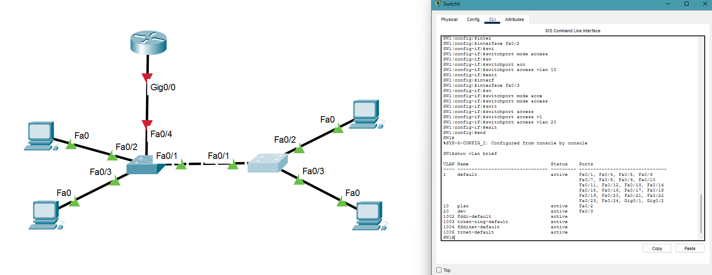
### 1-3 🔀 SW2 CLI — 똑같이

```bash
configure terminal
vlan 10
 name SALES
vlan 20
 name DEV
 exit
interface fa0/1
 switchport mode access
 switchport access vlan 10
interface fa0/2
 switchport mode access
 switchport access vlan 20
end
show vlan brief
```

> 💡 VLAN 은 **스위치마다 따로** 만든다. SW1 에 만들었다고 SW2 에 생기지 않는다.
> 👉 다음: PC0 으로

### 1-4 🖥 PC0 — 나눈 **뒤**: 어? 오히려 안 된다

```bash
ping 192.168.10.2              # ❌ 실패 — 같은 VLAN 10 인데?
```
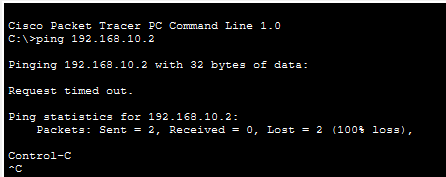
> 🗣 **"PC0 도 PC2 도 VLAN 10 입니다. 1-1 에선 됐는데 왜 갑자기 안 될까요?"**
> → 스위치 사이 선(Fa0/23)은 **VLAN 1 액세스 포트**다. VLAN 10 은 **VLAN 1 통로를 못 지나간다.**
> → [2_트렁크와_VLAN간_라우팅](lesson-2.md)

**✅ 체크** — 두 스위치 `show vlan brief` 에 10 SALES · 20 DEV · PC0 → PC2 **실패** (정상!)

---

# ▶ STEP 2 · 층을 넘어 잇는다 — 트렁크 (15분)

### 2-1 🔀 SW1 CLI — 스위치 사이 포트를 트렁크로

```bash
configure terminal
interface fa0/23
 switchport mode trunk          # 여러 VLAN 이 태그를 달고 같이 다니는 통로
end
```

> 👉 다음: SW2 도 똑같이 (SW1 만 해도 붙긴 한다 — DTP. 그래도 **양쪽 다 못 박는다**)

### 2-2 🔀 SW2 CLI — 반대쪽도

```bash
configure terminal
interface fa0/23
 switchport mode trunk
end
show interfaces trunk           # Status 가 trunking 인가
show vlan brief                 # ★ Fa0/23 이 사라졌다 — 고장 아니다, 트렁크가 된 것
```

```
Port        Mode         Encapsulation  Status        Native vlan
Fa0/23      on           802.1q         trunking      1
                          ──┬──          ──┬──
                          태그 규격        맺어졌다 ✅
```
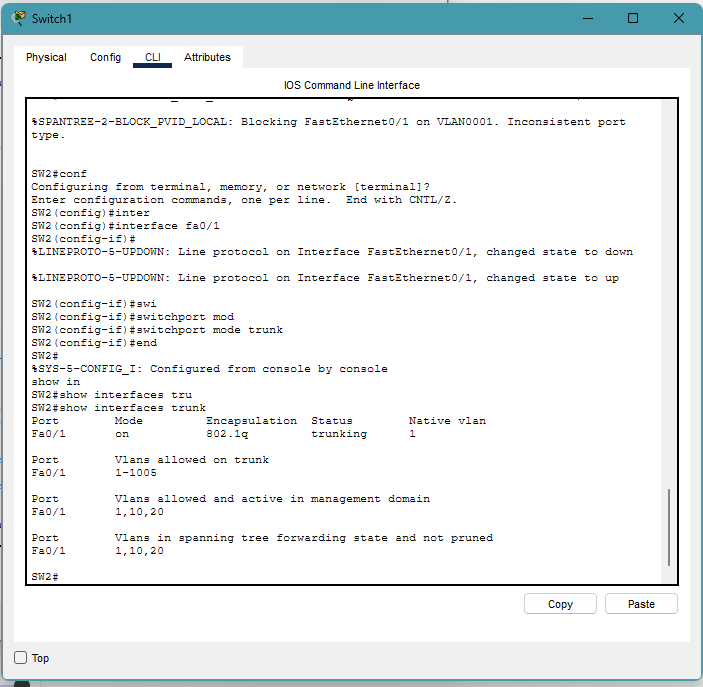
> 👉 다음: PC0 으로

### 2-3 🖥 PC0 — 같은 VLAN 은 층을 넘는다, 다른 VLAN 은?

```bash
ping 192.168.10.2              # ✅ PC2 (같은 VLAN 10, 3층) — 이제 된다
ping 192.168.20.1              # ❌ PC1 (VLAN 20, 바로 옆자리!) — 안 된다
```
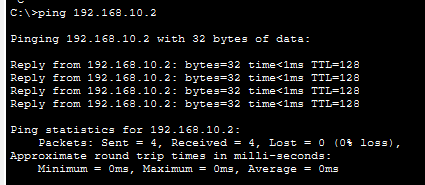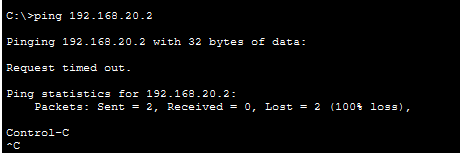

> 🗣 **"바로 옆자리 PC1 은 같은 스위치에 꽂혀 있는데 왜 안 될까요?"**
> → VLAN 이 다르다 = **다른 네트워크**다. 트렁크는 **같은 VLAN 끼리의** 통로일 뿐.
> → 네트워크를 넘으려면? **라우터** (4일차)

> 👀 **(관찰)** 시뮬레이션 모드 · PC0 `arp -d` → `ping 192.168.10.2` →
> 이번엔 ARP 가 **PC1 · PC3 에게 가지 않는다.** 1-1 과 비교! = **브로드캐스트 도메인이 나뉘었다**

**✅ 체크** — `show interfaces trunk` = trunking · PC0 → PC2 ✅ · PC1 → PC3 ✅ · PC0 → PC1 ❌

---

# ▶ STEP 3 · 벽 너머로 — Router-on-a-stick (20분)

### 3-1 🔀 SW1 CLI — 라우터 쪽 포트도 트렁크

```bash
configure terminal
interface g0/1
 switchport mode trunk          # 라우터에게 태그 10 · 20 을 둘 다 보낸다
end
```

> 👉 다음: R1 으로

### 3-2 🔁 R1 CLI — **일부러 틀리게 먼저** ⭐

```bash
enable
configure terminal
no ip domain-lookup
hostname R1
interface g0/0
 no shutdown                    # 물리 포트는 켜기만 한다 (IP 없음!)
 exit
interface g0/0.10               # VLAN 10 담당 서브인터페이스
 ip address 192.168.10.254 255.255.255.0     # ★ 태그 없이 IP 부터 쳐본다
```
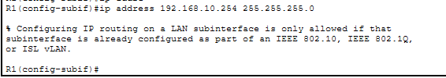
```
% Configuring IP routing on a LAN subinterface is only allowed if that
subinterface is already configured as part of an IEEE 802.10, IEEE 802.1Q,
or ISL vLAN.
```

> 🗣 **"거절당했습니다. 왜일까요?"** → 이 서브인터페이스가 **어느 태그 담당인지** 아직 모른다.
> → 구호: **"태그 먼저, 주소 나중"**

### 3-3 🔁 R1 CLI — 순서대로 다시

```bash
 encapsulation dot1Q 10         # ① 태그 10 은 내 담당
 ip address 192.168.10.254 255.255.255.0     # ② 이제 된다
 exit
interface g0/0.20
 encapsulation dot1Q 20
 ip address 192.168.20.254 255.255.255.0
end
show ip interface brief         # G0/0 · G0/0.10 · G0/0.20 모두 up/up
show ip route                   # C 192.168.10.0 · C 192.168.20.0 (둘 다 g0/0.xx)
```
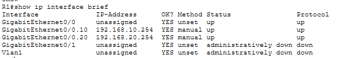
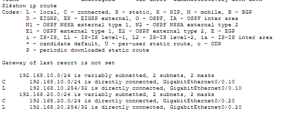
> 👉 다음: PC0 으로

### 3-4 🖥 PC0 — 벽을 넘었다 ⭐

```bash
ping 192.168.20.1              # ✅ PC1 (옆자리 개발팀)
ping 192.168.20.2              # ✅ PC3 (3층 개발팀 — 트렁크 두 번 + 라우터 한 번)
tracert 192.168.20.1           # 1홉: 192.168.10.254 (R1) → 2홉: 192.168.20.1
```
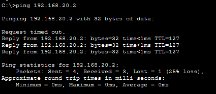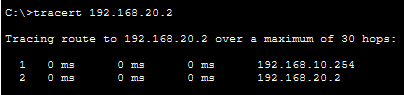
> 🗣 **"옆자리로 가는데 라우터를 들렀다 옵니다. 같은 선을 올라갔다 내려왔죠?"**
> → 모든 부서 간 트래픽이 **SW1–R1 선 한 줄**, **SW1–SW2 선 한 줄**에 몰린다 → STEP 4 의 동기

**💾 중간 저장** — `Ctrl + S`

**✅ 체크** — R1 `show ip route` 에 `C` 두 줄 · PC0 ↔ PC1 · PC0 ↔ PC3 모두 ✅

---

# ▶ STEP 4 · 선을 한 줄 더 — STP 가 막는다 → EtherChannel 로 묶는다 ⭐ (30분)

### 4-1 🖱 마우스로 — 두 번째 선 꽂기

**SW1 Fa0/24 ↔ SW2 Fa0/24** 크로스오버 연결 → ⏳ 30초 기다린다

> 👀 30초가 지나도 **한쪽 끝이 주황색으로 남는다.** 🗣 **"고장일까요?"**

### 4-2 🔀 SW1 · SW2 CLI — 누가 막았나 찾기

```bash
show spanning-tree vlan 10
```

```
(한쪽 스위치)                          (다른 쪽 스위치)
  This bridge is the root   👑           Fa0/23   Root FWD 19  128.23  P2p
  Fa0/23   Desg FWD                       Fa0/24   Altn BLK 19  128.24  P2p   ⛔
  Fa0/24   Desg FWD
```

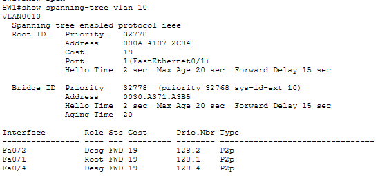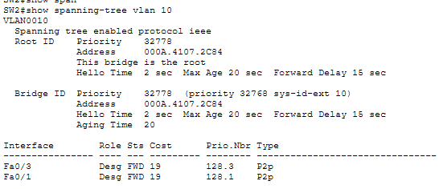

- `This bridge is the root` 가 보이는 쪽 = **대장(루트 브리지)**
- **대장이 아닌 쪽**에 `Altn BLK` = **막힌 선** — 주황색이 남은 그 끝
- 🗣 **"선 두 줄인데 하나는 놀고 있습니다. 속도는 두 배가 됐을까요?"** → 아니다 → [3_EtherChannel과_STP](lesson-3.md)

> 💡 어느 스위치가 대장이 될지는 **MAC 주소 운**이다. 옆 사람과 결과가 달라도 정상.

### 4-3 🔀 SW1 CLI — 두 줄을 한 묶음으로

```bash
configure terminal
interface range fa0/23 - 24
 shutdown                               # ① 끄고
 switchport mode trunk                  # ② 둘 다 똑같이 트렁크
 channel-group 1 mode active            # ③ 1번 묶음에 넣는다 (LACP, 먼저 제안)
 no shutdown                            # ④ 켠다
 exit
interface port-channel 1                # 방금 생긴 논리 포트 Po1
 switchport mode trunk
end
```

> 구호: **"끄고, 똑같이, 묶고, 켠다"**
> 👉 다음: SW2 도 **똑같이** (한쪽만 하면 묶이지 않는다)

### 4-4 🔀 SW2 CLI — 반대쪽도

```bash
configure terminal
interface range fa0/23 - 24
 shutdown
 switchport mode trunk
 channel-group 1 mode active
 no shutdown
 exit
interface port-channel 1
 switchport mode trunk
end
```

> ⏳ 30초 기다린다

### 4-5 🔀 SW1 · SW2 CLI — 묶였는지 확인 ⭐

```bash
show etherchannel summary
show spanning-tree vlan 10
show interfaces trunk
```
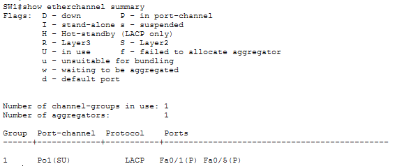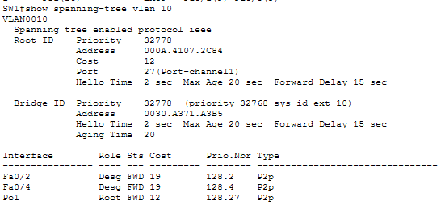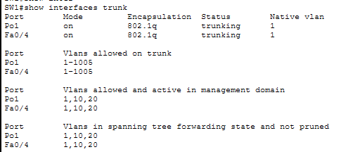
```
Group  Port-channel  Protocol    Ports
------+-------------+-----------+------------------------------
1      Po1(SU)           LACP   Fa0/23(P) Fa0/24(P)
       ──┬──                     ──┬──
       S=2계층 U=사용 중 ✅          P=묶음에 들어갔다 ✅
```

- `show spanning-tree` 에서 Fa0/23 · Fa0/24 가 사라지고 **`Po1` 한 줄**만 `FWD` → **막힌 선이 없다**
- `show interfaces trunk` 의 Port 칸도 **`Po1`**

> 🗣 **"STP 가 이제 막지 않네요. 왜죠?"** → 두 줄을 **길 하나(Po1)** 로 신고했으니까

### 4-6 🖥 PC0 — 선 하나를 뽑아도 끊기지 않는다 (관찰)

```bash
ping -t 192.168.10.2           # 계속 보낸다 (멈출 땐 Ctrl + C)
```

> PT 버전에 따라 `-t` 가 안 먹으면 → 선을 뽑은 **직후에** 일반 `ping` 을 바로 쳐서 확인한다.

- ping 이 도는 동안 🖱 **Fa0/24 선을 삭제**(X 도구) → **ping 이 끊기지 않는다**
- SW1 에서 `show etherchannel summary` → `Fa0/24(D)` 인데 **`Po1(SU)` 는 그대로**
- 선을 **다시 꽂는다** → 잠시 후 `Fa0/24(P)` 로 복귀

**💾 중간 저장** — 스위치 둘 `copy running-config startup-config` · 파일은 `Ctrl + S`

**✅ 체크**

- [ ] 두 스위치 모두 `Po1(SU)` · `Fa0/23(P) Fa0/24(P)`
- [ ] `show spanning-tree` 에 **BLK 가 없다**
- [ ] 선 하나를 뽑아도 ping 이 이어진다

---

# ▶ STEP 5 · 마무리 튜닝 — 대장 지명 · PortFast (10분, 여유 있으면)

### 5-1 🔀 SW1 CLI — 반장을 운에 맡기지 않는다

```bash
configure terminal
spanning-tree vlan 1,10,20 root primary     # SW1 을 대장으로 지명 (우선순위를 낮춘다)
end
show spanning-tree vlan 10                  # This bridge is the root · Priority 24586
```

> 💡 `24586` = 24576 + VLAN 10. 기본 32768 보다 **작아서** 이긴다. 코어 스위치를 대장으로 — **실무 필수**

### 5-2 🔀 SW1 CLI — PortFast 비교 실험 (PC0 포트만 먼저)

```bash
configure terminal
interface fa0/1
 spanning-tree portfast                     # PC 포트만! (경고 문구가 뜨는 게 정상)
end
```

- 🖱 **PC0 선과 PC1 선을 둘 다 삭제 → 다시 연결**
- **PC0(Fa0/1) 은 바로 초록**, **PC1(Fa0/2) 은 주황 30초** → 🗣 **"3일차 주황 점, 오늘 없앴습니다"**

### 5-3 🔀 SW1 · SW2 CLI — 나머지 PC 포트에도

```bash
configure terminal
interface range fa0/1 - 2
 spanning-tree portfast
end
```

> 🚨 **Fa0/23 · 24 · Po1 · Gi0/1(스위치·라우터 연결)에는 절대 켜지 않는다.**

**💾 최종 저장** — 모든 장비 `copy running-config startup-config` · 파일은 **`7일차_스위칭.pkt`** (8일차에 이어 쓴다)

**✅ 최종 체크** — PC 4대 **서로 전부** ping 성공 (4 × 3 = 12 방향)

---

# 📚 부록 A · L3 스위치로 VLAN 간 라우팅 (실무 방식, 시간 남으면)

> 라우터 대신 **3560(L3 스위치)** 한 대가 게이트웨이를 맡는다. **새 파일**에서 해볼 것.

```
        [MLS 3560]  ← 게이트웨이 .10.254 · .20.254 (SVI)
            │ Gi0/1 trunk
          [SW1 2960]
          │       │
        PC0(10)  PC1(20)
```

```bash
# ── 3560 ──
enable
configure terminal
hostname MLS
ip routing                              # ★ 라우팅 켜기 — 없으면 그냥 스위치
vlan 10
vlan 20
 exit
interface vlan 10                       # SVI = VLAN 의 가상 게이트웨이
 ip address 192.168.10.254 255.255.255.0
 no shutdown
interface vlan 20
 ip address 192.168.20.254 255.255.255.0
 no shutdown
interface g0/1
 switchport trunk encapsulation dot1q   # ★ 3560 은 이 줄이 먼저 (2960 은 없음)
 switchport mode trunk
end
show ip route                           # C 10.0 · C 20.0
```

- SW1(2960)에도 VLAN 10 · 20 을 만들고, **MLS 쪽 포트를 트렁크로**
- SVI 가 `up` 이 되려면 **그 VLAN 이 존재하고 + 그 VLAN 이 다니는 포트가 하나라도 살아 있어야** 한다

# 📚 부록 B · 트렁크 고급 옵션

```bash
interface fa0/23
 switchport trunk allowed vlan 10,20        # 이 트렁크엔 10 · 20 만 태운다
 switchport trunk allowed vlan add 30       # ★ 추가는 반드시 add
 switchport trunk native vlan 99            # 네이티브 VLAN 변경 (양쪽 똑같이!)
```

> 🚨 **실무 사고 1위**: `add` 없이 `switchport trunk allowed vlan 30` 을 치면 **10 · 20 이 지워지고 30 만 남는다.**
> 운영 중인 트렁크에서 이걸 치면 **회사 전체가 끊긴다.**

> ⚠️ EtherChannel 이 묶여 있으면 이런 설정은 **`interface port-channel 1`** 에서 한다 (멤버 포트에 따로 치면 어긋난다).

# 📚 부록 C · 오늘 새로 나온 명령 사전

| 무엇 | 명령 | 어느 모드 |
|------|------|-----------|
| VLAN 만들기 | `vlan 10` → `name SALES` | `(config)#` |
| 액세스 포트 지정 | `switchport mode access` | `(config-if)#` |
| 포트를 VLAN 에 | `switchport access vlan 10` | `(config-if)#` |
| 트렁크 지정 | `switchport mode trunk` | `(config-if)#` |
| 트렁크 규격 (3560만) | `switchport trunk encapsulation dot1q` | `(config-if)#` |
| 여러 포트 한 번에 | `interface range fa0/23 - 24` | `(config)#` |
| 서브인터페이스 | `interface g0/0.10` | `(config)#` |
| 서브인터페이스 태그 | `encapsulation dot1Q 10` | `(config-subif)#` |
| EtherChannel 묶기 | `channel-group 1 mode active` | `(config-if-range)#` |
| 논리 포트 | `interface port-channel 1` | `(config)#` |
| 루트 브리지 지명 | `spanning-tree vlan 1,10,20 root primary` | `(config)#` |
| PortFast | `spanning-tree portfast` | `(config-if)#` |
| L3 스위치 라우팅 | `ip routing` → `interface vlan 10` | `(config)#` |
| VLAN 확인 | `show vlan brief` | `#` |
| 트렁크 확인 | `show interfaces trunk` | `#` |
| STP 확인 | `show spanning-tree vlan 10` | `#` |
| EtherChannel 확인 | `show etherchannel summary` | `#` |

> 4~6일차 명령은 → [4일차](../day-04/commands.md) ·
> [5일차](../day-05/commands.md) · [6일차](../day-06/commands.md)

# ⚠️ 부록 D · 안 될 때 30초 점검 (오늘판)

| 증상 | 원인 · 조치 |
|------|-------------|
| **같은 VLAN** 인데 층을 못 넘는다 | 스위치 사이가 **트렁크가 아니다** → 양쪽 `switchport mode trunk` · `show interfaces trunk` |
| 같은 스위치 **다른 VLAN** 끼리 안 된다 | **정상.** 라우터(STEP 3)가 있어야 한다 |
| 라우터 거쳐도 다른 VLAN 이 안 된다 | ① SW1 **Gi0/1 이 트렁크**인가 ② R1 `g0/0` **`no shutdown`** 했나 ③ PC **게이트웨이** 오타 |
| 서브인터페이스에 IP 가 거부된다 | **`encapsulation dot1Q` 먼저** — "태그 먼저, 주소 나중" |
| `encapsulation dot1Q 10` 인데 VLAN 20 PC 가 응답 | 서브인터페이스 **번호와 태그가 뒤바뀜** → `show running-config` 로 대조 |
| `show vlan brief` 에서 포트가 사라졌다 | 트렁크가 된 것. **정상** → `show interfaces trunk` |
| PC 포트가 엉뚱한 VLAN 에 있다 | `switchport access vlan` 오타 → `show vlan brief` 로 대조 |
| `NATIVE_VLAN_MISMATCH` 경고 | 양쪽 네이티브 VLAN 이 다르다 → 둘 다 같은 번호로 |
| 두 번째 선이 계속 주황 | **STP 가 막은 것**. 정상 (STEP 4-2) |
| `Po1(SD)` · 포트가 `(I)` / `(s)` | ① **한쪽만** 설정 ② active–PAgP 섞임 ③ 두 선의 **설정이 다름**(하나만 트렁크 등) |
| `switchport trunk encapsulation` 이 에러 | **2960 은 필요 없다** (3560 에서만) |
| PC 를 꽂았는데 30초 먹통 | STP 확인 중 → PC 포트면 **PortFast** |
| 껐다 켜니 설정이 사라짐 | `copy running-config startup-config` 안 했다 |

> 공통 증상(`no shutdown`·게이트웨이·케이블)은 → [4일차 점검표](../day-04/commands.md)
