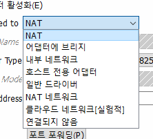
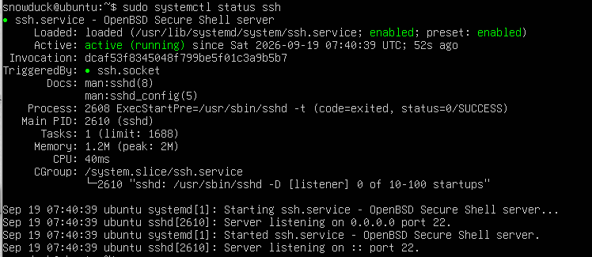

# 2. 가상머신과 설치 — 내 PC 안에 서버 한 대 더

> 상위: [9일차 · 리눅스 설명](README.md)

## 🎯 학습 목표

- **가상화 · 호스트 · 게스트 · 하이퍼바이저** 를 구분한다
- VirtualBox 에 VM 을 만들고 **Ubuntu Server 24.04 LTS** 를 설치한다
- VM 의 **네트워크 어댑터를 브릿지(Bridged)** 로 두는 뜻을 안다
- **`apt`** 로 **openssh-server** 를 설치하고 **`systemctl`** 로 켠다 — **첫 서버 구축**
- Windows 터미널에서 **`ssh student@<서버 IP>`** 로 VM 에 접속한다

## 🌉 다리 놓기: "서버를 사러 갈 수는 없으니까"

[1_운영체제와_리눅스](lesson-1.md) 에서 서버는 리눅스라고 했다. 그런데 연습하려고 **서버를 한 대 살 수는 없다.**
1단계에서는 라우터를 사지 않고 **패킷트레이서 안에** 만들었다. 오늘은 리눅스 서버를 **내 PC 안에** 만든다.
→ **가상머신(VM)**

---

## 📖 ① 가상화 — 컴퓨터 안의 컴퓨터

```
 ┌──────────── 호스트 (내 Windows PC · 진짜 하드웨어) ────────────┐
 │                                                               │
 │   [ Windows 앱들 ]    [ VirtualBox (하이퍼바이저) ]             │
 │                         ├── VM1: Ubuntu Server  ← 게스트       │
 │                         └── VM2: (나중에 더 만들 수 있다)        │
 └───────────────────────────────────────────────────────────────┘
```

| 용어 | 뜻 | 오늘 |
|------|----|------|
| **호스트** (Host) | 진짜 컴퓨터 | 내 Windows PC |
| **게스트** (Guest) | 그 안에 만든 가짜 컴퓨터 | Ubuntu VM |
| **하이퍼바이저** | 게스트에게 CPU · 메모리 · 디스크를 **나눠주는** 프로그램 | **VirtualBox** |
| **이미지 (ISO)** | 설치 DVD 를 파일 하나로 만든 것 | `ubuntu-24.04.x-live-server-amd64.iso` |

> 💡 **비유: 집 안에 원룸 한 칸 들이기.** 집(호스트)의 전기 · 수도(CPU · RAM)를 나눠 쓰지만, 원룸(VM) 안에서 무슨 짓을 해도 **본채는 멀쩡하다.**
> → 마음껏 부숴도 된다. 망가지면 **지우고 다시** 만들면 끝. (그래서 **스냅샷**이 있다 ↓)

- 클라우드(15 · 16일차)의 서버도 사실 **거대한 호스트 위의 VM** 이다 → 오늘 하는 게 클라우드의 축소판
- 14일차 **Docker** 는 VM 보다 더 가벼운 "칸막이" 방식이다 → 그때 비교

---

## 📖 ② VM 만들기 — 설정값과 이유

| 설정 | 값 | 왜 |
|------|----|----|
| 이름 | `ubuntu-server` | 자유 |
| ISO | Ubuntu Server 24.04 LTS | 화면 없는 서버판 (Desktop 판 X) |
| **무인 설치** (Unattended) | **건너뛰기** ✅ | 켜 두면 VirtualBox 가 알아서 설치해 버린다 → 과정을 **직접** 본다 |
| CPU | 2 | |
| RAM | **2048 MB** | 호스트 RAM 8GB 기준. 16GB 이상이면 4096 |
| 디스크 | **25 GB** (동적 할당) | 실제로는 **쓴 만큼만** 파일이 커진다 |
| 네트워크 | **브릿지 어댑터** | ↓ |



### 네트워크 어댑터 — **브릿지**로 둔다 ⭐

| 모드 | 한 줄 | 쓰임 |
|------|------|------|
| **브릿지 (Bridged)** ⭐ | VM 이 **공유기에 랜선을 직접 꽂은 PC 처럼** 된다 | **오늘 우리가 쓰는 것** |
| NAT (기본값) | VM 이 **호스트 뒤에 숨어서** 인터넷에 나간다 | 밖에서 들어오려면 포트포워딩이 필요 |
| 호스트 전용 | 호스트 ↔ VM 끼리만 | 인터넷 없이 실험 |

> 🖱 **설정 → 네트워크 → 어댑터 1 → 다음에 연결됨: `브릿지 어댑터`** · 이름은 **지금 인터넷이 되는 랜카드**를 고른다

```
        [ 강의실 공유기 ]
              │
      ┌───────┼────────────┐
  내 Windows  │        옆자리 PC
      └── 내 Ubuntu VM  ←── 브릿지: 공유기에서 IP 를 "직접" 받는다
```

- 브릿지로 두면 VM 은 **강의실 망의 주소**(`192.168.x.x` 등)를 **하나 차지**한다
- 그래서 **포트포워딩이 필요 없다.** Windows 에서 그 주소로 **바로** SSH 가 된다

> 📌 **떡밥**: "그 주소는 **누가** 줬을까?" → **DHCP**. 정체는 **10일차**에 → [10일차](../day-10/README.md)
> ⚠️ **주소는 매번 바뀔 수 있다.** 수업을 시작할 때마다 VM 에서 `ip a` 로 확인하는 습관을 들인다

---

## 📖 ③ Ubuntu Server 설치 — 화면별 선택

설치는 **키보드**로 한다: **↑↓ 이동 · Space 체크 · Enter 확정 · Tab 다음 칸**

| 화면 | 선택 | 메모 |
|------|------|------|
| Language | **English** | 한국어는 콘솔에서 **글자가 깨진다** |
| Keyboard | English (US) | 한국 키보드도 US 로 두면 된다 |
| Type of install | **Ubuntu Server** | (minimized 아님) |
| Network | 기본값 (`enp0s3` DHCP) | 🔎 **여기서 강의실 망의 IP 가 보인다** — 2일차 회수 · **적어 둘 것** |
| Proxy · Mirror | 기본값 | 미러 테스트가 느리면 기다린다 |
| Storage | **Use an entire disk** · 기본값 | 가상 디스크라 안전하다 |
| Profile | 이름 · 서버 이름 `ubuntu` · 사용자 `student` · 비밀번호 | **비밀번호 잊지 말 것** |
| Ubuntu Pro | Skip | |
| SSH | **체크하지 않고 Done** | 설치가 끝난 뒤 **직접 구축**한다 ↓ ⭐ |
| Featured snaps | 아무것도 선택 안 함 | Docker 는 14일차에 직접 |

→ 설치가 끝나면 **Reboot Now** → `Please remove the installation medium` 이 나오면 **Enter**

> ⏳ 설치에 10~20분 걸린다 → 이 시간에 [1_운영체제와_리눅스](lesson-1.md) 이야기

### 첫 로그인

```
ubuntu login: student
Password:                  ← ⚠️ 쳐도 화면에 아무것도 안 나온다. 고장이 아니다!
student@ubuntu:~$          ← 성공
```

---

## 📖 ④ 첫 서버 구축 — OpenSSH 서버 ⭐

8일차 Server0 에서는 체크박스 하나로 서비스를 켰다. 리눅스에서는 **① 프로그램을 설치하고 ② 켜고 ③ 확인**한다.

### ① 설치 — 패키지 관리자 `apt`

```bash
sudo apt update                    # 창고(저장소)의 최신 목록 받기
sudo apt install openssh-server    # SSH 서버 프로그램 설치 → 물어보면 y
```

| 패키지 관리자 | 어디서 | 비유 |
|--------------|--------|------|
| **`apt`** | Ubuntu · Debian | **앱스토어** — 검증된 창고에서 받아 설치 |
| `dnf` | Rocky · RHEL | (같은 일, 다른 계열) |
| `brew` | macOS | |
| `pip` | Python 라이브러리 | |

- `sudo` = **관리자 권한으로** 한 번 실행 (시스코 `enable` 과 같은 발상 — 10일차 오전에 자세히)
- 명령의 모양은 전부 같다: **`명령어 [옵션] [대상1] [대상2] ...`** → `apt install openssh-server`

### ② 켜기 — `systemctl`

```bash
sudo systemctl enable --now ssh    # enable = 부팅할 때마다 자동 시작 · --now = 지금 바로 켜기
```

> 💡 **비유: 가게 문 열기.** `--now` = 지금 문을 연다 · `enable` = **내일부터 매일 아침 자동으로** 문을 연다.
> 서버는 재부팅돼도 알아서 다시 떠야 한다 → 그래서 둘 다.

### ③ 확인 — `systemctl status`

```bash
sudo systemctl status ssh          # q 로 나가기
```



| 줄 | 뜻 |
|----|----|
| `Loaded: ... ; enabled;` | **부팅 때 자동 시작**이 켜져 있다 |
| `Active: active (running)` | **지금 돌고 있다** (초록색) |
| `Server listening on 0.0.0.0 port 22.` | **22번 문을 열고 손님을 기다린다** ← 10일차 오후에 정체를 밝힌다 |

> 🗣 **"방금 여러분은 리눅스에 서버를 하나 구축했습니다."** 12일차에 만들 DNS · 메일 · FTP 서버도 **똑같이 설치 → 켜기 → 확인** 3단계다.

### Windows 에서 SSH 접속

**Windows 터미널(PowerShell)** 에서:

```powershell
# 🐧 VM 창에서 먼저:  ip a   → 192.168.x.x 를 확인한다
ssh student@192.168.x.x
# 처음엔 "Are you sure you want to continue connecting (yes/no)?" → yes
```

> 🗣 **"8일차에 스위치에 SSH 로 들어갔죠. 오늘은 리눅스 서버에 SSH 로 들어갑니다. 명령 모양이 똑같습니다."**
> 8일차: `ssh -l admin 192.168.10.253` → 오늘: `ssh student@192.168.x.x` — **모양이 거의 같다**

- 왜 VM 창을 안 쓰고 SSH 로? → **복사 · 붙여넣기 · 한글 · 창 여러 개**가 된다. 그리고 **현업이 이렇게 일한다**
- VM 창은 **최소화**해 두면 된다. (VirtualBox 에서 **"헤드리스 시작"** 하면 창 없이 켜진다)

### 스냅샷 — 되돌리기 버튼

- VirtualBox `머신 → 스냅샷 찍기` = **지금 상태를 사진으로 저장**
- 설치 직후 **`설치완료`** 스냅샷을 찍어 두면, 무슨 짓을 해도 **5초 만에 복구**
- 12일차 서버 구축 전에도 한 번 더 찍는다

---

## ⚠️ 설치에서 막히는 곳 TOP 5

| 증상 | 원인 | 해결 |
|------|------|------|
| VM 시작 시 `VT-x is not available` · 현저히 느림 | BIOS 에서 **가상화(VT-x / AMD-V · SVM)** 꺼짐 | 재부팅 → BIOS → Virtualization **Enabled** |
| 가상화는 켰는데 여전히 안 됨 | Windows **Hyper-V** 와 충돌 | VirtualBox 7 은 대부분 공존. 안 되면 Plan B |
| 로그인 비밀번호가 안 쳐진다 | 원래 **화면에 안 보인다** | 그냥 치고 Enter |
| `ssh: connect ... refused` | ① SSH 서버 미설치 · 꺼짐 ② IP 를 잘못 봄 | ① `sudo systemctl status ssh` → 안 돌면 `sudo systemctl enable --now ssh` ② VM 에서 `ip a` 로 주소 재확인 |
| VM 이 `10.0.2.15` 를 받았다 | 어댑터가 아직 **NAT** | 설정 → 네트워크 → **브릿지 어댑터** 로 바꾸고 재부팅 |
| 설치 중 미러 · 업데이트에서 멈춤 | 강의실 네트워크 혼잡 | 기다리거나 `Continue without updating` |

## 🆘 Plan B — WSL

VirtualBox 가 도저히 안 되는 PC 는 **WSL(Windows Subsystem for Linux)** 로 오늘 명령어 실습은 **전부 할 수 있다.**

```powershell
wsl --install -d Ubuntu-24.04      # 관리자 PowerShell · 재부팅 후 사용자 이름/비밀번호 설정
```

- ✅ 오늘(9일차) 명령어 · 권한 · apt — **동일**
- ⚠️ 10일차 이후 **포트 · 서버 구축 · 방화벽** 은 VM 과 다르게 보이는 부분이 있다 → 가능하면 다음 주 전에 VirtualBox 를 해결해 오게 한다

## 🧪 질문 / 실습

- 실습 STEP 0 · 1 · 2 → [0_실습_명령어_모음](commands.md)
- "VM 에서 `rm -rf` 로 다 지워버리면 내 Windows 도 지워지나?" → **아니다.** 원룸만 부서진다 → 스냅샷으로 복구
- "그 `192.168.x.x` 는 누가 줬나?" → **10일차 DHCP** 에서. 지금은 "공유기가 줬다" 까지만

## 📝 강의 메모

- **ISO 는 사전 공지로 미리 받게** 한다 — 수업 시작 전 확인
- VirtualBox 7 의 **무인 설치(Unattended)** 는 반드시 **건너뛰게** — 켜면 계정이 `vboxuser` 로 자동 생성된다
- SSH 는 설치 화면에서 체크하지 않고 **설치 후 `apt` · `systemctl` 로 직접 구축** — "첫 서버 구축" 경험이 목적 (2026-09-19 수업에서 이렇게 진행)
- 설치가 빨리 끝난 학생에게는 **스냅샷** 찍게 하고 [1_파일시스템과_이동](../day-10/lesson-1.md) 을 먼저 읽게 한다
- **브릿지를 고른 이유**는 오늘 깊게 설명하지 않는다 — "공유기에 직접 꽂은 셈" 까지만
  - ⚠️ 대신 **어댑터 설정을 빠뜨린 학생**이 나온다. `ip a` 가 `10.0.2.15` 면 **NAT 그대로**다 → 바로 잡아 줄 것
  - 📌 이 선택이 **11일차 서버 보안**의 출발점이 된다 (교실의 다른 PC 가 내 서버에 닿는다) → [11일차](../day-11/lesson-3.md)
