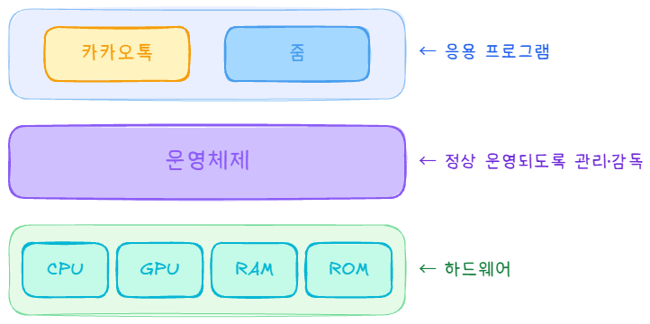
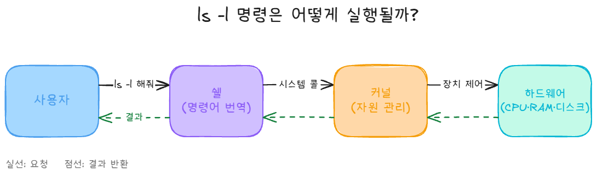
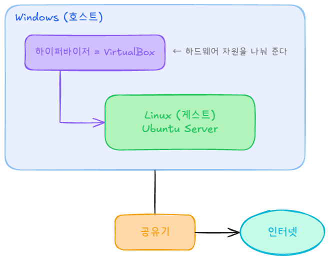

# 9. 9일차 복습 — 리눅스 서버 한 대 만들기

> 9일차 인덱스: [9일차 · 리눅스 설명](README.md) · 다음: [10일차 복습](../day-10/lesson-12.md)

## 작업 식별

| 항목 | 내용 |
|---|---|
| Task ID | LEC-N2-09-003-INS |
| 유형 | INS (점검) |
| 목적 | 9일차에 칠판에 그린 내용을 요약하고, 5분 재현과 셀프체크 8문으로 이해를 점검한다 |
| 확인 상태 | 미검증 (원본 복습 노트의 정답을 다시 읽고 확인했으며 VM에서 5분 재현을 실행해 확인하지 않았다) |
| 개정 | R1 (2026-11-18) |

이 문서는 그날 칠판에 그린 것만 정리했다. 더 자세한 설명은 각 항목의 링크를 따라간다.

## 점검 방법

- 아래 30초 요약과 정리를 읽은 뒤 5분 재현을 손으로 해본다. 결과를 먼저 예측하고 Enter를 친다. 예측과 다르면 그 지점이 배울 곳이다.
- 셀프체크 8문을 먼저 각자 풀고 정답을 확인한다.
- 합격 기준: 8문항 중 7문항 이상 정답이고, 5분 재현의 3번에서 `active (running)`을 확인한다.

## 30초 요약: 칠판 순서 그대로

1. 컴퓨터는 하드웨어, 운영체제, 응용 프로그램의 3층이다.
2. 운영체제는 용도마다 다르다. 서버는 리눅스를 쓴다(무료, 안 꺼짐, 화면이 필요 없다).
3. 리눅스 속은 하드웨어, 커널, 쉘, 사용자 순서다. 쉘은 통역사다.
4. 리눅스는 종류가 많다. 이를 배포판이라 한다. 우리는 Ubuntu(Debian 계열)를 쓴다.
5. 내 PC 안에 서버를 한 대 더 놓으려면 하이퍼바이저(VirtualBox)가 자원을 잘라 준다.
6. 프로그램은 패키지 관리자 `apt`로 설치한다.
7. `apt install openssh-server`와 `systemctl enable --now ssh`가 내 첫 서버 구축이다.
8. Windows 터미널에서 SSH로 접속한다. 명령은 늘 `명령어 [옵션] [대상]` 모양이다.

## 정리

### 1) 운영체제: 왜 하필 리눅스인가



| 운영체제 | 주 무대 | 한 줄 |
|---|---|---|
| Windows | 회사 사무용, 개인 PC | GUI 중심 |
| Android / iOS | 모바일 전용 | 리눅스 기반(Android) |
| macOS | 개발, 전문가용 | GUI가 있지만 유닉스 기반 |
| Cisco IOS | L2, L3 네트워크 장비 | 라우팅 등 패킷 처리 전용 |
| Linux | 서버, 클라우드, 네트워크, IoT | 무료, 오픈소스, GUI가 없다 |

서버가 리눅스인 이유 3개는 다음과 같다.

1. 라이선스 비용이 0이고 코드가 공개되어 누구나 쓴다.
2. 재부팅 없이 몇 년씩 돌아야 하는 서버에 최적화돼 있다.
3. GUI가 없다. 단점 같지만, 화면 그리는 데 자원을 안 쓴다는 뜻이다.

자세히: [1. 운영체제와 리눅스](lesson-1.md)

### 2) 커널과 쉘: 통역사가 있다



| 용어 | 정체 | 비유 |
|---|---|---|
| 커널(Kernel) | 하드웨어를 직접 부리는 알맹이 | 자동차 엔진 |
| 쉘(Shell) | 내가 친 명령을 해석해 커널에 전달 | 통역사, 운전대 |
| 배포판(Distribution) | 커널 + 쉘 + 도구 묶음 | 완성차 브랜드 |

배포판 두 계열은 다음과 같다.

| 계열 | 식구 | 주로 쓰이는 곳 |
|---|---|---|
| Debian 계열 | Debian, Ubuntu, Kali | 클라우드, 실습, 개발 |
| Red Hat 계열 | CentOS, Rocky | 기업 내부, 공공 서버 |

### 3) 가상화: 내 PC 안에 서버 한 대 더



| 용어 | 뜻 |
|---|---|
| 호스트(Host) | 진짜 PC. 내 Windows |
| 게스트(Guest) | 그 안에 만든 가상 PC. Ubuntu |
| 하이퍼바이저 | 호스트의 하드웨어 자원을 잘라서 게스트에게 나눠 주는 프로그램 |

가상 PC는 내부 망에서 동작하면서도 바깥으로 패킷을 보낼 수 있다. 그 주소는 누가 줬을까? 10일차 DHCP에서 밝힌다.

자세히: [2. 가상머신과 설치](lesson-2.md)

### 4) 패키지 관리자: 앱스토어

| 도구 | 어디서 |
|---|---|
| `apt` | 데비안, 우분투 |
| `brew` | macOS |
| `pip` | 파이썬 |

### 5) 내 첫 서버 구축

```bash
sudo apt update                      # ① 설치 목록 갱신 (설치가 아니다!)
sudo apt install openssh-server      # ② 설치  → 물어보면 y
sudo systemctl enable --now ssh      # ③ 지금 켜고 + 부팅 때도 자동
sudo systemctl status ssh            # ④ 살아 있나 확인
```

| 조각 | 뜻 |
|---|---|
| `sudo` | 관리자 권한으로 잠깐 실행 |
| `apt update` | 목록만 갱신(설치 아님) |
| `enable` | 부팅 때 자동 시작 등록 |
| `--now` | 지금 당장도 켜기(`start`를 겸함) |
| `status` | 지금 상태 보기 |


NOTE: `status` 결과에 나온 `Server listening on 0.0.0.0 port 22`의 22가 무엇인지는 [10일차](../day-10/lesson-8.md)에서 밝힌다.


### 6) 명령의 모양

```
명령어 [옵션] [대상1] [대상2] ...
  ls    -l     /etc
```

외울 것은 명령어 개수가 아니라 이 모양 하나다. 모르면 [AI에게 물어보면 된다](../day-10/lesson-5.md). 단, 검증은 내가 한다.

## 5분 재현: 손으로 해보기

먼저 결과를 예측하고 Enter를 친다. 예측과 다르면 그것이 배우는 지점이다.

1. VirtualBox를 실행하고 VM을 시작한다.
2. Windows 터미널에서 접속한다.
   ```bash
   ip a                      # [Ubuntu] VM 창에서 주소 확인
   ssh student@192.168.x.x   # [PowerShell] Windows 터미널에서
   ```
3. 내 첫 서버가 살아 있는지 확인한다.
   ```bash
   sudo systemctl status ssh
   ```
   → 결과: `active (running)` 초록불, `Server listening on 0.0.0.0 port 22`가 보인다.
4. 끌 때는 강제 종료하지 않고 다음 명령을 쓴다.
   ```bash
   sudo poweroff
   ```


NOTE: 이 VM은 12일차까지 계속 쓴다. 지우지 않는다.


## 점검 항목

### Q1. (수업 중 칠판 문제)

사용자가 입력한 명령을 해석하여 커널에 전달하는 프로그램은?

- A. 커널
- B. 쉘
- C. 배포판
- D. 하이퍼바이저


NOTE: 정답 B. 쉘(Shell)이다. 통역사 역할을 한다. 커널은 하드웨어를 부리는 알맹이, 배포판은 묶음 브랜드, 하이퍼바이저는 가상 PC를 만드는 프로그램이다. → [1. 운영체제와 리눅스](lesson-1.md)


### Q2.

Ubuntu는 어느 계열 배포판인가? 그 계열의 패키지 관리자는?


NOTE: 정답은 Debian 계열(Debian, Ubuntu, Kali)이고 패키지 관리자는 `apt`이다. Red Hat 계열(CentOS, Rocky)은 `dnf`/`yum`을 쓴다.


### Q3.

내 Windows PC와 그 안의 Ubuntu 중 어느 쪽이 호스트고 어느 쪽이 게스트인가?


NOTE: Windows가 호스트, Ubuntu가 게스트이다. 둘 사이에서 자원을 나눠 주는 것이 하이퍼바이저(VirtualBox)이다.


### Q4.

`sudo apt update`를 하면 프로그램이 설치되는가?


NOTE: 아니다. `update`는 설치 가능한 목록을 갱신할 뿐이다. 실제 설치는 `apt install <이름>`이다. 설치된 것들을 최신으로 올리는 것은 `apt upgrade`이다.


### Q5.

`systemctl start ssh`와 `systemctl enable --now ssh`의 차이는?


NOTE: `start`는 지금만 켠다. 재부팅하면 꺼져 있다. `enable`은 부팅 때 자동 시작만 등록한다. 지금은 안 켜진다. `enable --now`는 둘 다 한다. 그래서 수업에서 이것을 썼다.


### Q6.

서버 컴퓨터에는 왜 모니터가 없을까?


NOTE: 멀리서 SSH로 관리하기 때문이다. 그래서 서버용 리눅스(Ubuntu Server)는 GUI 자체가 없고, 그 자원을 서비스에 쓴다.


### Q7.

명령 `ls -l /etc`에서 `-l`과 `/etc`는 각각 무엇인가?


NOTE: `ls`는 명령어, `-l`은 옵션(자세히 보기), `/etc`는 대상이다. 모든 리눅스 명령은 `명령어 [옵션] [대상]` 모양이다.


### Q8.

리눅스가 서버 운영체제로 쓰이는 이유를 3가지 말해 본다.


NOTE: 하나, 무료이고 오픈소스이다. 둘, 재부팅 없이 장기 가동에 최적화돼 있다. 셋, GUI가 없어 자원을 서비스에 몰아줄 수 있고 원격 관리가 기본이다.


## 자주 틀리는 것

| 실수 | 바로잡기 |
|---|---|
| `apt update` 하면 설치되는 줄 안다 | 목록 갱신일 뿐이다. 설치는 `apt install`이다 |
| `enable`만 하고 "왜 안 켜지지?" | `enable`은 예약이다. 지금 켜려면 `--now`(또는 `start`)를 쓴다 |
| 호스트와 게스트를 반대로 말한다 | 호스트는 내 진짜 PC(Windows)이다 |
| 지난주 IP를 그대로 친다 | 브릿지라 주소가 바뀐다. `ip a`로 먼저 확인한다 |
| VM 창을 X로 닫는다 | 서버는 `sudo poweroff`로 종료한다 |
| 대소문자, 오타 | 리눅스는 대소문자를 구분한다. Tab 키 자동완성을 쓴다 |

## 다음 시간

들어가는 데 성공했다. 이제 그 안에서 일하는 법을 배운다. → [10일차 복습](../day-10/lesson-12.md)

## 강의 메모

- 판서 원본: `Excalidraw/Drawing 2026-09-19 13.44.55.excalidraw.md`
