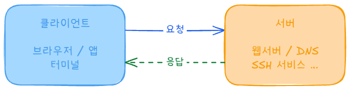

# 12. 🔁 10일차 복습 — 서버 안에서 일하기 · 서버란 무엇인가

> 10일차 인덱스: [10일차 · 서버 기초](README.md) · 이전: [9일차 복습](../day-09/lesson-9.md)
> 이 문서는 **그날 칠판에 그린 것만** 정리했다. 더 자세한 설명은 각 항목의 링크를 따라가면 된다.

---

## 🧠 30초 요약 — 칠판 순서 그대로
1. 파일을 **만들고 · 복사 · 이동 · 삭제** (`mkdir` `touch` `cp` `mv` `rm`)
2. **읽고**(`cat` `less` `head` `tail`) **고친다**(`nano`)
3. 출력을 **파일로 보내고**(`>` `>>`) **다음 명령에 넘긴다**(`|`)
4. 남의 것은 못 건드린다 → **`sudo`** 로 잠깐 관리자가 된다
5. 권한은 **`rwx` = 4·2·1** → `chmod`, 주인 바꾸기는 `chown`
6. 🤖 **AI 에게 물어본다. 단, 답은 내가 검증한다**
7. 서버 = **요청을 기다렸다가 응답하는 프로그램** (클라이언트 ↔ 서버)
8. 한 대에 서비스 여럿 → 관리 단위가 **데몬**(`sshd` `ftpd`)
9. 어느 서비스인지 구분 → **포트 번호**
10. 운반 방식은 **TCP**(3-way handshake, 튼튼) 또는 **UDP**(빠름)
11. **FTP 맛보기** — 윈도우 PC ↔ 리눅스 VM 파일 주고받기 ⭐

---

## 📋 치트시트 ① — 파일 다루기

| 명령 | 뜻 | 예시 |
|---|---|---|
| `mkdir` | 폴더 만들기 | `mkdir test` |
| `touch` | 빈 파일 만들기 | `touch memo.txt` |
| `cp` | 복사 | `cp memo.txt memo2.txt` |
| `mv` | 이동 · **이름 바꾸기** | `mv memo.txt /tmp/` |
| `rm` | 삭제 (**휴지통 없다**) | `rm memo.txt` |
| `nano` | 편집 | `nano memo.txt` → `Ctrl+O` 저장 · `Ctrl+X` 종료 |

**읽기 4형제**

| 명령 | 언제 쓰나 |
|---|---|
| `cat` | 짧은 파일 **통째로** |
| `less` | 긴 파일 **넘겨 가며** (`q` 로 나감) |
| `head` | **앞** 10줄 |
| `tail` | **뒤** 10줄 (로그 볼 때) |

→ 자세히: [1_파일시스템과_이동](lesson-1.md) · [2_파일다루기와_편집](lesson-2.md)

## 📋 치트시트 ② — 리다이렉션과 파이프 ⭐

| 기호 | 이름 | 뜻 |
|---|---|---|
| `>` | 리다이렉션(덮어쓰기) | 출력 결과를 **파일에 덮어쓴다** |
| `>>` | 리다이렉션(이어쓰기) | 출력 결과를 **파일 끝에 이어쓴다** |
| `\|` | 파이프 | **앞 명령의 결과**를 **뒷 명령의 입력**으로 |

```bash
ls -l > list.txt                # 결과를 파일로 (원래 내용은 날아간다!)
date >> list.txt                # 끝에 한 줄 덧붙이기
cat /etc/services | grep ftp    # 앞 결과에서 ftp 줄만
```

> 💡 **파이프 = 컨베이어 벨트.** 앞 기계가 뱉은 걸 뒷 기계가 받는다.
> 🔁 **회수**: 시스코의 `| include` 가 리눅스에서는 `| grep` 이다.

## 📋 치트시트 ③ — 권한

**`sudo`** = 일반 사용자가 **일시적으로** 관리자 권한으로 명령을 실행하게 해 주는 명령어.
(운영체제 설치할 때 만든 그 사용자가 `sudo` 를 쓸 수 있다.)

**권한 10글자 읽기**

```
-rw-r--r--
│└┬┘└┬┘└┬┘
│ │  │  └── 기타 사용자 (Others)
│ │  └───── 그룹 (Group)
│ └──────── 주인 (User)
└────────── 종류
```

| 첫 글자 | 종류 |
|---|---|
| `-` | 파일 |
| `d` | 디렉터리(폴더) |
| `l` | 링크 |

| 글자 | 뜻 | 숫자 |
|---|---|---|
| `r` | 읽기 | **4** |
| `w` | 쓰기(고치기) | **2** |
| `x` | 실행 | **1** |

**계산 연습** — "주인은 고칠 수 있고, 나머지는 읽기만" 인 `memo.txt`

```
주인: r + w = 4 + 2 = 6
그룹: r     = 4
기타: r     = 4
                    →  -rw-r--r--  →  chmod 644 memo.txt
```

| 명령 | 뜻 |
|---|---|
| `chmod` | **권한** 바꾸기 (`chmod 644 memo.txt`) |
| `chown` | **주인** 바꾸기 |
| `tree /` | 디렉터리 구조를 **트리**로 보기 (`sudo apt install -y tree`) |
| `-y` | "묻지 말고 yes" 옵션 |

→ 자세히: [3_사용자_권한_sudo](lesson-3.md)

## 🤖 AI 활용 — 물어보되, 검증한다 ⭐

**나쁜 질문 → 좋은 질문**

| ❌ | ✅ |
|---|---|
| "리눅스 파일 찾는 방법 알려줘" | "**Ubuntu 24.04** 를 쓰는데, **`/etc` 폴더 아래**에서 이름에 **`net`** 이 들어간 **파일만** 찾고 싶다. 방법을 알려줘" |

→ **환경 · 목적 · 제약**을 같이 준다.

**수업에서 본 AI 오답 사례** 🚨

> **Q.** Ubuntu 에서 `run.sh` 를 **주인만** 읽고 · 쓰고 · 실행하게 하려면?
> **A (AI).** `chmod 777 run.sh` 를 입력하세요. 7 은 읽기·쓰기·실행을 뜻합니다.
> 그리고 `sudo apt-get install chmod` 로 chmod 를 먼저 설치해야 할 수도 있습니다.

<details><summary>어디가 틀렸나 — 2군데</summary>

1. **`777` 은 주인·그룹·기타 모두에게 전부 허용**(`-rwxrwxrwx`) → 요구와 정반대.
   정답은 **`chmod 700 run.sh`** (주인 7 = 4+2+1, 나머지 0)
2. **`chmod` 는 설치하는 프로그램이 아니다.** 리눅스에 기본 내장되어 있다. AI 가 지어낸 말.

</details>

> 🛑 **AI 가 이걸 주면 3초 멈춘다**: `rm` · `sudo` · `chmod` · `chown` · `curl http://... | bash`
> 코덱스 · 클로드 코드 같은 도구는 **컴퓨터를 직접 제어**한다. 그래서 더 위험하다.

→ 자세히: [5_AI로_명령어_검증](lesson-5.md)

---

## 📖 클라이언트 ↔ 서버



- **서버 = 요청을 기다렸다가 응답하는 프로그램**
- "서버"라는 말은 두 가지를 가리킨다 → **서버 하드웨어**(물리 장비) / **서버 프로그램(서비스)**
- 물리 장비 1대 = 보통 **서버 기능 1개** → 그래서 **가상(논리적) 하드웨어**로 쪼개 쓴다

**데몬(daemon)** — 서비스를 **관리하는 단위**. 이름 끝에 `d` 가 붙는다.

| 서비스 | 데몬 |
|---|---|
| OpenSSH | `sshd` |
| FTP | `ftpd` (vsftpd) |
| nginx | `nginx` |
| DNS | `named` |

→ 자세히: [6_서버란_무엇인가](lesson-6.md)

## 📖 포트 번호 — IP 는 건물, 포트는 호실

자주 쓰는 서비스는 **포트 번호가 예약**되어 있다.

| 포트 | 서비스 | 포트 | 서비스 |
|---|---|---|---|
| **20 / 21** | FTP (데이터 / 제어) | **80** | HTTP |
| **22** | SSH · SCP | **443** | HTTPS |
| **23** | Telnet | **3306** | MySQL |
| **25 / 110 / 143** | 메일 | **3128** | Proxy |
| **53** | DNS | **2049** | NFS |
| **67 / 68** | DHCP | | |

→ 자세히: [8_포트번호와_소켓](lesson-8.md)

## 📖 TCP 와 UDP


| | TCP | UDP |
|---|---|---|
| 방식 | **연결형** (3-way handshake) | 비연결형 |
| 장점 | **연결 안정성이 매우 뛰어나다 · 데이터를 잃어버릴 일이 없다** | **속도가 매우 빠르다** |
| 쓰는 곳 | 웹 · 파일 전송 · 메일 · SSH | DNS · DHCP · 실시간 영상 |
| 비유 | 등기우편 | 전단지 |

> 💡 **UDP 인 것만 외우면 쉽다** — DNS 53 · DHCP 67/68 · SNMP 161/162 (+ TFTP 69 · NTP 123). 나머지는 대부분 TCP.

→ 자세히: [7_TCP와_UDP](lesson-7.md)

---

## 📁 FTP 맛보기 — 윈도우 PC ↔ 리눅스 VM 파일 주고받기 ⭐

### ① 왜 연결이 두 개인가

FTP 만 유별나게 **포트를 두 개** 쓴다.

| 포트 | 역할 | 언제 열리나 |
|---|---|---|
| **21** | **제어 연결** — 로그인 · 목록 요청 · 명령 | 접속하는 동안 **계속** 열려 있다 |
| **20** | **데이터 연결** — 실제 파일 내용 | 파일을 옮길 때만 **열었다 닫았다** |

> 💡 **주문서(21)와 배달 트럭(20)** 이 따로 있는 셈이다.
> 그래서 FTP 는 "접속은 됐는데 파일 목록이 안 나온다" 같은 **반쪽 고장**이 생긴다. → 아래 🔧 절

### ② 리눅스 쪽 — FTP 서버 올리기

9일차에 SSH 서버를 세울 때와 **완전히 같은 순서**다.

```bash
sudo apt install vsftpd              # ① 설치
sudo systemctl enable --now vsftpd   # ② 켜고 + 자동 시작
sudo systemctl status vsftpd         # ③ 확인
```

> 🔁 **SSH 때와 명령이 똑같다.** 이름만 `openssh-server` → `vsftpd` 로 바뀌었다.
> **"서버 종류는 달라도 세우는 순서는 같다"** — 12일차의 핵심 주제다.
> ⚠️ 설정 파일(`/etc/vsftpd.conf`)을 제대로 손보는 건 [12일차](../day-12/lesson-3.md). 오늘은 **맛보기**.

### ③ 윈도우 쪽 — 터미널에 내장된 `ftp`

윈도우에는 FTP 클라이언트가 **이미 들어 있다.** 따로 설치할 것 없다.

```
ftp 192.168.x.x
  사용자: student
  암호:   (입력해도 화면에 안 보인다 — 정상)

ftp> ls          ← 서버의 파일 목록
ftp> get 파일명   ← 서버 → 내 PC (내려받기)
ftp> put 파일명   ← 내 PC → 서버 (올리기)
ftp> bye         ← 종료
```

| 명령 | 뜻 |
|---|---|
| `ls` / `dir` | **서버** 쪽 목록 |
| `cd` | **서버** 쪽 폴더 이동 |
| `lcd` | **내 PC** 쪽 폴더 이동 (local cd) |
| `get` / `put` | 내려받기 / 올리기 |
| `binary` | **이진 모드** — 사진 · zip 을 받기 전에 꼭 |
| `bye` | 종료 |

> 🔒 **주의**: FTP 는 **아이디 · 비밀번호가 평문으로** 흘러간다. 실무에서는 **SFTP · SCP** 를 쓴다.
> 12일차에 `tcpdump` 로 **비밀번호가 그대로 보이는 장면**을 직접 볼 것이다.

### ④ SCP — SSH 로 파일 보내기 (22번)

```bash
scp 보낼파일 student@주소:/경로/     # 올리기
```

포트가 **22 하나뿐**이라 훨씬 간단하고, **암호화까지 된다.** → 12일차 본편

---

## 🔧 그날 안 됐던 것 — FileZilla 500 에러

수업 중 **FileZilla 로 접속을 시도했다가 `500` 으로 시작하는 에러**가 나서, 급하게 **윈도우 터미널의 `ftp`** 로 바꿔 실습했다.
이건 실패가 아니라 **좋은 교재**다. 외울 건 원인이 아니라 **로그를 읽는 습관**이다.

### 먼저 — 에러 번호 읽는 법

FTP 서버의 대답은 **세 자리 숫자**로 온다. 첫 자리만 봐도 절반은 안다.

| 앞자리 | 뜻 |
|---|---|
| `2xx` | 성공 (`230 Login successful`) |
| `3xx` | 더 필요함 (`331 Password required`) |
| `4xx` | **일시적** 실패 — 다시 하면 될 수도 있다 |
| **`5xx`** | **영구적** 실패 — **뭔가를 고쳐야** 한다 |

→ `500` 대가 떴다는 건 **"명령 자체를 서버가 거부했다"** 는 뜻이다.

### 원인 후보 2개

같은 서버에 **윈도우 `ftp` 는 됐는데 FileZilla 는 안 됐다.** 두 프로그램의 차이에 답이 있다.

| 후보 | 무슨 일인가 | 윈도우 `ftp` 는 왜 됐나 |
|---|---|---|
| **① 패시브 모드 데이터 연결이 안 열림** | FileZilla 는 **패시브(PASV)** 가 기본 → 서버가 **데이터용 포트를 새로 안내**하는데, **그 포트로 연결이 되지 않았다** (서버 설정 · 방화벽) | 윈도우 `ftp` 는 **액티브(PORT)** 가 기본 → **서버가 내 PC 쪽으로** 연결해 온다. **방향이 반대**라 이 문제를 비켜 간다 |
| **② 암호화(`AUTH TLS`) 거부** | FileZilla 는 접속하자마자 **"암호화 되나요?"** 부터 묻는다. 서버에 TLS 설정이 없으면 `500 AUTH not understood` | 윈도우 `ftp` 는 **애초에 묻지 않는다** |

> 💡 결국 **"FTP 는 연결이 두 개"** 라는 ①번 이야기로 돌아온다.
> 제어 연결(21)은 됐는데 **데이터 연결이 못 열린 것** — 그래서 접속은 된 것 같은데 목록이 안 나온다.

### 내가 직접 확인하는 법 ✅

FileZilla 는 **위쪽 로그 창에 서버와 주고받은 대화가 전부** 나온다. 추측하지 말고 읽으면 된다.

1. FileZilla 를 열고 접속을 다시 시도한다
2. **위쪽 로그 창**에서 `500` · `530` 으로 시작하는 줄을 찾는다
3. 그 줄 **바로 위**에 FileZilla 가 보낸 명령이 있다 → `AUTH TLS` 인가? `PASV` 인가?
   - `AUTH TLS` 직후에 `500` → **후보 ②**
   - `PASV` 직후에 멈추거나 `425` · 타임아웃 → **후보 ①**

> 🎓 **오늘의 진짜 교훈**: 에러 번호는 **고장이 아니라 메시지**다. 서버는 왜 거절했는지 이미 말해 주고 있다.
> 로그를 읽지 않고 검색부터 하면, **남의 문제의 답**을 내 문제에 붙이게 된다.

---

## 🔁 5분 재현 — 손으로 해보기

> ✋ **먼저 결과를 예측하고** 엔터를 친다. 예측과 다르면 그게 배우는 지점이다.

```bash
# 1. 접속
ssh student@192.168.x.x        # 주소는 VM 에서 ip a 로 확인

# 2. 연습장 만들고 들어가기
mkdir ~/review && cd ~/review

# 3. 리다이렉션 — > 와 >> 의 차이를 눈으로
ls -l > list.txt
cat list.txt
date >> list.txt        # 이어쓰기
date >  list.txt        # 덮어쓰기  ← 앞의 내용은?
cat list.txt

# 4. 파이프
cat /etc/services | grep -w ftp

# 5. 권한
touch memo.txt
ls -l memo.txt          # 지금 권한은?
chmod 644 memo.txt
ls -l memo.txt          # -rw-r--r-- 가 됐나?

# 6. 서버가 기다리고 있나
ss -tuln | grep -E ':22|:21'
```

**셀프 확인**: 3번에서 `>` 를 쓴 뒤 `list.txt` 안의 `ls -l` 결과가 **사라졌는가?** → 그게 덮어쓰기다.

---

## ❓ 셀프체크

**Q1.** ⭐ *(수업 중 칠판 문제)* 현재 위치가 `/var/log` 다. 다음 중 **결과가 다른 하나**는?
　A. `cd ~` 　B. `cd` 　C. `cd /home/student` 　D. `cd ..`

<details><summary>정답</summary>

**D. `cd ..`** — 한 단계 **위**(`/var`)로 간다.
A · B · C 는 모두 **내 홈 디렉터리(`/home/student`)** 로 간다. (`cd` 를 혼자 쓰면 홈으로, `~` 도 홈을 뜻한다.) → [1_파일시스템과_이동](lesson-1.md)

</details>

**Q2.** `ls -l > list.txt` 를 **두 번** 실행하면 `list.txt` 안에는 결과가 몇 개 들어 있나?

<details><summary>정답</summary>

**한 개.** `>` 는 **덮어쓰기**라서 앞의 내용이 날아간다. 두 개를 쌓으려면 두 번째를 **`>>`** 로.

</details>

**Q3.** `-rwxr-xr--` 를 숫자로 바꾸면?

<details><summary>정답</summary>

**754**. 주인 `rwx` = 4+2+1 = 7 · 그룹 `r-x` = 4+1 = 5 · 기타 `r--` = 4

</details>

**Q4.** `run.sh` 를 **주인만** 읽고 · 쓰고 · 실행하게 하려면?

<details><summary>정답</summary>

**`chmod 700 run.sh`**. `777` 은 **모두에게 전부** 허용이라 정반대다. (수업 중 AI 오답 사례)

</details>

**Q5.** 한 대의 서버에 SSH 도 있고 FTP 도 있다. 요청이 들어왔을 때 **어느 서비스로 갈지** 무엇으로 구분하나?

<details><summary>정답</summary>

**포트 번호.** IP 는 건물 주소, **포트는 호실 번호**다. SSH = 22, FTP = 21/20. → [8_포트번호와_소켓](lesson-8.md)

</details>

**Q6.** TCP 의 **3-way handshake** 3단계를 순서대로 말해보자.

<details><summary>정답</summary>

① 연결 요청(SYN) → ② 검증 응답(SYN+ACK) → ③ 확인(ACK). 그 다음에야 **실제 데이터**가 오간다.
이 과정 덕분에 **데이터를 잃어버릴 일이 없다.** → [7_TCP와_UDP](lesson-7.md)

</details>

**Q7.** DNS 는 TCP 인가 UDP 인가? 왜 그럴까?

<details><summary>정답</summary>

**UDP(53)**. 이름 하나 물어보는 아주 짧은 대화라서, 3-way handshake 하는 시간이 아깝다. **속도**가 우선.

</details>

**Q8.** FTP 는 왜 포트를 **두 개**(21, 20) 쓰나?

<details><summary>정답</summary>

**21 = 제어 연결**(로그인 · 명령 · 목록 요청, 접속 내내 유지), **20 = 데이터 연결**(실제 파일 내용, 옮길 때만 열렸다 닫힌다).
→ 그래서 "접속은 됐는데 목록이 안 나오는" 반쪽 고장이 생긴다.

</details>

**Q9.** FileZilla 로는 안 되는데 윈도우 `ftp` 로는 됐다. 가장 유력한 이유는?

<details><summary>정답</summary>

**패시브 / 액티브 모드 차이.** FileZilla 는 패시브가 기본이라 **서버가 안내한 데이터 포트로 내가** 붙어야 하는데 그 연결이 열리지 않았다. 윈도우 `ftp` 는 액티브라 **서버가 내 쪽으로** 연결해 온다 — 방향이 반대다.
(다른 후보: FileZilla 가 먼저 보내는 `AUTH TLS` 를 서버가 거부 → `500`)

</details>

**Q10.** AI 가 `curl http://... | bash` 를 알려줬다. 바로 실행해도 되나?

<details><summary>정답</summary>

**안 된다.** 인터넷에서 받은 것을 **내용을 보지 않고 곧바로 실행**하는 명령이다. `rm` · `sudo` · `chmod` · `chown` 과 함께 **3초 멈춤 목록**. → [5_AI로_명령어_검증](lesson-5.md)

</details>

---

## 🚩 자주 틀리는 것

| 실수 | 바로잡기 |
|---|---|
| `>` 로 파일을 **날린다** | `>` 는 덮어쓰기, 이어쓰기는 **`>>`**. 중요한 파일 이름을 쓸 땐 한 번 더 보기 |
| `rm` 하고 휴지통을 찾는다 | 리눅스 `rm` 에 **휴지통은 없다.** 파쇄기다 |
| `chmod 777` 로 해결한다 | "안 되니까 일단 777" 은 **보안 구멍**. 보통 **755 · 644** 면 충분하다 |
| 모든 명령에 `sudo` 를 붙인다 | `sudo` 는 **꼭 필요할 때만**. 남발하면 내 홈의 파일 주인이 root 로 바뀌어 더 꼬인다 |
| TCP/UDP 를 통째로 외우려 한다 | **UDP 인 것만** 외운다 (DNS · DHCP · SNMP · TFTP · NTP) |
| FTP 로 받은 사진 · zip 이 깨졌다 | 윈도우 `ftp` 는 기본이 **텍스트 모드**. 받기 전에 **`binary`** 를 먼저 |
| 비밀번호 칠 때 화면에 아무것도 안 나와 당황한다 | **정상이다.** 리눅스는 비밀번호를 보여 주지 않는다. 그냥 치고 엔터 |
| Tab 을 안 쓰고 전부 타이핑한다 | **Tab = 자동완성.** 오타의 90% 가 사라진다 |

---

## ⏭ 다음 시간

오늘 우리는 **포트를 열고 · 바깥에서 들어올 구멍을 뚫었다.**
그럼 **아무나 들어오면 어떡하지?** → **무선 공유기 · 방화벽 · ACL** → [11일차](../day-11/README.md)

> 📌 10일차 노트의 **[9_NAT와_포트포워딩](lesson-9.md) · [10_DNS와_DHCP_다시보기](lesson-10.md)** 는 시간 관계상 다루지 못했다.
> **11일차 공유기 실습 앞**에서 이어서 한다 — 미리 읽어 오면 좋다.

## 📝 강의 메모

- 📌 판서 원본: `Excalidraw/Drawing 2026-09-20 13.53.58.excalidraw.md`
- ⚠️ FileZilla `500` 원인은 **미확정**. 리허설에서 재현해 확정되면 🔧 절에 한 줄 추가할 것
- FTP 를 10일차에 맛보기로 이미 세웠다 → 12일차 3번의 "처음 세운다" 전제와 맞춰야 함 (별도 작업)
