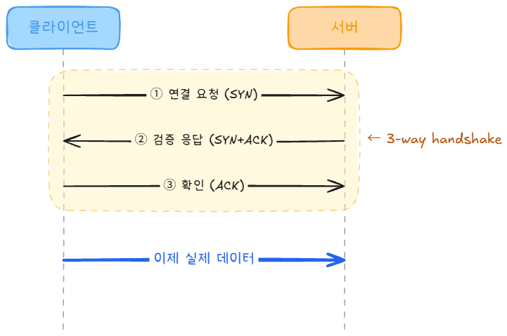

# 12. 10일차 복습 — 서버 안에서 일하기 · 서버란 무엇인가

> 10일차 인덱스: [10일차 · 서버 기초](README.md) · 이전: [9일차 복습](../day-09/lesson-9.md)
> 이 문서는 그날 칠판에 그린 것만 정리했다. 더 자세한 설명은 각 항목의 링크를 따라간다.

## 작업 식별

| 항목 | 내용 |
|---|---|
| Task ID | LEC-N2-10-012-REF |
| 유형 | REF (복습 정리표) |
| 목적 | 10일차 칠판 내용(명령, 권한, AI 검증, 서버, 포트, TCP/UDP, FTP 배경)을 표로 다시 찾는다 |
| 확인 상태 | 미검증 (원본 강의 노트를 AMM 형식으로 옮긴 것이며 VM에서 다시 확인하지 않았다) |
| 개정 | R1 (2026-11-18) |


NOTE: 원본은 복습 요약, FTP 실습, FileZilla 장애 분석, 5분 재현, 셀프체크를 한 페이지에 담고 있었다. 한 파일 한 유형 원칙에 따라 아래와 같이 나눴다. 이 페이지는 요약 표만 남겼다.


## 1. 이 복습의 분리 문서

| Task ID | 유형 | 문서 | 내용 |
|---|---|---|---|
| LEC-N2-10-025-MP | 절차 | [FTP 맛보기 실습](lesson-12-lab-ftp.md) | vsftpd 설치, Windows `ftp`로 파일 주고받기, SCP |
| LEC-N2-10-026-MP | 절차 | [5분 재현 실습](lesson-12-lab-review.md) | 리다이렉션, 파이프, 권한, 포트 확인을 손으로 재현 |
| LEC-N2-10-028-TS | 문제 해결 | [FileZilla 500 에러 분석](lesson-12-troubleshooting.md) | 수업 중 막힌 FileZilla 500 에러의 원인 후보와 확인법 |
| LEC-N2-10-029-INS | 점검 | [셀프체크 10문](lesson-12-selfcheck.md) | 10일차 내용을 10문항으로 점검 |

## 2. 30초 요약 — 칠판 순서 그대로

1. 파일을 만들고, 복사, 이동, 삭제한다(`mkdir`, `touch`, `cp`, `mv`, `rm`).
2. 읽고(`cat`, `less`, `head`, `tail`) 고친다(`nano`).
3. 출력을 파일로 보내고(`>`, `>>`) 다음 명령에 넘긴다(`|`).
4. 남의 것은 건드릴 수 없다. `sudo`로 잠깐 관리자가 된다.
5. 권한은 `rwx` = 4·2·1이다. 권한은 `chmod`, 주인은 `chown`으로 바꾼다.
6. AI에게 물어본다. 단, 답은 내가 검증한다.
7. 서버는 요청을 기다렸다가 응답하는 프로그램이다(클라이언트와 서버).
8. 한 대에 서비스가 여럿이면 관리 단위가 데몬이다(`sshd`, `ftpd`).
9. 어느 서비스인지는 포트 번호로 구분한다.
10. 운반 방식은 TCP(3-way handshake, 튼튼함) 또는 UDP(빠름)다.
11. FTP 맛보기: Windows PC와 리눅스 VM이 파일을 주고받는다.

## 3. 치트시트 ① — 파일 다루기

| 명령 | 뜻 | 예시 |
|---|---|---|
| `mkdir` | 폴더 만들기 | `mkdir test` |
| `touch` | 빈 파일 만들기 | `touch memo.txt` |
| `cp` | 복사 | `cp memo.txt memo2.txt` |
| `mv` | 이동 또는 이름 바꾸기 | `mv memo.txt /tmp/` |
| `rm` | 삭제(휴지통 없음) | `rm memo.txt` |
| `nano` | 편집 | `nano memo.txt` → `Ctrl+O` 저장, `Ctrl+X` 종료 |

읽기 4형제는 다음과 같다.

| 명령 | 언제 쓰나 |
|---|---|
| `cat` | 짧은 파일을 통째로 |
| `less` | 긴 파일을 넘겨 가며(`q`로 나간다) |
| `head` | 앞 10줄 |
| `tail` | 뒤 10줄(로그를 볼 때) |

→ 자세히: [1. 파일 시스템과 이동](lesson-1.md)(LEC-N2-10-001-DO), [2. 파일 다루기와 편집](lesson-2.md)(LEC-N2-10-002-DO)

## 4. 치트시트 ② — 리다이렉션과 파이프

| 기호 | 이름 | 뜻 |
|---|---|---|
| `>` | 리다이렉션(덮어쓰기) | 출력 결과를 파일에 덮어쓴다 |
| `>>` | 리다이렉션(이어쓰기) | 출력 결과를 파일 끝에 이어쓴다 |
| `\|` | 파이프 | 앞 명령의 결과를 뒷 명령의 입력으로 넘긴다 |

```bash
ls -l > list.txt                # 결과를 파일로 (원래 내용은 날아간다)
date >> list.txt                # 끝에 한 줄 덧붙이기
cat /etc/services | grep ftp    # 앞 결과에서 ftp 줄만
```


NOTE: 파이프는 컨베이어 벨트다. 앞 기계가 뱉은 것을 뒷 기계가 받는다. 회수: 시스코의 `| include`가 리눅스에서는 `| grep`이다.


## 5. 치트시트 ③ — 권한

`sudo`는 일반 사용자가 일시적으로 관리자 권한으로 명령을 실행하게 해 주는 명령이다. 운영체제 설치 때 만든 사용자가 `sudo`를 쓸 수 있다.

권한 10글자 읽기:

```
-rw-r--r--
│└┬┘└┬┘└┬┘
│ │  │  └── 기타 사용자 (Others)
│ │  └───── 그룹 (Group)
│ └──────── 주인 (User)
└────────── 종류
```

| 첫 글자 | 종류 |
|---|---|
| `-` | 파일 |
| `d` | 디렉터리(폴더) |
| `l` | 링크 |

| 글자 | 뜻 | 숫자 |
|---|---|---|
| `r` | 읽기 | 4 |
| `w` | 쓰기(고치기) | 2 |
| `x` | 실행 | 1 |

계산 연습: "주인은 고칠 수 있고, 나머지는 읽기만"인 `memo.txt`는 다음과 같다.

```
주인: r + w = 4 + 2 = 6
그룹: r     = 4
기타: r     = 4
                    →  -rw-r--r--  →  chmod 644 memo.txt
```

| 명령 | 뜻 |
|---|---|
| `chmod` | 권한 바꾸기(`chmod 644 memo.txt`) |
| `chown` | 주인 바꾸기 |
| `tree /` | 디렉터리 구조를 트리로 보기(`sudo apt install -y tree`) |
| `-y` | "묻지 말고 yes" 옵션 |

→ 자세히: [3. 사용자 · 권한 · sudo](lesson-3.md)(LEC-N2-10-003-DO)

## 6. AI 활용 — 물어보되, 검증한다

| 나쁜 질문 | 좋은 질문 |
|---|---|
| "리눅스 파일 찾는 방법 알려줘" | "Ubuntu 24.04를 쓰는데, `/etc` 폴더 아래에서 이름에 `net`이 들어간 파일만 찾고 싶다. 방법을 알려줘" |

환경, 목적, 제약을 같이 준다.

수업에서 본 AI 오답 사례는 다음과 같다.

> **Q.** Ubuntu에서 `run.sh`를 주인만 읽고, 쓰고, 실행하게 하려면?
> **A (AI).** `chmod 777 run.sh`를 입력하세요. 7은 읽기, 쓰기, 실행을 뜻합니다. 그리고 `sudo apt-get install chmod`로 chmod를 먼저 설치해야 할 수도 있습니다.


**어디가 틀렸나 — 2군데**

1. `777`은 주인, 그룹, 기타 모두에게 전부 허용(`-rwxrwxrwx`)한다. 요구와 정반대다. 정답은 `chmod 700 run.sh`(주인 7 = 4+2+1, 나머지 0)다.
2. `chmod`는 설치하는 프로그램이 아니다. 리눅스에 기본 내장되어 있다. AI가 지어낸 말이다.



WARNING: AI가 `rm`, `sudo`, `chmod`, `chown`, `curl http://... | bash`를 주면 3초 멈춘다. 코덱스, 클로드 코드 같은 도구는 컴퓨터를 직접 제어하므로 더 위험하다.


→ 자세히: [5. AI로 명령어 묻고 검증하기](lesson-5.md)(LEC-N2-10-005-DO)

## 7. 클라이언트와 서버


- 서버는 요청을 기다렸다가 응답하는 프로그램이다.
- "서버"라는 말은 두 가지를 가리킨다. 서버 하드웨어(물리 장비)와 서버 프로그램(서비스)이다.
- 물리 장비 1대는 보통 서버 기능 1개를 한다. 그래서 가상(논리적) 하드웨어로 쪼개 쓴다.

데몬(daemon)은 서비스를 관리하는 단위다. 이름 끝에 `d`가 붙는다.

| 서비스 | 데몬 |
|---|---|
| OpenSSH | `sshd` |
| FTP | `ftpd`(vsftpd) |
| nginx | `nginx` |
| DNS | `named` |

→ 자세히: [6. 서버란 무엇인가](lesson-6.md)(LEC-N2-10-006-DO)

## 8. 포트 번호 — IP는 건물, 포트는 호실

자주 쓰는 서비스는 포트 번호가 예약되어 있다.

| 포트 | 서비스 | 포트 | 서비스 |
|---|---|---|---|
| 20 / 21 | FTP(데이터 / 제어) | 80 | HTTP |
| 22 | SSH, SCP | 443 | HTTPS |
| 23 | Telnet | 3306 | MySQL |
| 25 / 110 / 143 | 메일 | 3128 | Proxy |
| 53 | DNS | 2049 | NFS |
| 67 / 68 | DHCP | | |

→ 자세히: [8. 포트 번호와 소켓](lesson-8.md)(LEC-N2-10-008-DO)

## 9. TCP와 UDP



| | TCP | UDP |
|---|---|---|
| 방식 | 연결형(3-way handshake) | 비연결형 |
| 장점 | 연결 안정성이 매우 뛰어나다. 데이터를 잃어버릴 일이 없다 | 속도가 매우 빠르다 |
| 쓰는 곳 | 웹, 파일 전송, 메일, SSH | DNS, DHCP, 실시간 영상 |
| 비유 | 등기우편 | 전단지 |


NOTE: UDP인 것만 외우면 쉽다. DNS 53, DHCP 67/68, SNMP 161/162(그리고 TFTP 69, NTP 123). 나머지는 대부분 TCP다.


→ 자세히: [7. TCP와 UDP](lesson-7.md)(LEC-N2-10-007-DO)

## 10. FTP — 왜 연결이 두 개인가

FTP만 유별나게 포트를 두 개 쓴다.

| 포트 | 역할 | 언제 열리나 |
|---|---|---|
| 21 | 제어 연결: 로그인, 목록 요청, 명령 | 접속하는 동안 계속 열려 있다 |
| 20 | 데이터 연결: 실제 파일 내용 | 파일을 옮길 때만 열었다 닫았다 한다 |


NOTE: 주문서(21)와 배달 트럭(20)이 따로 있는 셈이다. 그래서 FTP는 "접속은 됐는데 파일 목록이 안 나온다" 같은 반쪽 고장이 생긴다. → [LEC-N2-10-028-TS](lesson-12-troubleshooting.md)


Windows `ftp` 명령 요약은 다음과 같다. 실습은 [LEC-N2-10-025-MP](lesson-12-lab-ftp.md)에 있다.

| 명령 | 뜻 |
|---|---|
| `ls` / `dir` | 서버 쪽 목록 |
| `cd` | 서버 쪽 폴더 이동 |
| `lcd` | 내 PC 쪽 폴더 이동(local cd) |
| `get` / `put` | 내려받기 / 올리기 |
| `binary` | 이진 모드. 사진, zip을 받기 전에 필수 |
| `bye` | 종료 |

## 11. 자주 틀리는 것

| 실수 | 바로잡기 |
|---|---|
| `>`로 파일을 날린다 | `>`는 덮어쓰기, 이어쓰기는 `>>`. 중요한 파일 이름을 쓸 때는 한 번 더 본다 |
| `rm` 하고 휴지통을 찾는다 | 리눅스 `rm`에 휴지통은 없다. 파쇄기다 |
| `chmod 777`로 해결한다 | "안 되니까 일단 777"은 보안 구멍이다. 보통 755, 644면 충분하다 |
| 모든 명령에 `sudo`를 붙인다 | `sudo`는 꼭 필요할 때만 쓴다. 남발하면 내 홈의 파일 주인이 root로 바뀌어 더 꼬인다 |
| TCP/UDP를 통째로 외우려 한다 | UDP인 것만 외운다(DNS, DHCP, SNMP, TFTP, NTP) |
| FTP로 받은 사진, zip이 깨졌다 | Windows `ftp`는 기본이 텍스트 모드다. 받기 전에 `binary`를 먼저 입력한다 |
| 비밀번호 입력 시 화면에 아무것도 안 나와 당황한다 | 정상이다. 리눅스는 비밀번호를 보여 주지 않는다. 입력하고 Enter를 누른다 |
| Tab을 안 쓰고 전부 입력한다 | Tab은 자동완성이다. 오타의 90%가 사라진다 |

## 12. 다음 시간

오늘 우리는 포트를 열고, 바깥에서 들어올 구멍을 뚫는 방법을 배웠다. 그러면 아무나 들어오면 어떻게 하는가? 무선 공유기, 방화벽, ACL을 다룬다. → [11일차](../day-11/README.md)


NOTE: 10일차 노트의 [9. NAT와 포트포워딩](lesson-9.md), [10. DNS와 DHCP 다시 보기](lesson-10.md)는 시간 관계상 다루지 못했다. 11일차 공유기 실습 앞에서 이어서 한다. 미리 읽어 오면 좋다.


## 진행 메모

- 판서 원본: `Excalidraw/Drawing 2026-09-20 13.53.58.excalidraw.md`
- FileZilla `500` 원인은 미확정이다. 리허설에서 재현해 확정되면 TS 문서에 한 줄 추가한다.
- FTP를 10일차에 맛보기로 이미 세웠다. 12일차 3번의 "처음 세운다" 전제와 맞춰야 한다(별도 작업).
