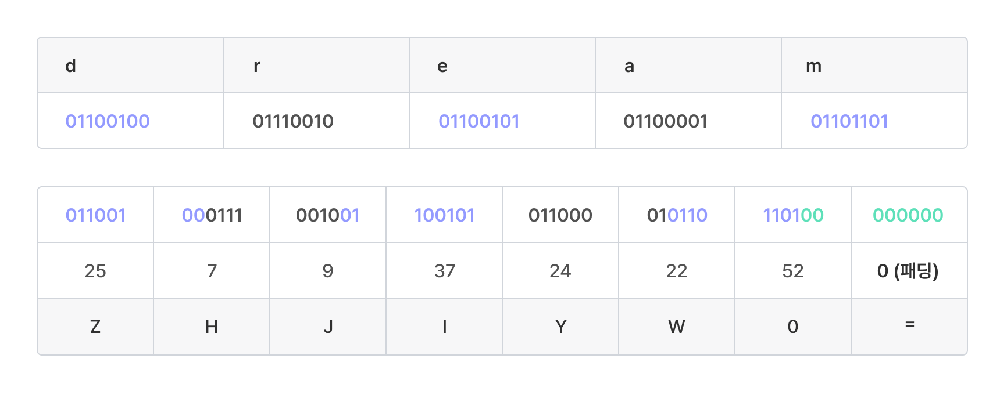

# Base64 인코딩 (Base64)

## 작업 식별

| 항목 | 내용 |
|---|---|
| Task ID | PRG-ENC-004-DO |
| 유형 | D&O (개념) |
| 목적 | Base64의 문자 집합, 변환 순서, 패딩의 이유를 설명한다 |
| 확인 상태 | 미검증 (예시 `dream` → `ZHJlYW0=`는 이 문서 작성 시 계산으로 일치함을 확인했다) |
| 개정 | R1 (2026-11-18) |

## 1. 목적

Base64는 이진 데이터를 ASCII 문자로 구성된 텍스트로 바꾸는 인코딩이다. 이진 데이터를 그대로 넣을 수 없고 텍스트만 허용되는 환경에서 쓴다. 예를 들어 이미지를 HTML 파일에 넣을 때 Base64로 인코딩해 넣는다.

## 2. 구성 요소

| 항목 | 내용 |
|---|---|
| 사용 문자 | 64개: 알파벳 대문자 26 + 소문자 26 + 숫자 10 + `+` + `/` |
| 패딩 문자 | `=` |
| 변환 비율 | 입력 3바이트(24비트) → 출력 4문자. 크기가 약 4/3배(약 33%) 커진다 |

문자 목록(인덱스 0~63 순서):

```
ABCDEFGHIJKLMNOPQRSTUVWXYZabcdefghijklmnopqrstuvwxyz0123456789+/
```


CAUTION: Base64는 암호화가 아니다. 누구나 디코딩할 수 있다. [인코딩과 디코딩 (PRG-ENC-001-DO)](encoding_decoding.md)를 참조한다.


## 3. 동작 원리



### 원본 비트 묶음화

원본 이진 데이터를 비트열로 표현하고 6비트씩 끊는다.\
비트 수가 6의 배수가 아니면 뒤에 0을 추가해 6의 배수로 만든다.



### 인덱스 변환 및 문자 치환

각 6비트 묶음을 0~63의 수로 바꾸고, [Base64 테이블](https://www.garykessler.net/library/base64.html)에서 해당 문자로 치환한다.



### 패딩 추가

문자 수가 4의 배수가 되도록 뒤에 `=`를 붙인다. 이를 패딩(padding)이라고 한다. 마지막 묶음의 입력이 1바이트면 `==`, 2바이트면 `=`이 붙는다.



<details>

<summary>패딩이 필요한 이유</summary>

`ZA` 두 글자를 디코딩하면 `011001 000000` 12비트가 된다. 앞에서 8비트씩 끊으면 문자 `d`(`01100100`) 뒤에 `0000` 4비트가 남는다. 이 4비트가 추가 데이터인지 채움 비트인지 디코더가 알 수 없다. 패딩 문자로 입력의 끝 길이를 명확히 한다(`ZA==`).

</details>

### 3.1 예시

문자열 `dream`(5바이트)의 인코딩 결과는 `ZHJlYW0=`이다. 5바이트를 3바이트+2바이트로 나누므로 마지막에 `=` 1개가 붙는다.



## 4. 참조

* [Base64 테이블 (Gary Kessler)](https://www.garykessler.net/library/base64.html)
* [CyberChef](https://tools.dreamhack.games/cyberchef)

## 내 말로 채우기


AI 없이 답을 적는다. 다 쓰면 체크하고, 이 안내는 지워도 된다.


- [ ] Base64가 필요한 상황을 내 말로 한 가지 설명해 본다.
- [ ] 패딩 `=`이 없으면 어떤 문제가 생기는가?
