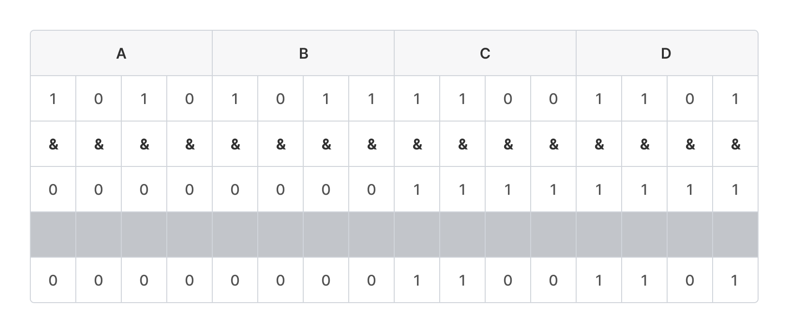

# 비트 연산 및 시프트 (Bit Ops)

## 작업 식별

| 항목 | 내용 |
|---|---|
| Task ID | PRG-NUM-006-DO |
| 유형 | D&O (개념) + 예제 |
| 목적 | 논리 연산자, 비트 연산자, 시프트 연산자의 차이와 마스킹·플래그 활용을 설명한다 |
| 확인 상태 | 미검증 (원본과 일반 지식을 정리한 것이며 코드를 실행하지 않았다) |
| 개정 | R1 (2026-11-18) |


NOTE: 이전 정정(논리 OR은 `||`, 비트 OR은 `|`, 산술 시프트는 음수에서 음의 무한대 방향 내림, `>>>`는 Java/JS 연산자)을 유지했다. 이번에 추가·정정한 곳: 표 안에 섞여 있던 설명 행을 표 밖으로 분리, 깨진 이미지 3개 삭제, `>>>` 예제를 C의 부호 없는 `>>`로 대체, "시프트가 곱셈보다 빠르다"를 정정, 정의되지 않은 시프트·연산자 우선순위 주의, Unity 플래그 예제 추가. `>>>`는 C# 11에도 있다.


## 1. 목적

비트 연산은 피연산자를 2진수로 보고 비트 단위로 계산한다. 비트 단위로 논리 연산을 하거나 비트를 정해진 칸만큼 옮기는 시프트(shift)를 한다. 플래그 묶음, 마스킹, 해시, 암호 알고리즘에 쓰인다.

## 2. 구성 요소

### 2.1 논리 연산자 (참/거짓 값에 적용)

| 연산자 | 설명 |
|---|---|
| `x \|\| y` | 둘 중 하나라도 참이면 참이다(논리 OR). x가 참이면 y를 평가하지 않는다 |
| `x && y` | 둘 다 참이면 참이다(논리 AND). x가 거짓이면 y를 평가하지 않는다 |
| `!x` | 참이면 거짓, 거짓이면 참이다(논리 NOT) |

### 2.2 비트 연산자 (각 비트에 적용)

| 연산자 | 설명 |
|---|---|
| `x \| y` | 두 비트 중 하나라도 1이면 1이다(비트 OR) |
| `x & y` | 두 비트 모두 1이면 1이다(비트 AND) |
| `x ^ y` | 두 비트가 다르면 1, 같으면 0이다(XOR) |
| `~x` | 모든 비트를 반전한다(비트 NOT) |

### 2.3 시프트 연산자

| 연산자 | 이름 | 빈 칸 채움 | 결과 |
|---|---|---|---|
| `x << n` | 왼쪽 시프트 | 오른쪽 빈 칸을 0으로 | x × 2^n (오버플로가 없을 때) |
| `x >> n` | 산술 시프트(부호 있는 정수) | 왼쪽 빈 칸을 MSB(부호 비트)와 같은 값으로 | x / 2^n, 음수는 0이 아니라 음의 무한대 방향으로 내림. 예: -1 >> 1 = -1 |
| `x >> n` | 논리 시프트(부호 없는 정수) | 왼쪽 빈 칸을 0으로 | 부호 없는 값을 2^n으로 나눈 몫 |
| `x >>> n` | 논리 시프트 연산자 | 왼쪽 빈 칸을 0으로 | Java, JavaScript, C#(11 이상)의 연산자. C·C++에는 없다 |

C·C++에서 부호 있는 음수의 `>>`가 산술인지 논리인지는 구현 정의(C++20부터는 산술로 정해졌다)이지만 주요 컴파일러는 산술 시프트로 동작한다.

## 3. 동작 원리

### 3.1 AND 마스킹

특정 위치의 비트만 남기거나 지우는 연산을 비트 마스킹(bit masking)이라 한다. AND는 두 비트가 모두 1일 때 1이므로, 남기려는 자리를 1로 한 마스크와 AND하면 그 자리의 값만 남는다.

예: 2바이트 데이터 `0xABCD`에서 하위 8비트만 남기려면 `0xABCD & 0x00FF`를 계산한다. 결과는 `0xCD`다.



16진수 F(1111)와 AND하면 그 4비트가 유지되고, 0(0000)과 AND하면 그 4비트가 0이 된다.

### 3.2 AND와 시프트로 특정 바이트 추출

32비트 데이터 `0x12345678`(`0001 0010 0011 0100 0101 0110 0111 1000`)에서 일부를 꺼내는 예다.

| 목적 | 식 | 결과 |
|---|---|---|
| 하위 1바이트 | `0x12345678 & 0x000000FF` | `0x00000078` |
| 상위 1바이트 | `(0x12345678 >> 24) & 0xFF` | `0x00000012` |
| 상위에서 두 번째 바이트 | `(0x12345678 >> 16) & 0xFF` | `0x00000034` |
| 하위 1바이트의 상위 4비트 | `(0x12345678 >> 4) & 0x0F` | `0x00000007` |

상위 1바이트는 Java·JavaScript의 `0x12345678 >>> 24`로도 얻는다. 위 값은 양수이므로 `>>`와 `>>>`의 결과가 같다. 음수에서는 `>>`가 부호 비트를 채우기 때문에 `& 0xFF`가 필요하다.

### 3.3 XOR의 성질

| 성질 | 식 | 쓰임 |
|---|---|---|
| 같은 값과 XOR하면 0 | `x ^ x == 0` | 두 값의 같음 비교(`(a ^ b) == 0`) |
| 두 번 XOR하면 원래 값 | `(x ^ y) ^ y == x` | 키 y로 하는 단순 암호화·복호화(XOR 암호) |
| 0과 XOR하면 그대로 | `x ^ 0 == x` | 비트 토글(`x ^ mask`) |


CAUTION: 반복 키 XOR은 암호로서 안전하지 않다. 암호 알고리즘의 구성 요소로만 쓰인다.


### 3.4 시프트와 곱셈·나눗셈

`x << n`은 x × 2^n, 양의 정수의 `x >> n`은 x / 2^n(몫)과 같다. 다만 "시프트가 곱셈보다 빠르다"는 말은 오늘날의 컴파일러에서는 대부분 성립하지 않는다. 컴파일러가 2의 거듭제곱 곱셈·나눗셈을 알아서 시프트로 최적화하므로, 의도가 곱셈이면 `*`로 쓰는 편이 읽기 쉽다. 시프트는 비트 위치를 다룰 때 쓴다.

## 4. 예제 코드

원본에는 코드가 없었다. 아래는 C#(Unity) 플래그·레이어 마스크 예(미검증)다.

```csharp
// 레이어 8, 9를 켠 마스크 만들기
int mask = (1 << 8) | (1 << 9);

// 레이어 layer가 마스크에 포함되어 있는지 확인
int layer = 8;
bool has = (mask & (1 << layer)) != 0;

// 레이어 9 끄기
mask &= ~(1 << 9);

// 레이어 8 토글
mask ^= (1 << 8);
```

### 4.1 코드 설명

| 줄 | 설명 |
|---|---|
| `(1 << 8) \| (1 << 9)` | 8번, 9번 비트만 1인 값을 만든다 |
| `mask & (1 << layer)` | layer번 비트만 남긴다. 0이 아니면 켜져 있다 |
| `mask &= ~(1 << 9)` | 9번 비트만 0인 값과 AND해 그 비트만 끈다 |
| `mask ^= (1 << 8)` | 8번 비트를 뒤집는다 |

## 5. 한계·주의

* **우선순위**: `==`, `!=`는 `&`, `^`, `\|`보다 먼저 계산된다. `mask & 1 == 0`은 `mask & (1 == 0)`으로 읽힌다. `(mask & 1) == 0`처럼 괄호를 친다.
* **시프트 폭**: C·C++에서 시프트 횟수가 음수이거나 자료형의 비트 수 이상이면 정의되지 않은 동작(UB)이다. 32비트 `int`에서 `1 << 32`가 그렇다. C#은 횟수를 비트 수로 나눈 나머지로 마스킹한다.
* **부호 있는 왼쪽 시프트**: C·C++에서 음수나 결과가 표현 범위를 넘는 부호 있는 값의 왼쪽 시프트는 위험하다(C++20 이전 UB). 비트 조작은 부호 없는 자료형으로 한다.
* **`~`의 승격**: 작은 정수형(`char`, `short`)은 연산 전에 `int`로 승격되어 `~` 결과의 상위 비트가 1로 채워질 수 있다.

## 6. 약어·용어

| 용어 | 뜻 |
|---|---|
| 마스크(mask) | 남기거나 지울 비트 위치를 표시한 값 |
| 시프트(shift) | 비트를 좌우로 옮기는 연산 |
| XOR | 배타적 논리합 |

## 내 말로 채우기


AI 없이 답을 적는다. 다 쓰면 체크하고, 이 안내는 지워도 된다.


- [ ] `||`와 `|`를 바꿔 쓰면 어떤 차이가 생기는지 단락 평가를 들어 적어 본다.
- [ ] `-8 >> 1`의 결과와 이유를 산술 시프트 규칙으로 적어 본다.
- [ ] 플래그 여러 개를 정수 하나에 담는 방식의 장점을 내 경험으로 적어 본다.
