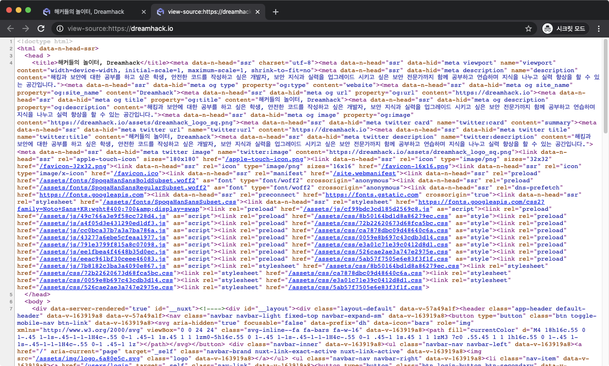

# 브라우저 개발자 도구 개요

## 작업 식별

| 항목 | 내용 |
|---|---|
| Task ID | PRG-BRW-002-DO |
| 유형 | D&O (개념, 패널 구성은 표) |
| 목적 | 브라우저 개발자 도구의 용도와 패널 구성, 페이지 소스 보기를 설명한다 |
| 확인 상태 | 미검증 (원본과 크롬 계열 일반 지식을 정리했다. 화면 배치는 브라우저 버전마다 다르다) |
| 개정 | R1 (2026-11-18) |

## 1. 목적

웹 개발은 코드를 자주 고치고 렌더링 결과를 자주 확인해야 한다. 브라우저는 이 불편을 줄이려고 개발자 도구(DevTools)를 내장한다. 개발자 도구로 다음을 할 수 있다.

- HTML과 CSS를 브라우저에서 수정하고 결과를 바로 확인한다.
- JavaScript 디버거를 쓴다.
- 서버와 오가는 HTTP 패킷을 자세히 본다. 프로토콜에서 생긴 문제를 찾기 쉽다.

웹 서비스를 진단하는 도구이므로 웹 취약점을 노리는 공격자에게도 유용하다.

## 2. 구성 요소

### 2.1 열기

| 환경 | 단축키 |
|---|---|
| Windows/Linux | F12 또는 Ctrl + Shift + I |
| macOS | Cmd(⌘) + Opt(⌥) + I |

### 2.2 패널 구성

원본은 화면의 색(빨강, 주황, 노랑, 녹색)으로 영역을 안내했다. 아래 표는 그 내용을 텍스트로 바꾼 것이다.


NOTE: 색 표시는 원본 이미지를 참조한다. 영역 이름과 배치는 브라우저와 버전마다 달라 현재 화면과 다를 수 있다.


| 영역 | 역할 | 관련 문서 |
|---|---|---|
| 요소 선택·장치 전환 버튼(원본의 빨간색) | 요소 검사(Inspect)와 디바이스 툴바(Device Toolbar)를 켠다 | [PRG-BRW-003-MP](inspect.md), [PRG-BRW-006-MP](devicetoolbar.md) |
| 기능 선택 탭(원본의 주황색) | 사용할 패널을 고른다. 아래 표 참조 | |
| 오류·경고 표시(원본의 노란색) | 현재 페이지에서 발생한 오류와 경고 메시지 수를 보여준다 | |
| 설정(원본의 녹색) | 개발자 도구 설정을 연다 | |

### 2.3 기능 탭

| 탭 | 용도 | 관련 문서 |
|---|---|---|
| Elements | 페이지를 구성하는 HTML을 검사한다 | [PRG-BRW-004-MP](elements.md) |
| Console | JavaScript를 실행하고 결과를 확인한다 | |
| Sources | HTML, CSS, JS 등 리소스를 확인하고 디버깅한다 | [PRG-BRW-007-MP](webdevelopertools.md) |
| Network | 서버와 오가는 데이터를 확인한다. 캐시 비활성화(Disable cache) 옵션이 있다. 개발자 도구가 열려 있는 동안에만 적용된다 | |
| Performance, Memory | 성능과 메모리 사용을 측정한다 | |
| Application | 쿠키, 로컬 스토리지(Local Storage), 세션 스토리지(Session Storage) 등 웹 애플리케이션 데이터를 확인한다 | [PRG-BRW-005-MP](devtools_applicationtab.md) |
| Security | 페이지의 보안(인증서 등) 정보를 확인한다 | |
| Lighthouse | 성능, 접근성 등을 점검한다 | |

## 3. 동작 원리: 페이지 소스 보기

**페이지 소스 보기**는 서버가 보낸 HTML 소스를 새 탭에 보여준다. 개발자 도구의 Elements 탭은 JavaScript가 바꾼 뒤의 현재 DOM을 보여주므로 두 결과가 다를 수 있다.

| 환경 | 단축키 |
|---|---|
| Windows/Linux | Ctrl + U |
| macOS | Cmd(⌘) + Opt(⌥) + U |

## 4. 약어·용어

| 용어 | 뜻 |
|---|---|
| DevTools | 브라우저에 내장된 웹 개발자 도구 |
| DOM | HTML 문서를 트리로 나타낸 객체 모델 |
| Local Storage, Session Storage | 브라우저에 키-값으로 저장하는 공간. Session Storage는 탭을 닫으면 지워진다 |

## 참조

| 문서 | 제목 |
|---|---|
| [PRG-BRW-001-DO](webbrowser.md) | 웹 브라우저 동작 원리 |
| [PRG-BRW-008-DO](incognito.md) | 시크릿 모드 |

## 내 말로 채우기


AI 없이 답을 적는다. 다 쓰면 체크하고, 이 안내는 지워도 된다.


- [ ] 페이지 소스 보기와 Elements 탭이 보여주는 HTML이 다를 수 있는 이유를 적어 보자.
- [ ] 개발자 도구로 직접 문제를 찾았던 경험을 적어 보자.
