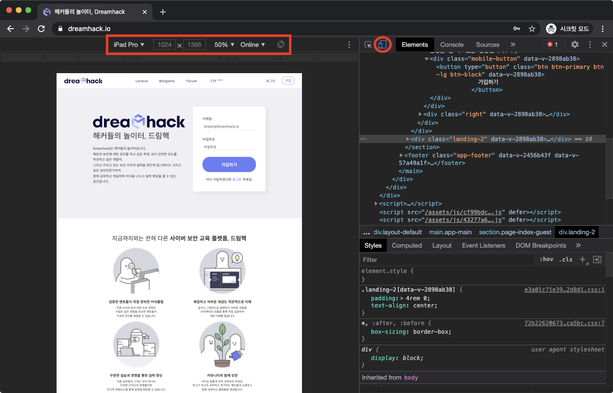

# 디바이스 툴바 반응형 테스트

## 작업 식별

| 항목 | 내용 |
|---|---|
| Task ID | PRG-BRW-006-MP |
| 목적 | 디바이스 툴바(Device Toolbar)로 화면 크기와 User-Agent를 바꿔 웹 페이지의 반응형 동작을 점검한다 |
| 적용 대상 | 크롬 계열 브라우저의 개발자 도구 (버전별 UI 차이 있음) |
| 소요 시간 | 약 3분 |
| 확인 상태 | 미검증 (원본 설명을 절차로 정리한 것이며 실행해 확인하지 않았다) |
| 개정 | R1 (2026-11-18) |


NOTE: 버튼 위치와 이름은 브라우저와 버전마다 달라 현재 화면과 다를 수 있다. 원본 이미지를 참조한다.


## 1. 참조

| 참조 문서 | Task ID | 제목 |
|---|---|---|
| [browserdevtools.md](browserdevtools.md) | PRG-BRW-002-DO | 브라우저 개발자 도구 개요 |

## 2. 필요 장비와 자재

| 번호 | 이름 | 사양 | 비고 |
|---|---|---|---|
| 1 | 웹 브라우저 | 개발자 도구 내장 | |

## 3. 안전 사항


NOTE: 디바이스 툴바는 화면 크기와 User-Agent를 흉내 낼 뿐이다. 실제 기기의 성능과 렌더링 차이는 재현하지 않으므로 중요한 점검은 실기기에서도 한다.


## 4. 준비

| 번호 | 항목 | 확인 방법 |
|---|---|---|
| 1 | 점검할 페이지를 연다 | 페이지가 표시된다 |
| 2 | 개발자 도구를 연다: F12 | 패널이 나타난다 |

## 5. 절차

데스크톱, 태블릿, 스마트폰 등 접속 장치가 다양하고 화면 비율도 제각각이므로, 개발자는 서비스가 여러 장치에서 잘 동작하는지 점검해야 한다.

### A. 장치 모드 켜기

1. (5-A-01) 개발자 도구의 디바이스 툴바 버튼(스마트폰과 태블릿 모양 아이콘)을 누른다. 단축키는 Ctrl + Shift + M(macOS: Cmd + Shift + M)이다. → 결과: 페이지 위에 장치 선택과 화면 크기 입력 막대가 나타난다.

### B. 화면 크기와 User-Agent 바꾸기

1. (5-B-01) 장치 목록에서 장치를 고르거나 가로·세로 크기(px)를 직접 입력한다. → 결과: 페이지가 그 화면 크기로 다시 그려진다.
2. (5-B-02) 필요하면 User-Agent 유형(모바일, 데스크톱 등)을 바꾼다. → 결과: 서버로 가는 요청의 `User-Agent` 헤더가 바뀐다.
3. (5-B-03) 페이지를 새로 고쳐 레이아웃을 확인한다. → 결과: 화면 크기에 맞춘 레이아웃이 표시된다.

## 6. 기능 확인

| 번호 | 확인 동작 | 기대 결과 | 합격 기준 |
|---|---|---|---|
| 1 | 가로 크기를 360px로 입력한다 | 모바일 레이아웃으로 바뀐다 | 내용이 가로로 잘리지 않는다 |

## 7. 복구

1. (7-01) 디바이스 툴바 버튼을 다시 눌러 끈다. → 결과: 페이지가 원래 창 크기로 표시된다.

## 8. 개정 이력

| 개정 | 날짜 | 변경 내용 |
|---|---|---|
| R1 | 2026-11-18 | AMM 형식으로 재작성. 단축키, 단계 분해, 복구는 원본에 없던 보충 |
