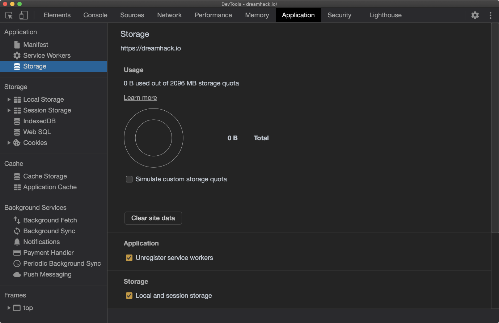
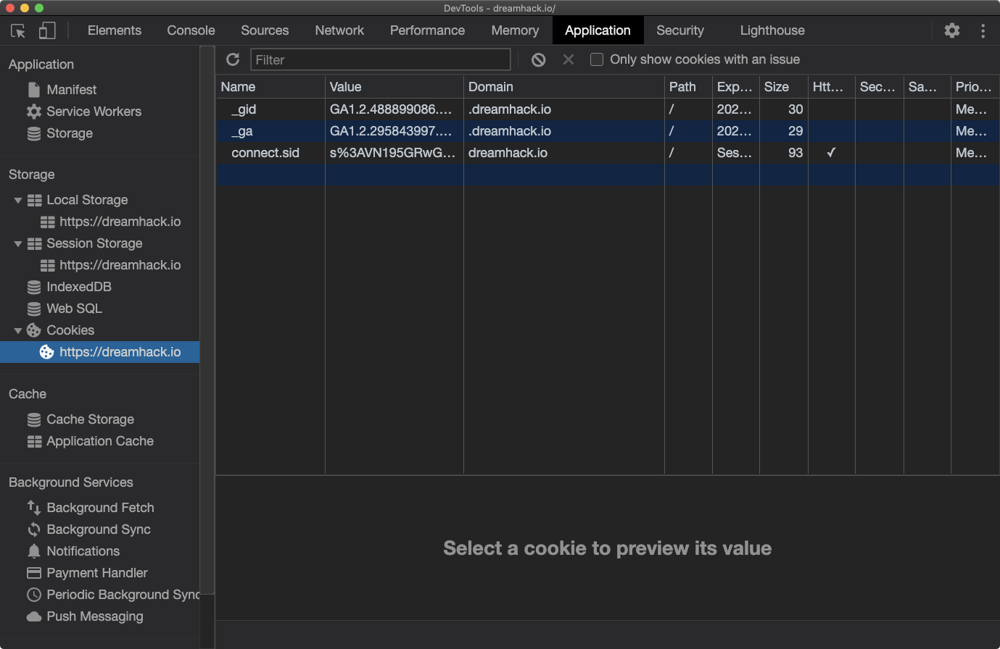

# 개발자 도구 Application 탭

## 작업 식별

| 항목 | 내용 |
|---|---|
| Task ID | PRG-BRW-005-MP |
| 목적 | Application 탭에서 브라우저에 저장된 쿠키를 조회하고 수정한다 |
| 적용 대상 | 크롬 계열 브라우저의 개발자 도구 (버전별 UI 차이 있음) |
| 소요 시간 | 약 3분 |
| 확인 상태 | 미검증 (원본 절차를 정리한 것이며 실행해 확인하지 않았다) |
| 개정 | R1 (2026-11-18) |


NOTE: 탭 이름과 배치는 브라우저와 버전마다 달라 현재 화면과 다를 수 있다. 파이어폭스는 이 탭을 Storage라고 부른다.


## 1. 참조

| 참조 문서 | Task ID | 제목 |
|---|---|---|
| [browserdevtools.md](browserdevtools.md) | PRG-BRW-002-DO | 브라우저 개발자 도구 개요 |
| [cookie.md](../http-and-urls/cookie.md) | | HTTP 쿠키 및 속성 |

## 2. 필요 장비와 자재

| 번호 | 이름 | 사양 | 비고 |
|---|---|---|---|
| 1 | 웹 브라우저 | 개발자 도구 내장 | |

## 3. 안전 사항


CAUTION: 쿠키 값을 바꾸면 로그인 세션이 끊기거나 사이트가 오작동할 수 있다. 서비스 점검 목적으로 본인 계정과 허가된 환경에서만 수정한다.


## 4. 준비

| 번호 | 항목 | 확인 방법 |
|---|---|---|
| 1 | 대상 페이지를 연다 | 페이지가 표시된다 |
| 2 | 개발자 도구를 연다: F12 | 패널이 나타난다 |

## 5. 절차

### A. 리소스 조회

1. (5-A-01) `Application` 탭을 선택한다. 탭이 보이지 않으면 `>>` 메뉴에서 찾는다. → 결과: 왼쪽에 저장소 목록이 표시된다.
2. (5-A-02) 조회할 항목을 선택한다. 쿠키, 캐시, 이미지, 폰트, 스타일시트 등이 있다. → 결과: 오른쪽에 해당 항목의 내용이 표시된다.

### B. 쿠키 조회와 수정

1. (5-B-01) 왼쪽에서 `Storage > Cookies`를 펼치고 현재 사이트 주소를 선택한다. → 결과: 쿠키 목록이 표로 표시된다.
2. (5-B-02) 이름, 값, 도메인, 경로, 만료일을 확인한다. → 결과: 각 쿠키의 속성이 열로 보인다.
3. (5-B-03) 수정할 쿠키의 `Value` 칸을 더블 클릭한다. → 결과: 칸이 편집 상태가 된다.
4. (5-B-04) 새 값을 입력하고 Enter를 누른다. → 결과: 목록에 새 값이 표시되고, 이후 요청에 새 값이 쓰인다.


NOTE: 쿠키 목록에는 `HttpOnly`, `Secure`, `SameSite` 열도 있다. 의미는 [HTTP 쿠키 및 속성](../http-and-urls/cookie.md)을 본다. `HttpOnly` 쿠키는 JavaScript에서 읽을 수 없지만 개발자 도구에서는 보인다.


### C. 로컬 스토리지와 세션 스토리지 조회

1. (5-C-01) 왼쪽에서 `Storage > Local Storage` 또는 `Session Storage`를 펼치고 사이트 주소를 선택한다. → 결과: 키-값 목록이 표시된다. 세션 스토리지는 탭을 닫으면 지워진다.

## 6. 기능 확인

| 번호 | 확인 동작 | 기대 결과 | 합격 기준 |
|---|---|---|---|
| 1 | 쿠키 값을 수정한 뒤 페이지를 새로 고친다 | 수정한 값이 유지된다 | 목록의 `Value`가 수정한 값이다 |

## 7. 복구

1. (7-01) 수정한 쿠키를 선택하고 원래 값을 다시 입력한다. 원래 값을 모르면 쿠키 행을 선택한 뒤 Delete 키로 삭제한다. → 결과: 목록에서 값이 복원되거나 행이 사라진다. 서버가 쿠키를 다시 발급하는지는 사이트마다 다르다.

## 8. 개정 이력

| 개정 | 날짜 | 변경 내용 |
|---|---|---|
| R1 | 2026-11-18 | AMM 형식으로 재작성. 스토리지 조회(구역 C), 쿠키 속성 NOTE, 복구 절은 원본에 없던 보충 |
