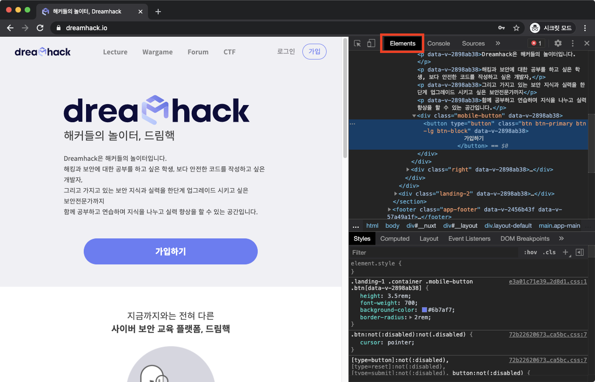
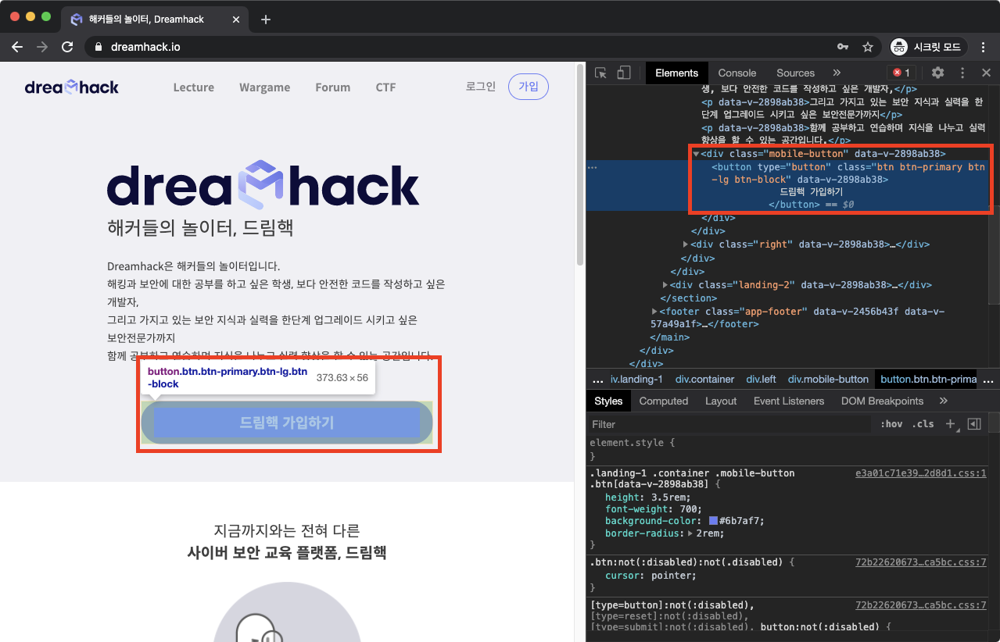

# 개발자 도구 Elements 탭

## 작업 식별

| 항목 | 내용 |
|---|---|
| Task ID | PRG-BRW-004-MP |
| 목적 | Elements 탭에서 현재 페이지의 HTML을 읽고 수정한다 |
| 적용 대상 | 크롬 계열 브라우저의 개발자 도구 (버전별 UI 차이 있음) |
| 소요 시간 | 약 3분 |
| 확인 상태 | 미검증 (원본 절차를 정리한 것이며 실행해 확인하지 않았다) |
| 개정 | R1 (2026-11-18) |


NOTE: 메뉴와 단축키는 브라우저와 버전마다 달라 현재 화면과 다를 수 있다.


## 1. 참조

| 참조 문서 | Task ID | 제목 |
|---|---|---|
| [inspect.md](inspect.md) | PRG-BRW-003-MP | 요소 검사 도구 |
| [browserdevtools.md](browserdevtools.md) | PRG-BRW-002-DO | 브라우저 개발자 도구 개요 |

## 2. 필요 장비와 자재

| 번호 | 이름 | 사양 | 비고 |
|---|---|---|---|
| 1 | 웹 브라우저 | 개발자 도구 내장 | |

## 3. 안전 사항


NOTE: Elements 탭의 수정은 브라우저 메모리의 현재 화면에만 적용된다. 서버의 원본과 저장된 파일은 바뀌지 않으며, 페이지를 새로 고치면 수정이 사라진다.


## 4. 준비

| 번호 | 항목 | 확인 방법 |
|---|---|---|
| 1 | 대상 페이지를 연다 | 페이지가 표시된다 |
| 2 | 개발자 도구를 연다: F12 | 패널이 나타난다 |

## 5. 절차

### A. HTML 읽기

1. (5-A-01) `Elements` 탭을 선택한다. → 결과: 현재 페이지를 구성하는 HTML 코드가 트리로 표시된다.

### B. HTML 수정

1. (5-B-01) 수정할 코드를 선택한다. 요소 검사([PRG-BRW-003-MP](inspect.md))를 쓰면 빨리 고를 수 있다. → 결과: 해당 줄이 선택 상태가 된다.
2. (5-B-02) F2를 누르거나 더블 클릭한다. → 결과: 해당 줄이 편집 상태가 된다.
3. (5-B-03) 내용을 고친다.
4. (5-B-04) 다른 곳을 클릭해 편집을 끝낸다. → 결과: 화면에 변경이 즉시 반영된다.

## 6. 기능 확인

| 번호 | 확인 동작 | 기대 결과 | 합격 기준 |
|---|---|---|---|
| 1 | 텍스트 요소의 내용을 바꾼다 | 화면의 글자가 바뀐다 | 수정한 문구가 화면에 보인다 |

## 7. 복구

1. (7-01) 페이지를 새로 고친다: F5. → 결과: 수정 내용이 사라지고 서버의 원본 HTML이 다시 표시된다.

## 8. 개정 이력

| 개정 | 날짜 | 변경 내용 |
|---|---|---|
| R1 | 2026-11-18 | AMM 형식으로 재작성. 수정 범위(메모리만)와 복구 단계는 원본에 없던 보충 |
