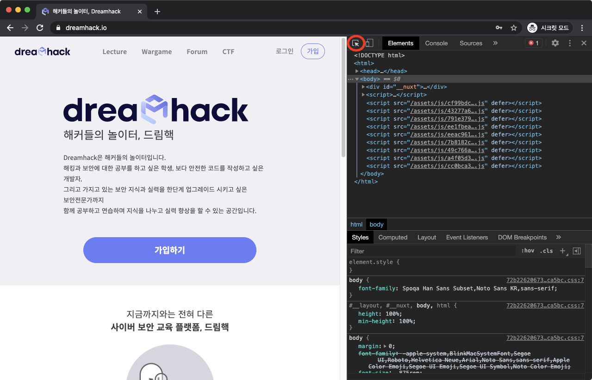
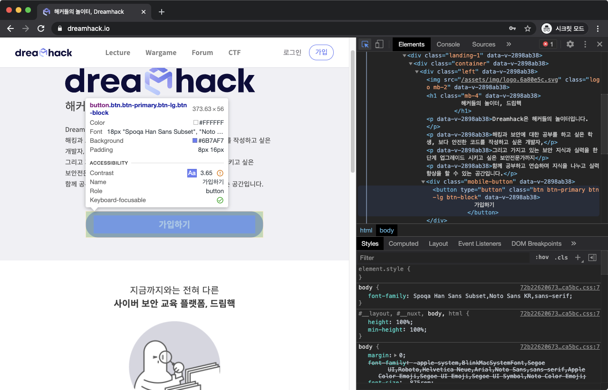

# 요소 검사 도구 (Inspect)

## 작업 식별

| 항목 | 내용 |
|---|---|
| Task ID | PRG-BRW-003-MP |
| 목적 | 요소 검사로 화면의 요소 정보를 보고 관련 HTML 코드를 찾는다 |
| 적용 대상 | 크롬 계열 브라우저의 개발자 도구 (버전별 UI 차이 있음) |
| 소요 시간 | 약 2분 |
| 확인 상태 | 미검증 (원본 절차를 정리한 것이며 실행해 확인하지 않았다) |
| 개정 | R1 (2026-11-18) |


NOTE: 버튼 모양과 위치는 브라우저와 버전마다 달라 현재 화면과 다를 수 있다.


## 1. 참조

| 참조 문서 | Task ID | 제목 |
|---|---|---|
| [browserdevtools.md](browserdevtools.md) | PRG-BRW-002-DO | 브라우저 개발자 도구 개요 |
| [elements.md](elements.md) | PRG-BRW-004-MP | 개발자 도구 Elements 탭 |

## 2. 필요 장비와 자재

| 번호 | 이름 | 사양 | 비고 |
|---|---|---|---|
| 1 | 웹 브라우저 | 개발자 도구 내장 | 크롬, 엣지 등 |
| 2 | 검사할 웹 페이지 | | |

## 3. 안전 사항


NOTE: 이 작업은 화면을 읽기만 한다. 페이지 내용을 바꾸지 않는다.


## 4. 준비

| 번호 | 항목 | 확인 방법 |
|---|---|---|
| 1 | 검사할 페이지를 연다 | 페이지가 화면에 표시된다 |
| 2 | 개발자 도구를 연다: F12 또는 Ctrl + Shift + I (macOS: Cmd + Opt + I) | 개발자 도구 패널이 나타난다 |

## 5. 절차

### A. 요소 검사

1. (5-A-01) 개발자 도구 왼쪽 위의 요소 검사 버튼(화살표 모양 아이콘)을 누른다. → 결과: 버튼이 활성 상태로 바뀐다.
2. (5-A-02) 웹 페이지에서 원하는 요소 위에 마우스를 올린다. → 결과: 요소의 정보가 말풍선으로 출력된다.

3. (5-A-03) 요소를 클릭한다. → 결과: Elements 탭에서 그 요소의 HTML 코드가 하이라이팅된다.

## 6. 기능 확인

| 번호 | 확인 동작 | 기대 결과 | 합격 기준 |
|---|---|---|---|
| 1 | 선택한 요소의 HTML을 확인한다 | Elements 탭에 해당 태그가 선택돼 있다 | 하이라이팅된 코드가 화면에서 클릭한 요소와 일치한다 |

## 7. 복구

1. (7-01) 요소 검사 버튼을 다시 눌러 끈다. → 결과: 버튼이 비활성 상태로 돌아간다.
2. (7-02) 개발자 도구를 닫는다: F12. → 결과: 패널이 사라진다.

## 8. 개정 이력

| 개정 | 날짜 | 변경 내용 |
|---|---|---|
| R1 | 2026-11-18 | AMM 형식으로 재작성 |
