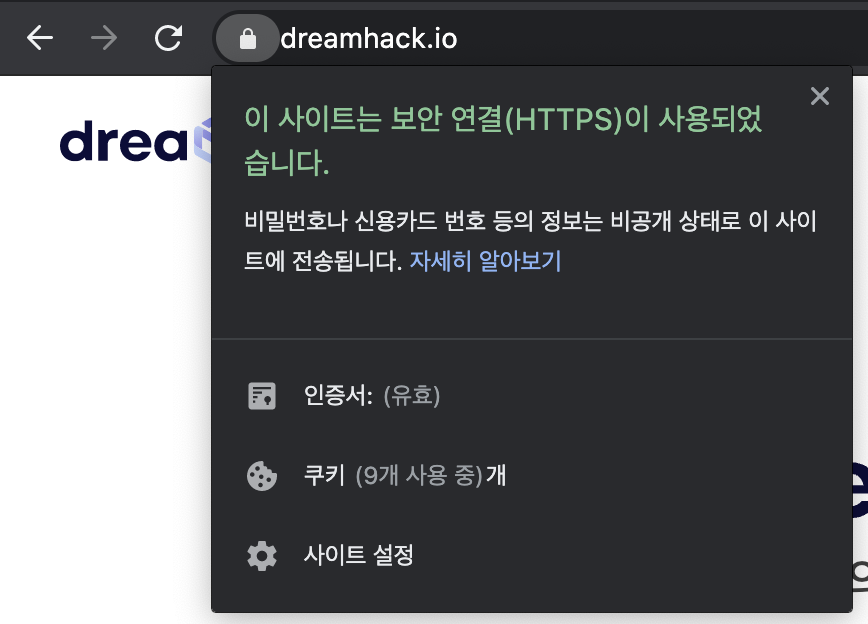
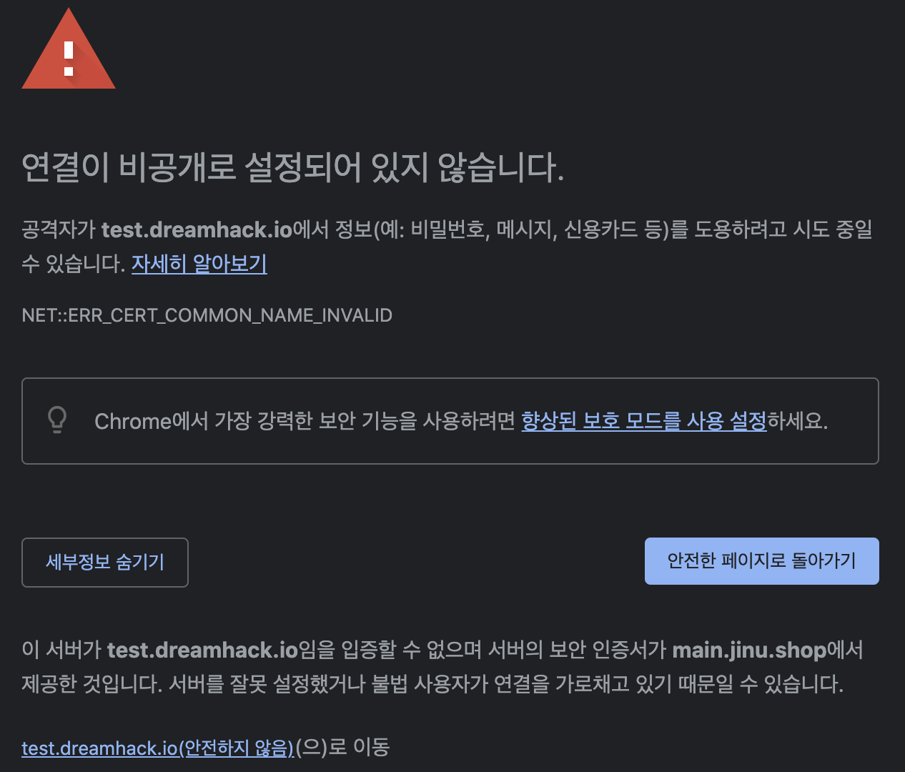

# 웹 브라우저 동작 원리 (Browser)

## 작업 식별

| 항목 | 내용 |
|---|---|
| Task ID | PRG-BRW-001-DO |
| 유형 | D&O (개념) |
| 목적 | 주소창에 주소를 입력했을 때 브라우저가 하는 일을 순서대로 설명한다 |
| 확인 상태 | 미검증 (원본과 일반 웹 지식을 정리했다) |
| 개정 | R1 (2026-11-18) |

## 1. 목적

웹은 인터넷이라는 글로벌 네트워크 위에서 정해진 프로토콜로 통신한다. 이용자가 프로토콜 규칙을 몰라도 웹을 쓸 수 있게 하는 프로그램이 웹 브라우저다. 이 문서는 이용자가 주소창에 `dreamhack.io`를 입력했을 때 일어나는 기본 동작을 설명한다.

## 2. 구성 요소

| 단계 | 하는 일 | 관련 기술 |
|---|---|---|
| 1. 주소 해석 | 주소창에 입력된 문자열을 분석한다 | [URL](../http-and-urls/url.md) |
| 2. 도메인 탐색 | 도메인 이름에 해당하는 IP 주소를 찾는다 | DNS, [도메인 이름](../../../../Network/protocols/domain_name.md) |
| 3. 요청 전송 | HTTP로 서버에 요청을 보낸다 | HTTP |
| 4. 응답 수신 | 서버의 HTTP 응답을 받는다 | HTTP |
| 5. 리소스 다운로드와 렌더링 | HTML, CSS, JavaScript를 받아 화면으로 그린다 | [웹 렌더링 엔진 원리](../../../../Security/notes/web_rendering.md) |

## 3. 동작 원리

1. 이용자가 주소창에 `dreamhack.io`를 입력한다.
2. 브라우저가 입력값을 URL로 분석한다.
3. 브라우저가 DNS로 도메인에 해당하는 주소를 찾는다.
4. 브라우저가 그 주소의 서버에 HTTP 요청을 보낸다.
5. 서버가 HTTP 응답을 돌려준다.
6. 브라우저가 응답에 포함된 리소스(HTML, CSS, JavaScript)를 내려받아 렌더링한다.

### 3.1 인증서 표시

HTTPS 사이트에서 브라우저는 서버의 인증서를 검사해 주소창 근처에 결과를 표시한다. 인증서가 유효하지 않으면 경고를 보여준다.


NOTE: 아래 이미지는 안전한 인증서와 안전하지 않은 인증서가 주소창에 어떻게 표시되는지 보여주는 원본 이미지다. 표시 방식은 브라우저와 버전마다 달라 현재 화면과 다를 수 있다.


| 안전한 인증서 | 안전하지 않은 인증서 |
|---|---|
|  |  |

## 4. 약어·용어

| 용어 | 뜻 |
|---|---|
| URL | Uniform Resource Locator. 리소스의 위치를 나타내는 주소 |
| DNS | Domain Name System. 도메인 이름을 IP 주소로 바꾸는 체계 |
| HTTP | HyperText Transfer Protocol. 웹 요청과 응답의 규칙 |
| 렌더링 | HTML, CSS, JavaScript를 해석해 화면에 그리는 일 |

## 참조

| 문서 | 제목 |
|---|---|
| [PRG-BRW-002-DO](browserdevtools.md) | 브라우저 개발자 도구 개요 |

## 내 말로 채우기


AI 없이 답을 적는다. 다 쓰면 체크하고, 이 안내는 지워도 된다.


- [ ] 주소를 입력한 뒤 화면이 나오기까지 브라우저가 거치는 다섯 단계를 내 말로 설명해 보자.
- [ ] 인증서 경고가 떴던 경험이 있다면, 그때 어떻게 판단했는지 적어 보자.
