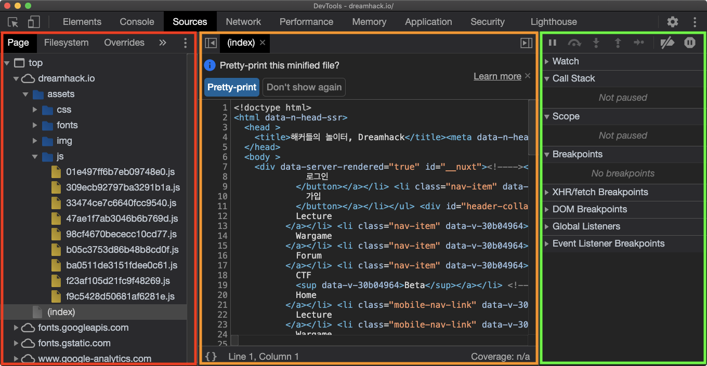

# 개발자 도구 디버깅 (DevTools)

## 작업 식별

| 항목 | 내용 |
|---|---|
| Task ID | PRG-BRW-007-MP |
| 목적 | Sources 탭에서 JavaScript에 브레이크포인트를 걸고 변수를 확인하며 디버깅한다 |
| 적용 대상 | 크롬 계열 브라우저의 개발자 도구 (버전별 UI 차이 있음) |
| 소요 시간 | 약 10분 |
| 확인 상태 | 미검증 (원본 절차를 정리한 것이며 실행해 확인하지 않았다) |
| 개정 | R1 (2026-11-18) |


NOTE: 패널 이름과 배치는 브라우저와 버전마다 달라 현재 화면과 다를 수 있다. 원본은 화면의 색(빨강, 주황, 녹색)으로 영역을 안내했으며, 이 문서는 텍스트 표로 바꿨다. 색 표시는 원본 이미지를 참조한다.


## 1. 참조

| 참조 문서 | Task ID | 제목 |
|---|---|---|
| [browserdevtools.md](browserdevtools.md) | PRG-BRW-002-DO | 브라우저 개발자 도구 개요 |

웹 개발자 도구(Web Developer Tools, DevTools)는 브라우저에 내장된 도구로, 웹 페이지의 구조, 스타일, 동작을 분석하고 디버깅하는 데 쓴다. HTML·CSS 편집, JavaScript 디버깅, 네트워크 활동 감시가 주요 기능이다. 구글 크롬, 모질라 파이어폭스, 마이크로소프트 엣지가 각자 개발자 도구를 제공한다.

## 2. 필요 장비와 자재

| 번호 | 이름 | 사양 | 비고 |
|---|---|---|---|
| 1 | 웹 브라우저 | 개발자 도구 내장 | |
| 2 | 실습 페이지 | 입력한 `name`, `num`에 따라 실행 흐름이 바뀐다 | [실습 페이지 열기](https://dreamhack-lecture.s3.ap-northeast-2.amazonaws.com/uploads/web-devtools/debug.html) |

### 2.1 Sources 탭 구성

| 영역(원본 색) | 역할 |
|---|---|
| 파일 트리(빨간색) | 현재 페이지의 리소스 파일 트리와 파일 시스템 |
| 소스 보기(주황색) | 선택한 리소스의 상세 내용 |
| 디버깅 정보(녹색) | 아래 표 참조 |

| 디버깅 패널 | 역할 |
|---|---|
| Watch | 입력한 JavaScript 식의 값이 코드 실행 중 어떻게 바뀌는지 보여준다 |
| Call Stack | 함수 호출 순서를 스택으로 보여준다. `A → B → C` 순으로 호출돼 `C`를 실행 중이면 맨 위가 `C`, 맨 아래가 `A`다 |
| Scope | 정의된 모든 변수의 값을 보여준다 |
| Breakpoints | 설정한 브레이크포인트를 나열하고 각각 켜거나 끈다 |

## 3. 안전 사항


NOTE: 변수 값을 바꿔도 현재 실행 중인 페이지의 메모리에만 적용된다. 페이지를 새로 고치면 원래대로 돌아간다.


## 4. 준비

| 번호 | 항목 | 확인 방법 |
|---|---|---|
| 1 | 실습 페이지를 연다 | 입력 양식이 표시된다 |
| 2 | 개발자 도구를 열고 `Sources` 탭을 선택한다: F12 | 파일 트리가 표시된다 |

## 5. 절차

### A. 브레이크포인트 설정과 실행 중단

1. (5-A-01) 파일 트리에서 디버깅할 파일을 선택한다. → 결과: 소스 코드가 표시된다.
2. (5-A-02) 멈추고 싶은 줄의 줄 번호를 클릭한다. → 결과: 그 줄에 브레이크포인트 표시가 생기고 Breakpoints 목록에 추가된다.
3. (5-A-03) 페이지 양식에 임의의 `name`과 `num`을 입력하고 실행한다. → 결과: 브레이크포인트에서 실행이 멈춘다.

### B. 변수 확인과 변경

1. (5-B-01) Scope 패널을 연다. → 결과: 현재 할당된 변수와 값이 보인다.
2. (5-B-02) 변경할 변수의 값을 더블 클릭하고 새 값을 입력한 뒤 Enter를 누른다. → 결과: 변수 값이 바뀐다.
3. (5-B-03) 실행 재개 버튼을 누른다(F8). → 결과: 바뀐 값으로 실행이 이어진다.

## 6. 기능 확인

| 번호 | 확인 동작 | 기대 결과 | 합격 기준 |
|---|---|---|---|
| 1 | 5-A-03 이후 Scope를 본다 | 입력한 값이 변수에 들어 있다 | `name`, `num` 관련 변수에 입력값이 보인다 |
| 2 | 5-B-02에서 값을 바꾸고 재개한다 | 실행 흐름이 바뀐 값에 따라 달라진다 | 화면 결과가 입력값이 아닌 변경값을 따른다 |

## 7. 복구

1. (7-01) 브레이크포인트 줄 번호를 다시 클릭하거나 Breakpoints 목록에서 체크를 해제한다. → 결과: 브레이크포인트가 사라지거나 꺼진다.
2. (7-02) 페이지를 새로 고친다. → 결과: 변경한 변수 값이 초기화된다.

## 8. 개정 이력

| 개정 | 날짜 | 변경 내용 |
|---|---|---|
| R1 | 2026-11-18 | AMM 형식으로 재작성. 패널 색 안내를 표로 변환, 변경 값 확인 기준과 복구는 원본에 없던 보충 |
