# 데브옵스 환경 구성도 (DevOps)

## 작업 식별

| 항목 | 내용 |
|---|---|
| Task ID | PRJ-DSO-004-REF |
| 유형 | REF (구성도) |
| 목적 | 팀 협업 환경과 빌드 자동화 환경의 구성을 한 장의 그림으로 확인한다 |
| 확인 상태 | 미검증 (원본 SVG 이미지의 글자를 읽고 정리했다) |
| 개정 | R1 (2026-11-18) |

<figure><figcaption>데브옵스 환경 구성도</figcaption></figure>

## 구성 요소

| 구성 요소 | 구성도의 표기 | 역할 | 관련 문서 |
|---|---|---|---|
| SVN | SVN (협업환경 구축) | 팀원이 소스를 공유하는 저장소 | [SVN 설치 가이드 (SVN)](svnsetupguide.md) |
| GitAction | GitAction (빌드 자동화) | 저장소 변경 시 빌드를 자동으로 실행하는 GitHub Actions | 원본에 없음, 확인 필요 |
| 개발 환경 세팅 과정 | 개발환경 세팅 과정 | 구성도에 외부 영상 링크가 하나 붙어 있다 | 원본에 없음, 확인 필요 |


NOTE: 구성도 이미지에는 구성 요소 이름만 있고 연결 관계(어느 저장소가 어느 빌드를 일으키는지)를 설명하는 글이 없다. 연결 관계는 원본에 없어 적지 않는다. 확인 필요.

